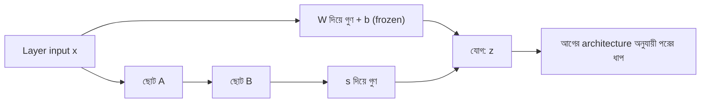

# Lecture 03 — LoRA-র Forward Pass: একই input, দুই পথ

> আগে যা জানা থাকলে ভালো: [forward pass](../module-09-model-architecture/lecture-06-forward-pass.md), [activation](../module-09-model-architecture/lecture-04-activation.md) আর [fine-tuning-এর মানচিত্র](lecture-02-finetuning-methods-map.md)। এই lecture শেষে পারবে: একটা layer-এ LoRA যোগ হলে output কীভাবে বের হয় তা হাতে হিসাব করতে, আর বলতে activation কোথায় বসে। ([Map-এ অবস্থান](../01-learning-map.md): PEFT → LoRA → output-এর হিসাব। এখানে loss বা update নেই।)

## সমস্যাটা কী?

একটা layer-এর weight matrix W-তে লাখ লাখ সংখ্যা থাকতে পারে। নতুন কাজের জন্য সেগুলো সব বদলাতে গেলে memory ও সময় বেশি লাগে। **LoRA** (Low-Rank Adaptation) অন্য পথ নেয়: W যেমন আছে তেমনই থাকবে। তার পাশে ছোট একটা অতিরিক্ত পথ জুড়ে দেওয়া হবে, যা শুধু একটা "সংশোধন" হিসাব করবে। শেখার কাজ হবে শুধু ওই ছোট পথের সংখ্যাগুলো নিয়ে।

## ধারণাটা সহজ ভাষায়

একটা layer-এর input `x` হলো কয়েকটা সংখ্যার vector। আগের হিসাব ছিল `z = Wx + b`, যেখানে `b` bias। LoRA যোগ হলে একই `x` দুই পথে যায়:

- **মূল পথ:** `Wx + b`, W frozen।
- **LoRA পথ:** প্রথমে ছোট matrix **A** দিয়ে `x` থেকে কম সংখ্যক মান বানানো (`Ax`), তারপর ছোট matrix **B** দিয়ে আবার layer-এর output-এর সমান সংখ্যক মান বানানো (`B(Ax)`)। শেষে একটা গুণক **s** দিয়ে গুণ।

দুই পথের ফল যোগ হয়:

**`z = Wx + b + s × B(Ax)`**

A আর B-তে শেখার মতো সংখ্যা থাকে, W-এ নয়। A কেন "ছোট" আর B-র আকার কেমন, তা [Lecture 04](lecture-04-lora-matrix-pairs-and-effective-weights.md)-এ। গুণক `s`-এর মান ঠিক হয় কীভাবে, তা [Lecture 07](lecture-07-lora-rank-alpha-init-dropout.md)-এ। এখন `s = 1` ধরো।

সাবধান: Module 09-এ weights লেখা হয়েছিল "input × unit" table-এ। এখানে W লেখা হচ্ছে প্রতি row এক unit ধরে (`Wx`)। সংখ্যা একই, শুধু table উল্টো করে সাজানো।



## ছোট একটা উদাহরণ

Module 09-এর hidden layer: দুই unit, `W = [[1, 1], [−1, 1]]`, bias 0। Input `x = [2, 1]`। LoRA-র জন্য শেখানো ধরে নেওয়া A আর B (শেখানোর জন্য বানানো সংখ্যা, কোনো আসল model-এর নয়): `A = [[1, 0]]`, `B = [[0], [1]]`, `s = 1`।

```text
মূল পথ:   Wx = [1×2 + 1×1, −1×2 + 1×1] = [3, −1]
LoRA পথ:  Ax = 1×2 + 0×1 = 2
          B(Ax) = [0×2, 1×2] = [0, 2]
যোগ:      z = [3, −1] + [0, 2] = [3, 1]
```

এবার hidden layer-এর ReLU:

```text
LoRA ছাড়া:  ReLU([3, −1]) = [3, 0]
LoRA সহ:    ReLU([3, 1])  = [3, 1]
```

W আর ReLU একই, তবু layer-এর output বদলে গেল। দ্বিতীয় unit আগে `0` দিত, এখন `1` দিচ্ছে। পরের layer এখন `[3, 1]` পাবে। কোড:

```python
def matvec(M, v):
    return [sum(m * x for m, x in zip(row, v)) for row in M]

def relu(v):
    return [max(0, a) for a in v]

W = [[1, 1], [-1, 1]]     # মূল weights (frozen); প্রতি row এক unit
A = [[1, 0]]              # ছোট matrix A: 2টা সংখ্যাকে 1টায় আনে
B = [[0], [1]]            # ছোট matrix B: 1টা সংখ্যা থেকে 2টা বানায়
s = 1                     # LoRA-র অংশ কত গুণ ধরা হবে
x = [2, 1]

base = matvec(W, x)                              # Wx (bias 0)
small = matvec(A, x)                             # Ax
extra = [s * v for v in matvec(B, small)]        # s * B(Ax)
z = [p + q for p, q in zip(base, extra)]

print("Wx       =", base)
print("Ax       =", small)
print("s*B(Ax)  =", extra)
print("z        =", z)
print("ReLU, LoRA ছাড়া:", relu(base))
print("ReLU, LoRA সহ  :", relu(z))
# output:
# Wx       = [3, -1]
# Ax       = [2]
# s*B(Ax)  = [0, 2]
# z        = [3, 1]
# ReLU, LoRA ছাড়া: [3, 0]
# ReLU, LoRA সহ  : [3, 1]
```

## Activation কোথায় বসে

LoRA নিজের A আর B-র মাঝখানে নতুন কোনো activation বসায় না। মূল layer-এ আগে যদি `ReLU(Wx + b)` থাকত, এখন হয় `ReLU(Wx + b + s×B(Ax))`। অর্থাৎ দুই পথ যোগ হওয়ার **পরে** আগের সেই ReLU-ই কাজ করে। ReLU-র নিয়ম একই থাকে; বদলায় তার input।

সাবধান: এই "dense layer + ReLU" ছকটা শেখার সুবিধার জন্য। বাস্তব Transformer-এর প্রতিটা linear হিসাবের পরে activation থাকে না। LoRA মূল architecture-এর ক্রম যেমন আছে তেমনই রাখে।

## বাইরে থেকে কী বদলায়, ভেতরে কী

LoRA input-এর format বদলায় না: OCR-এ ছবি আর নির্দেশ আগের মতোই model-এ ঢোকে। বদলায় ভেতরের কিছু layer-এর output, তাই পরের হিসাব আর শেষের score-ও বদলাতে পারে। Base আর LoRA আলাদা দুটো উত্তর বানিয়ে শেষে জোড়া লাগায় না; সংখ্যার হিসাবের ভেতরেই দুটো যোগ হয়ে যায়। Score বদলালেও প্রতিটা input-এর শেষ text বদলাবেই, এমন নয়।

Training-এ A আর B শেখানো হয়, W frozen। Inference-এ W আর A/B দুটোই হিসাবে লাগে, কিন্তু কিছু update হয় না। দুই পথ একটা matrix-এ জুড়ে একপথ বানানো যায়: [Lecture 09](lecture-09-merge-save-load.md)।

## মনে রাখার সারকথা

- LoRA-তে একই input মূল পথ (`Wx + b`) আর ছোট LoRA পথ (`s×B(Ax)`) দিয়ে যায়, আর ফল যোগ হয়।
- শেখার মতো সংখ্যা A ও B-তে; W frozen থাকে, কিন্তু হিসাবে অংশ নেয়।
- Activation থাকে দুই পথ যোগ হওয়ার পরে, আগের architecture-এর জায়গাতেই।

## নিজে করো

১. একই `W`, `A`, `B`, `s = 1` নিয়ে `x = [3, 2]`-এ `z` কত? LoRA সহ ও ছাড়া ReLU-র পরে কত?
২. যদি `B = [[0], [0]]` হয়, `z` কত হবে? (`x = [2, 1]`)
৩. `s = 2` হলে `x = [3, 2]`-এ `z` কত?

<details><summary>উত্তর</summary>

১. `Wx = [1×3 + 1×2, −1×3 + 1×2] = [5, −1]`। `Ax = 3`, `B(Ax) = [0, 3]`। `z = [5, 2]`। ReLU: LoRA সহ `[5, 2]`, LoRA ছাড়া `[5, 0]`।
২. `B(Ax)` শূন্য হয়ে যায়, তাই `z = Wx = [3, −1]`। LoRA-র অবদান নেই। (Lecture 07-এ দেখবে, শুরুতে B-কে শূন্য রাখা হয় ঠিক এই কারণে।)
৩. LoRA অংশ `2 × [0, 3] = [0, 6]`, তাই `z = [5, −1] + [0, 6] = [5, 5]`।

</details>

## পরের পাঠ

A আর B-র আকার কেমন হয়, parameter কয়টা লাগে, আর ΔW = B·A কী: [Lecture 04 — A, B-র আকার ও effective weights](lecture-04-lora-matrix-pairs-and-effective-weights.md)।

Source: [PEFT LoRA documentation](https://huggingface.co/docs/peft/en/package_reference/lora)।
