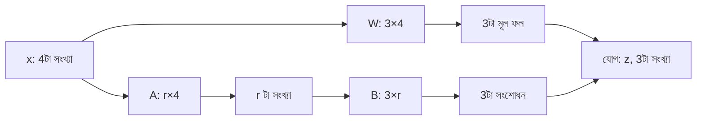

# Lecture 04 — A আর B-র আকার, Parameter সংখ্যা ও Effective Weights

> আগে যা জানা থাকলে ভালো: [LoRA-র forward pass](lecture-03-lora-forward-pass-and-activation.md) আর [shape ও parameter count](../module-09-model-architecture/lecture-07-shapes-and-parameter-count.md)। এই lecture শেষে পারবে: যেকোনো weight matrix-এর জন্য A আর B-র shape বলতে, LoRA-র parameter সংখ্যা গুনতে, আর `W + s·B·A` হিসাব করে দেখাতে যে দুই পথ আর এক পথের ফল সমান। ([Map-এ অবস্থান](../01-learning-map.md): LoRA → shape ও parameter count)

## সমস্যাটা কী?

LoRA-র উদ্দেশ্য ছিল কম সংখ্যা শেখানো। কিন্তু A আর B আসলে কত বড়? তাদের shape ঠিক না হলে `B(Ax)` মূল পথের `Wx`-এর সঙ্গে যোগই হবে না। আবার কত সংখ্যা শেখানো লাগছে, সেটা না গুনলে সাশ্রয় বোঝা যায় না। এই দুটো প্রশ্নের উত্তর shape থেকেই আসে।

## ধারণাটা সহজ ভাষায়

ধরো একটা layer-এ 4টা input আর 3টা output unit। তাহলে W-এর shape `3×4` (3টা row, প্রতি unit-এর জন্য একটা, 4টা column)। LoRA-তে একটা ছোট সংখ্যা **r** বেছে নেওয়া হয়, যার নাম **rank**। এটা A আর B-র মাঝের মাপ:

- **A-র shape `r×4`:** 4টা input থেকে r টা মান বানায়।
- **B-র shape `3×r`:** সেই r টা মান থেকে 3টা output-এর সংশোধন বানায়।

`3×r` কে `r×4` দিয়ে গুণ করলে `3×4` পাওয়া যায়, ঠিক W-এর আকার। তাই দুই পথের ফল যোগ করা যায়।



নিয়মটা এক লাইনে: **W যদি `m×d` হয়, A হয় `r×d` আর B হয় `m×r`।** r সাধারণত ছোট (যেমন 8 বা 16)। Rank নিয়ে আরও কথা [Lecture 07](lecture-07-lora-rank-alpha-init-dropout.md)-এ।

## ছোট একটা উদাহরণ

আগের মতো `x = [1, 2, 0, 1]`, `s = 1`, `r = 2`। W আর A, B এই:

```text
W (3×4) = [[ 1,  2, 0, 0],      A (2×4) = [[1, 0, 0, 0],      B (3×2) = [[ 1, 0],
           [ 0,  1, 1, 2],                 [0, 1, 0, 0]]                  [ 0, 1],
           [-1, -1, 0, 1]]                                                [-1, 1]]
```

```text
Wx    = [5, 4, −2]
Ax    = [1, 2]                  ← r = 2 টা সংখ্যা
B(Ax) = [1×1 + 0×2, 0×1 + 1×2, −1×1 + 1×2] = [1, 2, 1]
z     = [5, 4, −2] + [1, 2, 1] = [6, 6, −1]
```

লক্ষ্য করো: একই দুটো মধ্যবর্তী সংখ্যা `[1, 2]` থেকে B-র তিন row তিনটা আলাদা সংশোধন বানাল। সব unit-এ একই সংশোধন বসেনি।

## Parameter কয়টা?

A-তে `r × d` টা, B-তে `m × r` টা। মোট **`r × (d + m)`**।

| | হিসাব | সংখ্যা |
|---|---|---|
| W (frozen) | `3 × 4` | 12 |
| A + B (trainable) | `2×4 + 3×2` | 14 |

এই ছোট matrix-এ LoRA-র সংখ্যা W-র চেয়েও বেশি, কোনো সাশ্রয় নেই। সাশ্রয় আসে বড় matrix আর ছোট r-এ:

| W-এর আকার | W-এর সংখ্যা | `r = 8`-এ A + B | অনুপাত |
|---|---|---|---|
| `1000×1000` | 1,000,000 | 8,000 + 8,000 = 16,000 | 1.6% |

(Bias গণনায় ধরা হয়নি।)

## Effective weight: দুই পথ জুড়ে এক পথ

`x`-এর আগে সব গুণ আলাদা না করে, দুই পথের গুণ একসঙ্গে বসানো যায়:

`Wx + s·B(Ax) = (W + s·B·A) x`

**`ΔW = s·B·A`** হলো LoRA-র শেখা সংশোধন, যার shape W-এর মতোই `m×d`। আর **`W_effective = W + ΔW`**। উদাহরণের সংখ্যায়:

```text
B·A   = [[ 1, 0, 0, 0],
         [ 0, 1, 0, 0],
         [-1, 1, 0, 0]]
W + BA = [[ 2, 2, 0, 0],
          [ 0, 2, 1, 2],
          [-2, 0, 0, 1]]
(W + BA)x = [6, 6, −1]      ← আগের z-এর সমান
```

সাবধান: এটা matrix-এর **মানের** যোগ (`W + ΔW`)। A আর B-র আকার আলাদা, তাই `W + A + B` যোগ করা যায় না। আবার parameter সংখ্যাও `12 + 14`-এর মতো শুধু যোগ করে একটা matrix হয় না; unmerged অবস্থায় W আর A, B দুটোই রাখতে হয়।

```python
def matvec(M, v):
    return [sum(m * x for m, x in zip(row, v)) for row in M]

def matmul(P, Q):
    return [[sum(P[i][k] * Q[k][j] for k in range(len(Q))) for j in range(len(Q[0]))]
            for i in range(len(P))]

W = [[1, 2, 0, 0], [0, 1, 1, 2], [-1, -1, 0, 1]]    # 3x4, frozen
A = [[1, 0, 0, 0], [0, 1, 0, 0]]                    # 2x4
B = [[1, 0], [0, 1], [-1, 1]]                       # 3x2
x = [1, 2, 0, 1]
s = 1

Wx = matvec(W, x)
BAx = matvec(B, matvec(A, x))
print("Wx =", Wx, "| B(Ax) =", BAx, "| z =", [p + s * q for p, q in zip(Wx, BAx)])

dW = [[s * v for v in row] for row in matmul(B, A)]          # ΔW = s*B*A  (3x4)
W_eff = [[w + d for w, d in zip(r1, r2)] for r1, r2 in zip(W, dW)]
print("ΔW    =", dW)
print("W_eff =", W_eff)
print("W_eff x =", matvec(W_eff, x))

def lora_count(m, d, r):          # W: m x d
    return r * (d + m)
print("12 বনাম", lora_count(3, 4, 2))
print("1000x1000, r=8:", lora_count(1000, 1000, 8), "of", 1000 * 1000)
# output:
# Wx = [5, 4, -2] | B(Ax) = [1, 2, 1] | z = [6, 6, -1]
# ΔW    = [[1, 0, 0, 0], [0, 1, 0, 0], [-1, 1, 0, 0]]
# W_eff = [[2, 2, 0, 0], [0, 2, 1, 2], [-2, 0, 0, 1]]
# W_eff x = [6, 6, -1]
# 12 বনাম 14
# 1000x1000, r=8: 16000 of 1000000
```

## কোন matrix কোন জোড়া পায়

Standard LoRA-তে বেছে নেওয়া **প্রতিটা weight matrix নিজের A, B জোড়া** পায়। প্রতি unit আলাদা জোড়া পায় না, আবার পুরো model-এর জন্য একটাই জোড়াও থাকে না। বেছে না নেওয়া matrix-এ LoRA পথই থাকে না। কোন matrix বাছা হবে, তা [Lecture 08](lecture-08-target-selection-gradient-and-memory.md)-এর বিষয়।

## তিনটা আলাদা ঘটনা

| ঘটনা | W | A, B | Parameter সংখ্যা |
|---|---|---|---|
| LoRA যোগ করা | একই | নতুন শুরুর মান | A, B যোগ হওয়ায় total বাড়ে |
| Training | frozen | মান বদলায় | একই |
| Inference | একই | একই | একই |

Training-এ বদলায় A, B-র **মান**। LoRA যোগ করায় বাড়ে **সংখ্যা**। Merge করলে (Lecture 09) সংশোধন W-তে বসে যায়। এই তিনটা গুলিয়ে ফেলো না।

## মনে রাখার সারকথা

- W যদি `m×d` হয়, তাহলে A হয় `r×d`, B হয় `m×r`; trainable সংখ্যা `r × (d + m)`।
- `ΔW = s·B·A`-এর shape W-র সমান, আর `(W + ΔW)x` ঠিক `Wx + s·B(Ax)`-এর সমান।
- ছোট matrix-এ LoRA সাশ্রয়ী নয়; বড় matrix আর ছোট r-এ সংখ্যা অনেক কমে।

## নিজে করো

১. W-এর shape `6×5`, `r = 2`। A আর B-র shape কী? LoRA-তে মোট কয়টা trainable সংখ্যা, আর W-তে কয়টা?
২. W-এর shape `2000×500`, `r = 4`। LoRA-র সংখ্যা W-র কত ভাগ?
৩. `W = [[1,0],[0,1]]`, `B = [[1],[2]]`, `A = [[1,1]]`, `s = 1`। `W_effective` কত? `x = [1, 1]`-এ `W_effective · x` কত?

<details><summary>উত্তর</summary>

১. `m = 6`, `d = 5`। A হলো `2×5`, B হলো `6×2`। LoRA: `2 × (5 + 6) = 22`। W: `6 × 5 = 30`।
২. LoRA: `4 × (500 + 2000) = 10,000`। W: `2000 × 500 = 1,000,000`। অনুপাত `1%`।
৩. `B·A = [[1,1],[2,2]]`, তাই `W_effective = [[2,1],[2,3]]`। `x = [1,1]`-এ ফল `[3, 5]`। যাচাই: `Wx = [1,1]`, `Ax = 2`, `B(Ax) = [2,4]`, যোগ `[3,5]`। মিলেছে।

</details>

## পরের পাঠ

LoRA-র আকার আর হিসাব জানা হলো। এবার একটা আলাদা প্রশ্ন: প্রতিটা সংখ্যা কত bit-এ রাখা হয়? তার প্রথম ধাপ [Bridge — একই তথ্য কম জায়গায় রাখা](bridge-01-lossless-compression.md), তারপর [Lecture 05 — Quantization](lecture-05-quantization-and-qlora.md)। A, B-র `r` আর `s`-এর মান ঠিক হয় কীভাবে, তা [Lecture 07](lecture-07-lora-rank-alpha-init-dropout.md)-এ (তার আগে [Lecture 06](lecture-06-full-selective-and-head-training.md))।

Sources: [LoRA paper](https://arxiv.org/abs/2106.09685), [PEFT LoRA documentation](https://huggingface.co/docs/peft/en/package_reference/lora)।
