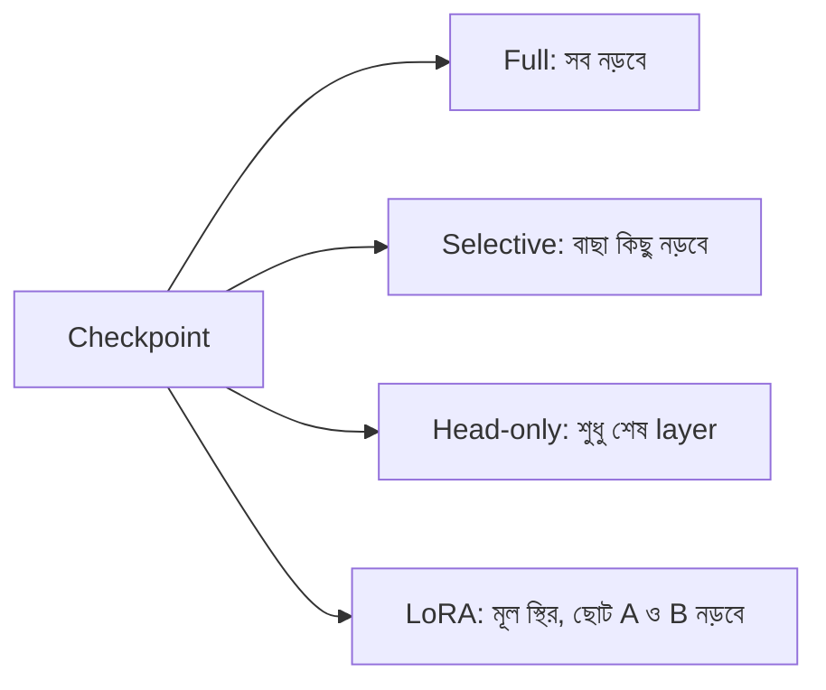

# Lecture 06 — Full, Selective ও Head-only Training: কে নড়বে, কে স্থির

> আগে যা জানা থাকলে ভালো: [fine-tuning পদ্ধতির মানচিত্র](lecture-02-finetuning-methods-map.md) আর [`2 → 2 → 1` network-এর backpropagation-এর gradient](../module-10-neural-network-training/lecture-04-backpropagation.md)। এই lecture শেষে পারবে: trainable আর frozen parameter বেছে একটা update-এ কোন মান বদলায় তা হাতে বের করতে। ([Map-এ অবস্থান](../01-learning-map.md): update-এর ধাপ → কোন parameter update পাবে)

## সমস্যাটা কী?

Fine-tuning-এ checkpoint থেকে সব parameter বদলানো সহজ পথ। কিন্তু সব বদলালে প্রতিটা নতুন কাজের জন্য পুরো model-এর আলাদা কপি রাখতে হয়, আর training-এর সময় সবার gradient ও optimizer-এর হিসাব memory-তে রাখতে হয়। অনেক সময় নতুন কাজে শুধু কয়েকটা parameter বদলালেই চলে। তাই ঠিক করতে হয় কোনগুলো নড়বে, কোনগুলো স্থির থাকবে।

## ধারণাটা সহজ ভাষায়

Checkpoint থেকে model load করার পরে প্রতিটা parameter-কে একটা চিহ্ন দেওয়া যায়: **trainable** (update পাবে) বা **frozen** (মান স্থির)। Update-এর ধাপে শুধু trainable parameter-এর মান `নতুন = পুরোনো − learning rate × gradient` নিয়মে বদলায়। কোন চিহ্ন কাকে দেওয়া হবে, তার কয়েকটা পরিচিত পছন্দ:

| পছন্দ | trainable কারা | কেন |
|---|---|---|
| Full | সবাই | পুরো model মানাতে |
| Selective | বেছে নেওয়া কিছু layer বা parameter | কম অংশ বদলে কাজ চালাতে |
| Head-only | শুধু শেষের output অংশ (**head**) | আগে শেখা features ঠিক রেখে শেষ সিদ্ধান্ত নতুন করে শেখাতে |
| Bias-only | শুধু bias | সবচেয়ে কম সংখ্যা বদলে মানাতে |

Frozen মানে হিসাব বন্ধ নয়। Frozen parameter forward pass-এ অংশ নেয়, শুধু তার মান বদলায় না। আর trainable হলেও কোনো step-এ তার gradient `0` হলে মান নাও বদলাতে পারে।

## ছোট একটা উদাহরণ

Module 09–10-এর সেই network: input `x = [2, 1]`, target `5`, loss `(y − 5)²`। Checkpoint-এর মান ধরো আগের মতোই (A: `[1,1]`, bias 0; B: `[−1,1]`, bias 0; C: `[2,1]`, bias 1)। এই মানে prediction `7`, loss `4`।

Backpropagation-এর gradient (Module 10, Lecture 04):

```text
A.w1 = 16   A.w2 = 8   A.b = 8
B.w1 = 0    B.w2 = 0   B.b = 0
C.w1 = 12   C.w2 = 0   C.b = 4
```

Learning rate `0.01`। শুধু trainable parameter-এ update, তিন পছন্দে:

| পছন্দ | trainable | যা বদলাল | নতুন prediction | নতুন loss |
|---|---|---|---|---|
| Full | 9টা | A.w1, A.w2, A.b, C.w1, C.b | 5.6976 | 0.4866 |
| Head-only (C) | 3টা | C.w1, C.b | 6.6 | 2.56 |
| Bias-only | 3টা | A.b, C.b | 6.8 | 3.24 |

হিসাব মেলাতে head-only দেখো: `C.w1 = 2 − 0.01 × 12 = 1.88`, `C.b = 1 − 0.01 × 4 = 0.96`। hidden output `[3, 0]` একই, তাই `y = 1.88 × 3 + 1 × 0 + 0.96 = 6.6`, loss `(6.6 − 5)² = 2.56`।

লক্ষ্য করো: head-only-তে trainable 3টা, কিন্তু বদলাল 2টা। `C.w2`-এর gradient `0` (কারণ `hB = 0`), তাই সে নড়েনি। আর একই এক step-এ full-এর loss সবচেয়ে বেশি কমেছে, কারণ সবাই ঢালের দিকে সরেছে। এটা একটা ছোট step-এর খেলনা হিসাব; বাস্তবে কম parameter বদলেও অনেক কাজে ভালো ফল পাওয়া যায়।

```python
x, target, lr = [2, 1], 5, 0.01
names = ["A.w1", "A.w2", "A.b", "B.w1", "B.w2", "B.b", "C.w1", "C.w2", "C.b"]
P = [1, 1, 0,  -1, 1, 0,  2, 1, 1]          # checkpoint-এর মান (Module 09 থেকে)

def forward(P):
    hA = max(0, P[0] * x[0] + P[1] * x[1] + P[2])
    hB = max(0, P[3] * x[0] + P[4] * x[1] + P[5])
    return P[6] * hA + P[7] * hB + P[8]

def loss(P):
    return (forward(P) - target) ** 2

def gradient(P):                              # ঠেলা দিয়ে gradient (Module 10, Lecture 02)
    g = []
    for i in range(len(P)):
        up, dn = P[:], P[:]
        up[i] += 1e-6; dn[i] -= 1e-6
        g.append(round((loss(up) - loss(dn)) / 2e-6, 3))
    return g

grad = gradient(P)
print("gradient:", dict(zip(names, grad)))
print("আগে: prediction =", forward(P), "loss =", loss(P))

choices = {
    "full":      range(9),
    "head-only": [6, 7, 8],
    "bias-only": [2, 5, 8],
}
for name, trainable in choices.items():
    new = P[:]
    for i in trainable:                       # শুধু trainable-এর মান বদলায়
        new[i] = P[i] - lr * grad[i]
    changed = [names[i] for i in range(9) if new[i] != P[i]]
    print(f"{name:9s} trainable={len(list(trainable))} বদলেছে={changed} prediction={forward(new):.4f} loss={loss(new):.4f}")
# output:
# gradient: {'A.w1': 16.0, 'A.w2': 8.0, 'A.b': 8.0, 'B.w1': 0.0, 'B.w2': 0.0, 'B.b': 0.0, 'C.w1': 12.0, 'C.w2': 0.0, 'C.b': 4.0}
# আগে: prediction = 7 loss = 4
# full      trainable=9 বদলেছে=['A.w1', 'A.w2', 'A.b', 'C.w1', 'C.b'] prediction=5.6976 loss=0.4866
# head-only trainable=3 বদলেছে=['C.w1', 'C.b'] prediction=6.6000 loss=2.5600
# bias-only trainable=3 বদলেছে=['A.b', 'C.b'] prediction=6.8000 loss=3.2400
```

## বাস্তব framework-এ কেমন দেখায়

নিচের কোডটা শুধু ধারণা বোঝানোর pseudo-code। চালানো হয়নি, আর এর নামগুলো আসল library-র API নয়।

```text
# pseudo-code, চালানো হয়নি
model = load_checkpoint("pretrained")

for each parameter p in model:
    p.trainable = False            # প্রথমে সবাইকে স্থির করি

for each parameter p in model.last_layer:
    p.trainable = True             # head-only: শুধু শেষ layer খুলি

train(model, data)                 # optimizer শুধু trainable-এর মান বদলায়
```

PyTorch-এ এই flag-টার আসল নাম `requires_grad`।

## ছবি



শেষ বাক্স LoRA অন্য ধরনের: সে মূল parameter-গুলোর কোনোটাই বদলায় না, বদলায় নতুন যোগ করা A, B। সেটা Lecture 03–04-এ দেখা হয়েছে।

## মনে রাখার সারকথা

- Fine-tuning-এ প্রতিটা parameter trainable বা frozen; update শুধু trainable-এর মান বদলায়।
- Frozen parameter-ও হিসাবে অংশ নেয়; আর trainable হলেও gradient `0` হলে ওই step-এ মান বদলায় না।
- Full, selective, head-only, bias-only হলো trainable বেছে নেওয়ার পছন্দ; কোনটা ভালো তা কাজ আর data-র উপর নির্ভর করে।

## নিজে করো

১. Bias-only পছন্দে নতুন `A.b`, `B.b`, `C.b` কত?
২. Head-only-তে trainable 3টা, কিন্তু 2টা বদলাল। কোনটা বদলায়নি আর কেন?
৩. `3 → 4 → 1` network-এ (21টা parameter) head-only আর bias-only-তে trainable কয়টা?

<details><summary>উত্তর</summary>

১. `A.b = 0 − 0.01 × 8 = −0.08`, `B.b = 0 − 0.01 × 0 = 0`, `C.b = 1 − 0.01 × 4 = 0.96`।
২. `C.w2` বদলায়নি। এর gradient `0`, কারণ `C.w2` গুণ হচ্ছে `hB`-এর সঙ্গে, আর `hB = 0` (ReLU B-র ঋণাত্মক score `0` করে দিয়েছে)।
৩. Head-only: শেষ layer `(4 + 1) × 1 = 5`। Bias-only: hidden-এর 4টা + output-এর 1টা = 5।

</details>

## পরের পাঠ

LoRA-তে মূল parameter স্থির থাকে, কিন্তু A, B-র সেটিংগুলো (rank, alpha, শুরুর মান, dropout) মানে কী? [Lecture 07 — rank, alpha, initialization, dropout](lecture-07-lora-rank-alpha-init-dropout.md)।
