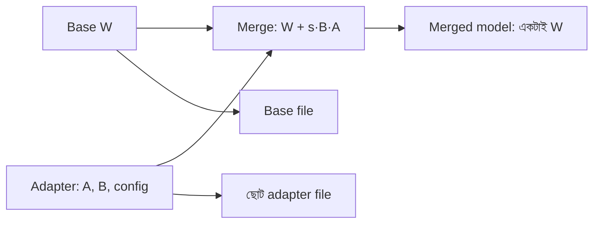

# Lecture 09 — Merge, Save ও Load: শেখার পরে LoRA-র কী হয়

> আগে যা জানা থাকলে ভালো: [`W_effective = W + s·B·A`](lecture-04-lora-matrix-pairs-and-effective-weights.md) আর [target ও memory-র হিসাব](lecture-08-target-selection-gradient-and-memory.md)। এই lecture শেষে পারবে: merge ও unmerge হাতে করে দেখাতে, adapter আর merged model-এর save-এর পার্থক্য বলতে, আর শেখা LoRA থেকে আবার training চালানোর তিনটা পথ চিনতে। ([Map-এ অবস্থান](../01-learning-map.md): training-এর পরের ধাপ। এখানে নতুন কোনো loss বা update-এর নিয়ম নেই।)

## সমস্যাটা কী?

LoRA-তে training শেষে তোমার হাতে থাকে মূল checkpoint আর ছোট A, B। কিন্তু প্রতিবার inference-এ দুই পথে হিসাব করা বাড়তি কাজ। আবার file হিসেবে সবকিছু রাখতে গেলে কী রাখবে: শুধু A, B, নাকি পুরো model? আর পরে নতুন data এলে কীভাবে চালিয়ে যাবে? তিনটা প্রশ্নের উত্তর আসে একটা সূত্র থেকে: `ΔW = s·B·A`।

## ধারণাটা সহজ ভাষায়

**Merge:** `ΔW` কে সরাসরি W-তে যোগ করে নতুন একটা matrix বানানো: `W_merged = W + s·B·A`। এখন আলাদা LoRA পথ লাগে না, কারণ `W_merged · x` আগের দুই পথের যোগফলের সমান। Matrix-এর shape আগের মতোই থাকে।

**Unmerge:** উল্টোটা: `W = W_merged − s·B·A`। এর জন্য A, B হাতে থাকতে হয়।

**Adapter save:** শুধু A, B (আর config: কোন module-এ, কোন `r`, কোন `α`) রাখা। এটা ছোট, কিন্তু চালাতে একই base checkpoint লাগে। **Merged save:** পুরো `W_merged` রাখা। এটা base-এর সমান বড়, কিন্তু আলাদা adapter লাগে না।



## ছোট একটা উদাহরণ

Lecture 04-এর `W`, `A`, `B`, `x = [1, 2, 0, 1]`। তিনটা `s` নিয়ে unmerged ফল আর merged ফল মেলানো হলো, সঙ্গে unmerge-এ W ফিরে আসে কি না:

```python
from fractions import Fraction as F

def matvec(M, v):
    return [sum(m * x for m, x in zip(row, v)) for row in M]

def matmul(P, Q):
    return [[sum(P[i][k] * Q[k][j] for k in range(len(Q))) for j in range(len(Q[0]))]
            for i in range(len(P))]

def combine(W, dW, sign=1):              # W + sign * dW
    return [[w + sign * d for w, d in zip(r1, r2)] for r1, r2 in zip(W, dW)]

W = [[1, 2, 0, 0], [0, 1, 1, 2], [-1, -1, 0, 1]]
A = [[1, 0, 0, 0], [0, 1, 0, 0]]
B = [[1, 0], [0, 1], [-1, 1]]
x = [1, 2, 0, 1]

def run(s, conv):
    c = lambda M: [[conv(v) for v in row] for row in M]
    W_, A_, B_, x_ = c(W), c(A), c(B), [conv(v) for v in x]
    unmerged = [p + s * q for p, q in zip(matvec(W_, x_), matvec(B_, matvec(A_, x_)))]
    dW = [[s * v for v in row] for row in matmul(B_, A_)]
    merged_W = combine(W_, dW)                         # merge
    restored = combine(merged_W, dW, sign=-1)          # unmerge
    return unmerged, matvec(merged_W, x_), restored == W_

print("s=1 (পূর্ণ সংখ্যা):", run(1, int))
u, m, ok = run(0.1, float)
print("s=0.1 (float): unmerged =", u, "| merged =", m, "| একই?", u == m)
u, m, ok = run(F(1, 10), F)
print("s=1/10 (সঠিক ভগ্নাংশ): একই?", u == m, "| unmerge-এ W ফেরত?", ok)

m_, d_, r_ = 1000, 1000, 8
print("প্রতি matrix: merged =", m_ * d_, "| adapter =", r_ * (m_ + d_))
print("তিন কাজ: তিনটা পূর্ণ কপি =", 3 * m_ * d_, "| base + তিন adapter =", m_ * d_ + 3 * r_ * (m_ + d_))
# output:
# s=1 (পূর্ণ সংখ্যা): ([6, 6, -1], [6, 6, -1], True)
# s=0.1 (float): unmerged = [5.1, 4.2, -1.9] | merged = [5.1, 4.2, -1.9000000000000001] | একই? False
# s=1/10 (সঠিক ভগ্নাংশ): একই? True | unmerge-এ W ফেরত? True
# প্রতি matrix: merged = 1000000 | adapter = 16000
# তিন কাজ: তিনটা পূর্ণ কপি = 3000000 | base + তিন adapter = 1048000
```

পূর্ণ সংখ্যা আর সঠিক ভগ্নাংশে merged আর unmerged ফল হুবহু সমান, unmerge-এ W-ও ফেরত আসে। Computer-এর সাধারণ দশমিক (float) সংখ্যায় `-1.9` আর `-1.9000000000000001`-এর মতো ক্ষুদ্র পার্থক্য আসতে পারে, কারণ দশমিকের গোলমাল জমে। বাস্তব model-এ 16 bit-এর মতো কম precision-এ এই গোলমাল আরও বড় হতে পারে। তাই merge-এর পরে কয়েকটা test input-এ merged আর unmerged output মিলিয়ে দেখা ভালো অভ্যাস।

Size দেখো: একটা `1000×1000` matrix-এ merged সংখ্যা 1,000,000, adapter (`r = 8`) মাত্র 16,000। তিনটা আলাদা কাজের জন্য তিনটা পূর্ণ কপি রাখলে 3,000,000; একটা base আর তিনটা adapter রাখলে 1,048,000। কাজ বদলাতে শুধু adapter বদলালেই চলে।

## Save আর load

নিচের কোড ধারণা বোঝানোর pseudo-code। চালানো হয়নি, আর নামগুলো আসল library-র API নয়।

```text
# pseudo-code, চালানো হয়নি
# --- training শেষে ---
save_adapter("my-adapter", model)         # শুধু A, B আর config (r, alpha, target list)

# --- পরে ব্যবহারে ---
base  = load_base_model("base-checkpoint")   # আগের একই base লাগে
model = attach_adapter(base, "my-adapter")   # unmerged: দুই পথ
model = merge(model)                         # চাইলে merged: একটাই W
save_full_model("my-merged-model", model)    # merged হলে পুরো model রাখা যায়
```

Adapter আলাদা রাখলে base বদলে গেলে (যেমন অন্য checkpoint) A, B আর মানে রাখে না, কারণ `ΔW` ওই নির্দিষ্ট `W`-র জন্য শেখা। Adapter-এর সঙ্গে base-এর নাম বা version লিখে রাখা তাই দরকারি।

## শেখা LoRA থেকে আবার training

| পথ | কী ঘটে | কখন |
|---|---|---|
| ক. একই adapter-এ চালিয়ে যাওয়া | A, B load করে trainable রাখা, নতুন data-তে শেখা | একই কাজে আরও data এলে |
| খ. Merge করে নতুন LoRA | `W_merged` কে নতুন base ধরে নতুন A, B (B শূন্য) শেখানো | আগের শেখা পাকা করে নতুন কাজ যোগ করতে |
| গ. Merged model-এ full fine-tuning | `W_merged` থেকে শুরু করে সব parameter trainable | বেশি memory থাকলে আর পুরো model বদলাতে চাইলে |

(খ)-তে মোট পরিবর্তন `ΔW + ΔW'`। দুটোর rank সর্বোচ্চ `r` আর `r'` হলে যোগফলের rank সর্বোচ্চ `r + r'`। অর্থাৎ বারবার merge করে নতুন LoRA শেখালে মোট পরিবর্তনের ক্ষমতা বাড়তে পারে। (ক)-তে rank `r`-এই সীমিত থাকে।

সাবধান:

- Base যদি quantized হয় (Lecture 05), merge করতে base-এর মান ফিরিয়ে `ΔW` যোগ করে আবার কম bit-এ রাখতে হয়। এই দ্বিতীয় rounding-এ output সামান্য সরতে পারে। বিস্তারিত [Lecture 10](lecture-10-precision-nf4-and-qlora-practice.md)-এ।
- এই merge LoRA-র মতো additive পদ্ধতির জন্য। সব PEFT পদ্ধতি একটা `W + ΔW`-তে মেশানো যায় না ([Lecture 13](lecture-13-other-peft-adapters-prompts-ia3.md))।

## মনে রাখার সারকথা

- Merge: `W_merged = W + s·B·A`; এর পরে একটাই W, আলাদা LoRA পথ লাগে না। Unmerge: ΔW বিয়োগ।
- Adapter ছোট ও base-নির্ভর; merged model পূর্ণ আকারের কিন্তু স্বয়ংসম্পূর্ণ। আসল precision-এ ক্ষুদ্র সংখ্যাগত পার্থক্য হতে পারে, তাই মিলিয়ে দেখো।
- Training চালিয়ে যাওয়ার তিনটা পথ: একই adapter, merge করে নতুন LoRA, বা merged model-এ full training।

## নিজে করো

১. `W = [[1,0],[0,1]]`, `B = [[1],[2]]`, `A = [[1,1]]`, `s = 2`। `W_merged` কত? `x = [1, 1]`-এ `W_merged · x` কত?
২. একটা `2000×2000` matrix-এ `r = 8` adapter আর পূর্ণ matrix-এর সংখ্যা কত?
৩. Adapter আলাদা রেখে ডাউনলোড করলে একটা অন্য checkpoint-এ লাগিয়ে দিলে সমস্যা কী?

<details><summary>উত্তর</summary>

১. `B·A = [[1,1],[2,2]]`, `s × BA = [[2,2],[4,4]]`, তাই `W_merged = [[3,2],[4,5]]`। `x = [1,1]`-এ `[5, 9]`। যাচাই: `Wx = [1,1]`, `Ax = 2`, `s×B(Ax) = 2 × [2,4] = [4,8]`, যোগ `[5,9]`।
২. Adapter: `8 × (2000 + 2000) = 32,000`। পূর্ণ matrix: `4,000,000`।
৩. `ΔW` ওই নির্দিষ্ট base-এর `W`-র জন্য শেখা। অন্য base-এ `W` আলাদা, তাই `W + ΔW` আর সঠিক সংশোধন হবে না।

</details>

## পরের পাঠ

Quantized base-এর সঙ্গে LoRA (QLoRA)-র বাস্তব হিসাব, NF4 আর precision-এর মাপ: [Lecture 10](lecture-10-precision-nf4-and-qlora-practice.md)।

Source: [PEFT LoRA documentation](https://huggingface.co/docs/peft/en/package_reference/lora), [LoRA paper](https://arxiv.org/abs/2106.09685)।
