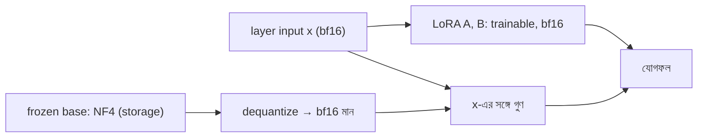

# Lecture 10 — কম bit-এ weight রাখা: Precision, NF4 ও QLoRA

> আগে যা জানা থাকলে ভালো: [Lecture 05 — Quantization-এর প্রথম পরিচয়](lecture-05-quantization-and-qlora.md) এবং [Lecture 04 — LoRA-র A ও B](lecture-04-lora-matrix-pairs-and-effective-weights.md)। এই lecture শেষে পারবে: কয়েকটা সংখ্যাকে 4-bit grid-এ ঠেলে error মাপতে, আর বলতে QLoRA-তে কোন জিনিস 4-bit-এ থাকে আর কোনটা থাকে না।

## সমস্যাটা কী?

৭ বিলিয়ন (7B) weight-এর একটা model bf16-তে রাখলে শুধু weight-ই প্রায় 14 GB। এর উপর training-এর অন্য জিনিস যোগ হলে ছোট GPU-তে আঁটে না। Weight-গুলো কম bit-এ রাখতে পারলে একই GPU-তে বড় model চালানো যায়। Hobbyist থেকে শুরু করে ছোট team পর্যন্ত যাদের সীমিত GPU, তাদের জন্য এটাই QLoRA-র মূল কাজ।

## ধারণাটা সহজ ভাষায়

### Precision মানে কয় bit-এ একটা সংখ্যা রাখা

**Precision** হলো একটা সংখ্যা রাখতে কয় bit খরচ হয়। Bit বেশি হলে সংখ্যা বেশি সূক্ষ্মভাবে রাখা যায়, কিন্তু memory বেশি লাগে।

| নাম | Bit | প্রতি weight-এ byte | ৭ বিলিয়ন weight-এর raw size | কয়টা আলাদা code |
|---|---|---|---|---|
| fp32 | 32 | 4 | 28 GB | অনেক |
| bf16 / fp16 | 16 | 2 | 14 GB | 65,536 |
| int8 | 8 | 1 | 7 GB | 256 |
| 4-bit | 4 | 0.5 | 3.5 GB | 16 |

(bf16 আর fp16 দুটোই 16 bit। bf16-এ fp32-র মতো বড় range রাখা যায় কিন্তু precision কম; fp16-এ range ছোট, precision একটু বেশি।) সব হিসাব শুধু weight-এর raw size; scale, activation ও optimizer memory আলাদা।

4-bit-এ মাত্র 16টা code। তাই যেকোনো সংখ্যা রাখা যায় না; প্রতিটা সংখ্যাকে ঠেলে 16টা নির্দিষ্ট মানের (grid) একটাতে নিতে হয়।

### Grid-এ ঠেলা: block ও scale

Weight-এর মান 0.12 বা 0.42-এর মতো ছোট, কিন্তু grid-এর মান -1 থেকে 1-এর মাঝে। তাই কয়েকটা weight মিলে একটা **block** বানানো হয়, আর প্রতি block-এর জন্য একটা **scale** রাখা হয় (block-এর সবচেয়ে বড় absolute মান, একে absmax বলে)। ধাপগুলো:

1. Block-এর সব সংখ্যাকে scale দিয়ে ভাগ করো। ফল -1 থেকে 1-এর মাঝে আসে।
2. প্রতিটা সংখ্যাকে grid-এর সবচেয়ে কাছের মানে ঠেলো। এই ধাপে 4-bit code সংরক্ষণ হয়।
3. দরকারের সময় code থেকে grid-মান নিয়ে scale দিয়ে গুণ করো। এটা আনুমানিক মান, আসল মান নয়। আসল ও আনুমানিক মানের পার্থক্যই **quantization error**।

Block ছোট হলে প্রতি block-এর scale নিজের সংখ্যাগুলোর কাছাকাছি হয়, তাই error কম। একটা বড় outlier মান শুধু নিজের block-ই নষ্ট করে। QLoRA paper weight-এ block size 64 ব্যবহার করেছে।

### NF4: grid কোথায় বসবে

সমান দূরত্বের grid সবচেয়ে সহজ। কিন্তু training-এর পর weight-এর বেশিরভাগ থাকে 0-এর কাছে, কিছু থাকে দূরে (ঘণ্টার মতো আকার)। তাই 0-এর কাছে grid ঘন, দূরে ফাঁকা হলে গড় error কমে। **NF4 (NormalFloat 4-bit)** ঠিক এই grid: normal distribution-এর quantile থেকে বানানো 16টা মান, যাতে ঠিক 0 আছে এবং সীমা -1 থেকে 1।

```text
NF4 grid: -1.000 -0.696 -0.525 -0.395 -0.284 -0.185 -0.091  0.000
           0.080  0.161  0.246  0.338  0.441  0.563  0.723  1.000
```

এই মানগুলো paper-এর বর্ণনা অনুযায়ী নিজে হিসাব করা (Python-এর `statistics.NormalDist`), আর আমার জানা প্রকাশিত table-এর সঙ্গে মিলেছে। তবে bitsandbytes-এর source বা official table-এর সঙ্গে সরাসরি মেলানো হয়নি। আসল ব্যবহারে library-র নিজের table-ই সঠিক।

### Double quantization: scale-ও জায়গা নেয়

প্রতি 64 weight-এ একটা fp32 scale (32 bit) মানে weight-প্রতি 32/64 = 0.5 bit বাড়তি। **Double quantization** এই scale-গুলোকেই আবার 8-bit-এ quantize করে (256টা scale মিলে একটা fp32 দ্বিতীয় স্তরের scale)। খরচ নামে 8/64 + 32/(64×256) = 0.127 bit। সাশ্রয় 0.373 bit প্রতি weight; QLoRA paper-ও এই হিসাব দিয়েছে।

| ৭ বিলিয়ন weight | Bit প্রতি weight | Size |
|---|---|---|
| bf16 | 16 | 14.00 GB |
| NF4 + fp32 scale (block 64) | 4.5 | 3.94 GB |
| NF4 + double quantization | 4.127 | 3.61 GB |

## ছোট একটা উদাহরণ: grid-এ ঠেলে error মাপা

প্রথমে 8টা weight-এর একটা block, তারপর 4096টা bell-shaped weight (random, seed ঠিক করা)। শেষে একটা outlier বসিয়ে block size-এর প্রভাব। Error = আসল ও আনুমানিক মানের পার্থক্যের গড় (absolute)।

```python
import random

NF4 = [-1.0, -0.696, -0.525, -0.395, -0.284, -0.185, -0.091, 0.0,
       0.080, 0.161, 0.246, 0.338, 0.441, 0.563, 0.723, 1.0]
UNI = [k / 7 for k in range(-7, 8)]      # সমান দূরত্বের grid

def quant_block(ws, grid):
    s = max(abs(w) for w in ws)           # block-এর scale = absmax
    # প্রতিটা সংখ্যাকে [-1,1]-এ এনে কাছের grid-মানে ঠেলা, তারপর scale ফেরানো
    return [min(grid, key=lambda c: abs(c - w / s)) * s for w in ws]

def mean_err(ws, grid, block):
    tot = 0
    for i in range(0, len(ws), block):
        b = ws[i:i + block]
        tot += sum(abs(x - y) for x, y in zip(b, quant_block(b, grid)))
    return tot / len(ws)

w = [0.12, -0.05, 0.31, -0.42, 0.02, 0.27, -0.18, 0.09]
for name, grid in [("uniform", UNI), ("NF4", NF4)]:
    q = quant_block(w, grid)
    print(name, [round(x, 3) for x in q], round(mean_err(w, grid, 8), 4))

random.seed(0)
big = [random.gauss(0, 0.02) for _ in range(4096)]   # bell-shaped weight
for blk in (64, 4096):
    print("block", blk, round(mean_err(big, UNI, blk), 5), round(mean_err(big, NF4, blk), 5))
big[5] = 0.5                                         # একটা outlier
for blk in (64, 4096):
    print("outlier, block", blk, round(mean_err(big, UNI, blk), 5), round(mean_err(big, NF4, blk), 5))
# output:
# uniform [0.12, -0.06, 0.3, -0.42, 0.0, 0.3, -0.18, 0.06] 0.0125
# NF4 [0.103, -0.038, 0.304, -0.42, 0.034, 0.236, -0.166, 0.103] 0.0137
# block 64 0.00176 0.00144
# block 4096 0.00254 0.00175
# outlier, block 64 0.00198 0.00159
# outlier, block 4096 0.01482 0.0104
```

ফল পড়ার উপায়:

- **8টা সংখ্যায়** NF4 একটু খারাপ (0.0137 বনাম 0.0125)। এত অল্প সংখ্যায় কিছু প্রমাণ হয় না; NF4 বানানো হয়েছে অনেক bell-shaped weight-এর জন্য।
- **4096টা bell-shaped weight-এ** (block 64) NF4-এর error প্রায় ১৮% কম: 0.00144 বনাম 0.00176।
- **Block 4096 থেকে 64 করলে** uniform grid-এর error 0.00254 থেকে 0.00176-এ নামে।
- **Outlier থাকলে** একটা বড় block-এ error 0.00254 থেকে লাফিয়ে 0.01482 হয়; block 64-এ মাত্র 0.00198। Outlier শুধু নিজের block নষ্ট করেছে।

এটা শিক্ষামূলক simulation: আসল NF4 library-র নিজের implementation ও packing ব্যবহার করে।

## PTQ বনাম QAT: কখন quantize করা হয়

| | PTQ (Post-Training Quantization) | QAT (Quantization-Aware Training) |
|---|---|---|
| কখন | Training শেষ হওয়ার পরে weight quantize | Training-এর সময়ই quantization-এর প্রভাব অনুকরণ |
| আবার training লাগে? | সাধারণত না (কখনো অল্প calibration data) | হ্যাঁ |
| খরচ | কম | বেশি |
| কম bit-এ ফল | quality কমার ঝুঁকি বেশি | model নিজে মানিয়ে নেয়, সাধারণত ভালো |

QLoRA-র base quantization **PTQ-ধরনের**: আগে শেখানো base weight একবার 4-bit করা হয়, তারপর base আর quantization-aware করে শেখানো হয় না। শেখে শুধু LoRA অংশ। তাই quantization error base-এ থেকেই যায়, আর LoRA-র কাজের একটা অংশ হিসেবে সেটা কিছুটা সামলাতে পারে, নিশ্চিতভাবে নয়। [LoftQ](lecture-12-init-variants-pissa-loftq.md) ঠিক এই শুরুর error কমানোর চেষ্টা। QAT-এর বিস্তারিত (rounding-এর gradient শূন্য, তাই বিশেষ কৌশল লাগে) এই কোর্সের বাইরে।

## QLoRA-তে storage বনাম compute

4-bit **storage**-এ আছে শুধু frozen base weight। কিন্তু **গুণ-যোগের হিসাব** 4-bit-এ হয় না। QLoRA paper-এ base weight দরকারের সময় bf16-তে dequantize করা হয়, তারপর সেই bf16 মান দিয়ে গুণ হয়। Backward-এও একই dequantize করা মান দিয়ে gradient যায়; update হয় শুধু LoRA-র A ও B-এ, যা higher precision-এ থাকে।



| জিনিস | কোথায়/কত precision | Training-এ বদলায়? |
|---|---|---|
| Base weight | 4-bit (NF4), double-quantized scale | না |
| গুণ-যোগের সময় base মান | bf16 (dequantize করা) | না |
| LoRA A, B | সাধারণত bf16 বা বেশি | হ্যাঁ |
| Gradient, optimizer state | শুধু A/B-এর জন্য, higher precision | হ্যাঁ |

সুতরাং memory অনেক কমে, কিন্তু প্রতিটা step-এ dequantize-এর বাড়তি কাজ আছে। ফলে speed hardware ও implementation-এর উপর নির্ভর করে, এবং সাধারণত bf16 LoRA-র চেয়ে ধীর হতে পারে; তোমার setup-এ মেপে দেখো ([Lecture 14](lecture-14-controlled-comparison.md))। QLoRA paper আরও একটা কৌশল দিয়েছে, paged optimizers: GPU memory ফুরোলে optimizer state CPU RAM-এ সরে যায়।

**Pseudo-code (ধারণা বোঝানোর জন্য, চালানো হয়নি):** QLoRA-র load-এ সাধারণত quantization config দিয়ে 4-bit, NF4, double quantization ও compute dtype বলা হয়। সঠিক API-র নাম নির্দিষ্ট library version-এর docs থেকে দেখে নাও। এখানে আন্দাজে নাম লেখা হলো না।

## মনে রাখার সারকথা

- Precision মানে প্রতি weight-এ কয় bit; 4-bit-এ 16টা code, তাই প্রতিটা মান কাছের grid-মানে ঠেলতে হয় এবং error থাকে।
- Block-wise scale error কমায়; NF4 bell-shaped weight-এর জন্য 0-এর কাছে ঘন grid; double quantization scale-এর খরচ কমায়।
- QLoRA-তে শুধু frozen base 4-bit storage-এ থাকে; গুণ-যোগ bf16-তে হয়, আর A/B higher precision-এ শেখে।

## নিজে করো

১. 1 বিলিয়ন weight bf16-তে আর 4-bit-এ (scale ছাড়া) raw কত GB?
২. Block `[0.8, 0.2, -0.3, 0.0]`-কে সমান দূরত্বের grid (`k/7`, `k = -7…7`) দিয়ে quantize করো। কোন সংখ্যায় error কত, গড় কত?
৩. 7 বিলিয়ন weight-এ double quantization-এর সাশ্রয় কত GB?
৪. QLoRA-তে base weight আবার quantization-aware করে শেখানো হয় কি?

<details><summary>উত্তর</summary>

১. bf16: `1e9 × 2 byte = 2 GB`। 4-bit: `1e9 × 0.5 byte = 0.5 GB`।
২. Scale 0.8, ধাপ `0.8/7 ≈ 0.1143`। 0.8 → 7 ধাপ = 0.8 (error 0)। 0.2 → 1.75, তাই 2 ধাপ = 0.2286 (error 0.0286)। -0.3 → -2.625, তাই -3 ধাপ = -0.3429 (error 0.0429)। 0.0 → 0 (error 0)। গড় error `(0 + 0.0286 + 0.0429 + 0)/4 ≈ 0.018`।
৩. `7e9 × 0.373 / 8 ≈ 0.33 GB`।
৪. না। Base একবার PTQ-ধরনে 4-bit করা হয়; শেখে শুধু LoRA অংশ।

</details>

## পরের পাঠ

Memory কমানোর পথ দেখা হলো। এবার LoRA নিজেই কোন কোন অংশে বদলানো যায়: [Lecture 11 — rsLoRA, AdaLoRA ও DoRA](lecture-11-lora-variants-rslora-adalora-dora.md)।

**Reference:** [QLoRA paper](https://arxiv.org/abs/2305.14314) (NF4, block size 64, double quantization-এর 0.373 bit সাশ্রয়, paged optimizers)।
