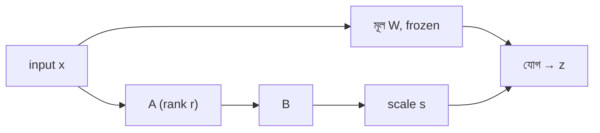

# Lecture 11 — LoRA-র তিনটি variant: rsLoRA, AdaLoRA, DoRA

> আগে যা জানা থাকলে ভালো: [Lecture 04 — A, B ও effective weights](lecture-04-lora-matrix-pairs-and-effective-weights.md)। এই lecture শেষে পারবে: প্রতিটা variant সাধারণ LoRA-র কোন অংশ বদলায় তা বলতে, আর প্রতিটার একটা ছোট সংখ্যার উদাহরণ হাতে করতে।

## সমস্যাটা কী?

সাধারণ LoRA-র হিসাব: `z = Wx + b + s·B(Ax)`। এতে তিনটা সিদ্ধান্ত স্থির: scale `s` কত হবে, প্রতি module-এ rank `r` কত, আর পরিবর্তনটা `W`-তে কীভাবে যোগ হবে। প্রতিটা নিয়েই গবেষকরা প্রশ্ন তুলেছেন। নতুন নাম শুনলেই নতুন math ধরে নেওয়ার দরকার নেই: আগে দেখো LoRA-র কোন অংশ বদলাচ্ছে, বাকিটা আগের মতোই।

## ধারণাটা সহজ ভাষায়



| Variant | LoRA-র কোন অংশ বদলায় | কী একই থাকে | খরচ বা ঝুঁকি |
|---|---|---|---|
| সাধারণ LoRA | কিছু না: `s = α/r`, সব module-এ একই `r`, `ΔW = sBA` | — | Rank বড় করলে সুবিধা কমে যেতে পারে |
| rsLoRA | **Scale `s`**: `α/√r` | A, B-এর গঠন, merge | α আবার বাছতে হতে পারে |
| AdaLoRA | **Rank-এর বণ্টন**: module ভেদে আলাদা `r` | মোট budget-এর ধারণা | Training-এ বাড়তি হিসাব ও জটিলতা |
| DoRA | **Parameterization**: weight-কে magnitude ও direction ভাগ করা | LoRA-র A, B | Training-এ বাড়তি norm হিসাব |

সব পরিবর্তনের পরেও Forward pass-এ মূল `W` frozen, আর ছোট trainable অংশ যোগ হয়।

### rsLoRA: scale বদলায়

সাধারণ LoRA-র `s = α/r`। Rank `r` বাড়ালে `s` ছোট হয়, ফলে LoRA অংশের অবদান চেপে যায়। rsLoRA paper (Kalajdzievski, 2023) বলে `α/√r` নেওয়াই ঠিক; তাহলে উঁচু rank-এ শেখা স্থিতিশীল থাকে। Paper-এর দাবি, উঁচু rank-এ সাধারণ scale-এ বাড়তি rank থেকে লাভ আসে না। আমরা এখানে শুধু scale-এর পার্থক্য হিসাব করব; কতটা লাভ হবে তা তোমার task-এ মেপে দেখতে হবে।

`α = 16` ধরলে:

| r | `α/r` | `α/√r` |
|---|---|---|
| 4 | 4 | 8 |
| 16 | 1 | 4 |
| 64 | 0.25 | 2 |
| 256 | 0.0625 | 1 |

`r` 4 থেকে 256 (64 গুণ) হলে `α/r` কমে 64 ভাগের এক ভাগ; `α/√r` কমে মাত্র 8 ভাগের এক ভাগ। সাবধান: একই `α` রেখে rsLoRA চালু করলে `r = 16`-এ scale 1 থেকে 4 হয়ে যায়। তাই শুধু flag বদলে তুলনা করলে ন্যায্য হয় না।

### AdaLoRA: কোন module-কে কত rank

সাধারণ LoRA প্রতিটা target module-কে সমান rank দেয়। কিন্তু সব module-এর পরিবর্তন সমান জরুরি নয়। **AdaLoRA** (Zhang ও অন্যান্য, 2023) পরিবর্তনকে SVD-র ধাঁচে `P·Λ·Q` আকারে লিখে, importance score দেখে কম দরকারি অংশ ছেঁটে ফেলে। মোট parameter budget ঠিক থাকে, কিন্তু কোন module কত rank পাবে তা training-এর সময় ঠিক হয়। Importance score-এর সূত্র ও budget schedule-এর বিস্তারিত এখানে নিশ্চিত করা হয়নি; ধারণাটাই মূল।

ছোট উদাহরণ: তিনটা 8×8 module, মোট rank budget 12। একটা rank-এর খরচ `8 + 8 = 16` parameter। সমান ভাগে `(4, 4, 4)`; বণ্টনে `(6, 4, 2)` (কাল্পনিক ফল)। দুই ক্ষেত্রেই parameter 192, কিন্তু capacity বসেছে ভিন্ন জায়গায়। তুলনা: হাতে নিজে আলাদা rank ঠিক করাও সম্ভব। PEFT docs-এ LoRA-র `rank_pattern` option দিয়ে module নাম ধরে আলাদা rank দেওয়া যায়। AdaLoRA সেটা স্বয়ংক্রিয় করে।

### DoRA: magnitude আর direction আলাদা

একটা output unit-এর weight একটা vector। এর আছে **দৈর্ঘ্য** (magnitude) আর **দিক** (direction)। DoRA (Liu ও অন্যান্য, 2024) প্রতিটা output unit-এর দৈর্ঘ্য আলাদা একটা সংখ্যা `m` হিসেবে শেখায়, আর দিক শেখে LoRA দিয়ে:

`W' = m · (W + sBA) / ‖W + sBA‖` (প্রতিটা output unit-এর row আলাদাভাবে)

Paper লেখা হয় column ধরে; আমাদের convention-এ ([Lecture 04](lecture-04-lora-matrix-pairs-and-effective-weights.md)) প্রতি row এক output unit, তাই row ধরা হলো। শুরুতে `m` = মূল row-এর দৈর্ঘ্য। Trainable বাড়ে output unit-এর সংখ্যার সমান `m`-এর মান। শেষে একটা সাধারণ matrix `W'` পাওয়া যায়, তাই merge করে চালালে inference-এ বাড়তি branch লাগে না (paper-এর দাবি)।

ছোট উদাহরণ: একটা unit-এর row `[3, 4]`, দৈর্ঘ্য 5, দিক `[0.6, 0.8]`। LoRA-র পরিবর্তন `[0.5, -0.5]`:

- সাধারণ LoRA: `[3.5, 3.5]`; দৈর্ঘ্য 4.95, দিক `[0.707, 0.707]`। দিক ও দৈর্ঘ্য দুটোই একসঙ্গে বদলেছে।
- DoRA, `m = 5`: দিক একই `[0.707, 0.707]`, দৈর্ঘ্য ঠিক 5 → `[3.536, 3.536]`।
- DoRA, `m` শেখা হয়ে 5.5: `[3.889, 3.889]`; দৈর্ঘ্য এখন আলাদাভাবে 5.5।

## Code দিয়ে মেলানো

```python
import math

# ১) rsLoRA: scale s = alpha/r বনাম alpha/sqrt(r)
alpha = 16
for r in (4, 16, 64, 256):
    print("r =", r, " alpha/r =", alpha / r, " alpha/sqrt(r) =", round(alpha / math.sqrt(r), 3))

# ২) AdaLoRA-র ধারণা: ৩টা 8x8 module, মোট rank budget 12; প্রতি rank-এ (8+8) parameter
for name, ranks in [("সমান rank", (4, 4, 4)), ("বণ্টিত (উদাহরণ)", (6, 4, 2))]:
    print(name, ranks, "মোট rank", sum(ranks), "parameter", sum(r * (8 + 8) for r in ranks))

# ৩) DoRA: একটা output unit-এর weight row [3, 4], LoRA-র পরিবর্তন [0.5, -0.5]
norm = lambda v: math.sqrt(sum(x * x for x in v))
W0, dW = [3.0, 4.0], [0.5, -0.5]
print("মূল row length", norm(W0))
new = [a + b for a, b in zip(W0, dW)]
print("LoRA row", new, "length", round(norm(new), 4))
direction = [x / norm(new) for x in new]
for m in (5.0, 5.5):                      # m = শেখা magnitude
    row = [m * x for x in direction]
    print("DoRA m =", m, "row", [round(x, 4) for x in row], "length", round(norm(row), 4))
# output:
# r = 4  alpha/r = 4.0  alpha/sqrt(r) = 8.0
# r = 16  alpha/r = 1.0  alpha/sqrt(r) = 4.0
# r = 64  alpha/r = 0.25  alpha/sqrt(r) = 2.0
# r = 256  alpha/r = 0.0625  alpha/sqrt(r) = 1.0
# সমান rank (4, 4, 4) মোট rank 12 parameter 192
# বণ্টিত (উদাহরণ) (6, 4, 2) মোট rank 12 parameter 192
# মূল row length 5.0
# LoRA row [3.5, 3.5] length 4.9497
# DoRA m = 5.0 row [3.5355, 3.5355] length 5.0
# DoRA m = 5.5 row [3.8891, 3.8891] length 5.5
```

**Config-এর pseudo-code (চালানো হয়নি):** PEFT-এর LoRA docs-এ `use_rslora` (scale `α/√r` করে) ও `use_dora` নামের option দেখা গেছে। Version অনুযায়ী বিস্তারিত নিজে docs থেকে মিলিয়ে নাও।

```text
LoraConfig(r=..., lora_alpha=..., use_rslora=True)   # rsLoRA
LoraConfig(r=..., lora_alpha=..., use_dora=True)     # DoRA
```

## মনে রাখার সারকথা

- Variant দেখলে আগে প্রশ্ন করো: LoRA-র কোন অংশ বদলাল? rsLoRA বদলায় scale, AdaLoRA rank-এর বণ্টন, DoRA parameterization।
- Rank বাড়ালে `α/r` দ্রুত ছোট হয়; rsLoRA-র `α/√r` ধীরে ছোট হয়, তাই একই `α`-তে তুলনা ন্যায্য নয়।
- DoRA দৈর্ঘ্য আর দিক আলাদা শেখায়; AdaLoRA সমান ভাগের বদলে দরকার অনুযায়ী rank দেয়। সব variant-এর লাভ নিজের task-এ মাপতে হবে।

## নিজে করো

১. `α = 32`, `r = 16`। সাধারণ scale ও rsLoRA scale কত?
২. `α = 16` ধরে `r` 4 থেকে 64 করলে (ক) `α/r` (খ) `α/√r` কত গুণ ছোট হয়?
৩. চারটা 8×8 module, মোট rank budget 20 হলে parameter কত?
৪. DoRA: row `[6, 8]`, LoRA-র পরিবর্তন `[1, -1]`, শেখা `m = 10`। নতুন row কত?

<details><summary>উত্তর</summary>

১. সাধারণ: `32/16 = 2`। rsLoRA: `32/√16 = 32/4 = 8`।
২. (ক) `4 → 0.25`, মানে 16 গুণ ছোট। (খ) `8 → 2`, মানে 4 গুণ ছোট।
৩. প্রতি rank-এ `8+8 = 16`; `20 × 16 = 320`। বণ্টন যেমনই হোক, মোট rank 20 হলে parameter 320।
৪. LoRA-র পরে `[7, 7]`, দৈর্ঘ্য `√98 ≈ 9.899`, দিক `[0.707, 0.707]`। `m = 10` দিয়ে গুণ: `[7.071, 7.071]`।

</details>

## পরের পাঠ

এই তিনটা variant-এ শুরুর অবস্থায় LoRA-র পরিবর্তন সাধারণত শূন্য থাকে, অর্থাৎ model শুরুতে base-এর মতোই চলে। শুরুর মানটাই বদলালে কী হয়: [Lecture 12 — PiSSA ও LoftQ](lecture-12-init-variants-pissa-loftq.md)।

**References:** [rsLoRA](https://arxiv.org/abs/2312.03732), [AdaLoRA](https://arxiv.org/abs/2303.10512), [DoRA](https://arxiv.org/abs/2402.09353), [PEFT LoRA docs](https://huggingface.co/docs/peft/en/package_reference/lora)।
