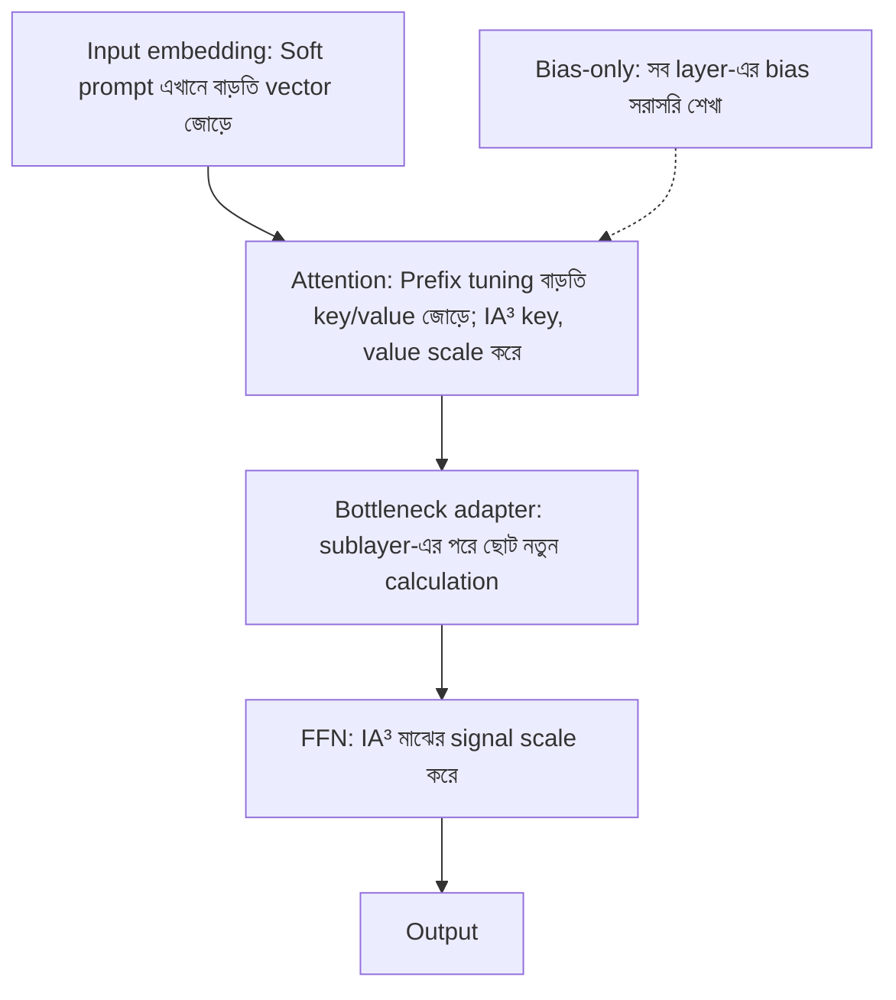

# Lecture 13 — LoRA ছাড়া অন্য PEFT: কোথায় বসে, merge হয় কি না

> আগে যা জানা থাকলে ভালো: [Lecture 02 — PEFT-এর শাখার তালিকা](lecture-02-finetuning-methods-map.md) এবং [Lecture 04 — `W + ΔW` merge](lecture-04-lora-matrix-pairs-and-effective-weights.md)। এই lecture শেষে পারবে: পাঁচটা PEFT পদ্ধতি model-এর কোথায় বসে তা বলতে, আর কোনটা `W`-তে merge করা যায় তা কারণসহ বলতে।

## সমস্যাটা কী?

LoRA merge করা সহজ: পরিবর্তনটা `ΔW` নামের একটা matrix, মূল `W`-র সঙ্গে যোগ করলেই একটা সাধারণ matrix হয়ে যায়। তাই অনেকে ধরে নেয় সব PEFT এভাবে চলে। চলে না। কিছু পদ্ধতি model-এর ভেতরে নতুন calculation বসায়, কিছু input-এর সঙ্গে বাড়তি সংখ্যা জোড়ে, আর কিছু কোনো matrix বদলায়ই না। Deploy করার সময় এই পার্থক্য কাজে লাগে: merge করা যায় কি না তা ঠিক করে inference-এ বাড়তি খরচ থাকবে কি না, আর একটা base-এ অনেক task-এর adapter রাখা যাবে কি না।

## ধারণাটা সহজ ভাষায়

কোন পদ্ধতি model-এর কোথায় বসে, আগে সেটা দেখো:



(LoRA বসে attention ও FFN-এর linear weight-এর পাশে, `ΔW` হিসেবে।)

### ছোট পরিচয়

**Bottleneck adapter** (Houlsby ও অন্যান্য, 2019): sublayer-এর output `h`-কে ছোট করে `r` সংখ্যায় নামায়, একটা activation বসায়, আবার `d` সংখ্যায় ওঠায়, আর মূল `h`-এর সঙ্গে যোগ করে: `h' = h + Up(act(Down(h)))`। Paper-এর পরীক্ষায় BERT-এ প্রতি task-এ মাত্র 3.6% বাড়তি parameter-এ full fine-tuning-এর 0.4%-এর মধ্যে ফল এসেছিল।

**Soft prompt (prompt tuning)** (Lester ও অন্যান্য, 2021): input-এর শুরুতে `k`টা trainable vector (প্রতিটা `d` মাপের) জোড়া হয়। Model-এর কোনো weight বদলায় না। Paper-এ দেখা গেছে model যত বড়, এই পদ্ধতি full tuning-এর তত কাছাকাছি।

**Prefix tuning** (Li ও Liang, 2021): soft prompt-এর মতোই বাড়তি trainable vector, কিন্তু শুধু input-এ নয়, প্রতিটা layer-এর attention-এ বাড়তি key ও value হিসেবে। (Key/value-র পূর্ণ ব্যাখ্যা Module 12-তে; এখানে "প্রতি layer-এ বাড়তি প্রসঙ্গ-vector" বুঝলেই চলবে।)

**IA³** (Liu ও অন্যান্য, 2022): ছোট scaling vector `l` শেখা হয়, যা attention-এর key ও value আর FFN-এর মাঝের signal-কে সংখ্যা ধরে ধরে গুণ করে (`l ⊙ output`)। শুরুতে `l`-এর সব মান 1, তাই শুরুতে model অপরিবর্তিত।

**Bias-only (BitFit)** (Ben Zaken ও অন্যান্য, 2021): শুধু bias-এর মান শেখা, বাকি সব frozen। নতুন parameter যোগ হয় না। সাবধান: কিছু আধুনিক LLM-এর linear layer-এ bias নেই; তখন শেখার মতো কিছুই থাকে না। Model ধরে দেখতে হয়।

### কেন সব PEFT merge হয় না

Merge মানে adapter-এর কাজটা মূল `W`-র ভেতরেই ঢুকিয়ে ফেলা, যাতে আলাদা branch না থাকে। এটা সম্ভব তখনই, যখন adapter-এর প্রভাবটা একই input থেকে একই output-এ যাওয়া **linear** কাজ। পাঁচটার অবস্থা:

| পদ্ধতি | Merge? | কারণ |
|---|---|---|
| LoRA, rsLoRA, AdaLoRA | হ্যাঁ, `W + ΔW` | পরিবর্তনটাও একটা matrix |
| DoRA | হ্যাঁ, নতুন `W'` তৈরি করে | শেষে একটা সাধারণ matrix পাওয়া যায়; যোগ নয়, পুনর্গঠন |
| IA³ | হ্যাঁ, কিন্তু **গুণ দিয়ে** | scale-এর মানে `W`-র row (বা পরের layer-এর column) গুণ করা; যোগ নয় |
| Bias-only | আলাদা merge লাগে না | bias নিজেই model-এর অংশ, জায়গায় বদলেছে |
| Bottleneck adapter | সাধারণত না | মাঝে activation আছে, পুরো কাজ linear নয় |
| Soft prompt, prefix tuning | না | কোনো weight বদলায়নি; বাড়তি vector input/attention-এ জোড়া |

কোন library merge সমর্থন করে সেটা আলাদা প্রশ্ন; এই lecture-এ সেটা যাচাই করা হয়নি।

## ছোট একটা উদাহরণ

**IA³ গুণ দিয়ে merge:** `W = [[1,2],[3,4]]`, `x = [1,1]`, scale `l = [2, 0.5]`।

```text
Wx = [3, 7]
l ⊙ Wx = [6, 3.5]
W' = প্রতিটা row-কে l দিয়ে গুণ = [[2,4],[1.5,2]]
W'x = [2+4, 1.5+2] = [6, 3.5]   ← একই
```

এখানে `W'` তৈরি হয়েছে `W`-র সঙ্গে scale গুণ করে, যোগ করে নয়। তাই IA³-র merge হলো গুণের merge; LoRA-র `W + ΔW` সূত্র এখানে খাটে না।

**Bottleneck adapter কেন merge হয় না:** ছোট adapter: `z = ReLU(h₀ − h₁)`, output `[h₀ + 2z, h₁ − z]`। দুটো input `a = [3,1]`, `b = [1,3]`:

```text
f(a) = z=2 → [7, -1]
f(b) = z=0 → [1, 3]
f(a) + f(b) = [8, 2]
f(a + b) = f([4,4]) = z=0 → [4, 4]
```

`f(a) + f(b) ≠ f(a+b)`। যেকোনো matrix `M`-এর জন্য `M(a+b) = Ma + Mb` সত্যি। তাই এই adapter-এর কাজ কোনো একক matrix `W'` দিয়ে সব input-এর জন্য নকল করা যায় না।

## Parameter সংখ্যা: এক তুলনা

কাল্পনিক model: hidden `d = 4096`, FFN-এর মাপ 16384, 32 layer; rank বা bottleneck `r = 8`, prompt/prefix দৈর্ঘ্য `k = 20`। LoRA শুধু `q`, `v` ধরা; adapter প্রতি layer-এ একটা (bias ছাড়া); IA³-এ key, value ও FFN।

```python
# ১) কাল্পনিক model: hidden d=4096, FFN 16384, 32 layer; rank/bottleneck r=8, prompt/prefix দৈর্ঘ্য k=20
d, d_ff, L, r, k = 4096, 16384, 32, 8, 20
counts = {
    "LoRA (q,v)":              L * 2 * r * (d + d),
    "Bottleneck adapter":      L * (d * r + r * d),     # নামানো + ওঠানো, bias ছাড়া, layer-প্রতি ১টা
    "Soft prompt":             k * d,
    "Prefix tuning":           L * 2 * k * d,           # প্রতি layer-এ key ও value
    "IA3 (K, V, FFN)":         L * (d + d + d_ff),
}
for name, c in counts.items():
    print(f"{name:20s} {c:>10,}")

# ২) IA3-ধাঁচ scale: output-কে l দিয়ে গুণ = W-র row-কে l দিয়ে গুণ
W, x, l = [[1, 2], [3, 4]], [1, 1], [2, 0.5]
mul = lambda M, v: [sum(a * b for a, b in zip(row, v)) for row in M]
print("scaled output:", [li * y for li, y in zip(l, mul(W, x))])
W2 = [[li * w for w in row] for li, row in zip(l, W)]
print("folded W':", W2, " W'x:", mul(W2, x))

# ৩) Bottleneck adapter: h + up(relu(down(h))); linear হলে f(a+b) == f(a)+f(b) হতো
def adapter(h):
    z = max(0, h[0] - h[1])                # down (d=2 -> 1) + ReLU
    return [h[0] + 2 * z, h[1] - 1 * z]    # up (1 -> 2) + residual
a, b = [3, 1], [1, 3]
print("f(a)+f(b) =", [p + q for p, q in zip(adapter(a), adapter(b))],
      " f(a+b) =", adapter([4, 4]))
# output:
# LoRA (q,v)            4,194,304
# Bottleneck adapter    2,097,152
# Soft prompt              81,920
# Prefix tuning         5,242,880
# IA3 (K, V, FFN)         786,432
# scaled output: [6, 3.5]
# folded W': [[2, 4], [1.5, 2.0]]  W'x: [6, 3.5]
# f(a)+f(b) = [8, 2]  f(a+b) = [4, 4]
```

লক্ষ্য করো: soft prompt সবচেয়ে ছোট, prefix tuning তার 64 গুণ। Trainable সংখ্যা কম হলে ভালো, এমন নয়; সব পদ্ধতির ফল ও খরচ নিজের task-এ মাপতে হয় ([Lecture 14](lecture-14-controlled-comparison.md))। সংখ্যাগুলো এই কল্পিত গঠনের হিসাব, কোনো আসল model-এর নয়; Prefix tuning-এর মূল paper আরও একটা reparameterization ব্যবহার করে, এখানে ধরা হয়নি।

## মনে রাখার সারকথা

- PEFT-এর পদ্ধতিগুলো model-এর আলাদা আলাদা জায়গায় বসে: weight-এর পাশে (LoRA), sublayer-এর পরে (adapter), input বা attention-এ বাড়তি vector (soft prompt, prefix), signal-এর গুণক (IA³), বা bias-এ।
- Merge সম্ভব তখনই, যখন প্রভাবটা linear। LoRA যোগে, IA³ গুণে merge হয়; nonlinear adapter ও বাড়তি-vector পদ্ধতি হয় না।
- Merge না হলে inference-এ বাড়তি branch বা বাড়তি sequence দৈর্ঘ্য থাকে। Deploy করার আগে এটা বিবেচনায় রাখো।

## নিজে করো

১. Soft prompt: `k = 50`, `d = 2048`। Trainable parameter কত?
২. IA³: `W = [[2,0],[1,1]]`, `l = [3, 2]`। Merge করা `W'` কত?
৩. Bottleneck adapter: `d = 1024`, `r = 16`, bias ছাড়া। Parameter কত?
৪. Soft prompt কেন `W + ΔW`-তে merge করা যায় না?

<details><summary>উত্তর</summary>

১. `50 × 2048 = 102,400`।
২. প্রতিটা row-কে তার `l` দিয়ে গুণ: `[[6,0],[2,2]]`।
৩. নামানো `1024 × 16` আর ওঠানো `16 × 1024`: `2 × 16,384 = 32,768`।
৪. এটা কোনো weight বদলায় না; input-এর সঙ্গে বাড়তি vector জোড়ে। তাই বদলানোর মতো কোনো `ΔW` নেই।

</details>

## পরের পাঠ

Full, LoRA, QLoRA (এবং এই variant-গুলো) সব মিলিয়ে কোনটা ভালো, তা ন্যায্যভাবে কীভাবে তুলনা করবে: [Lecture 14 — Controlled comparison](lecture-14-controlled-comparison.md)।

**References:** [Adapter (Houlsby)](https://arxiv.org/abs/1902.00751), [Prompt tuning](https://arxiv.org/abs/2104.08691), [Prefix tuning](https://arxiv.org/abs/2101.00190), [IA³](https://arxiv.org/abs/2205.05638), [BitFit](https://arxiv.org/abs/2106.10199)।
