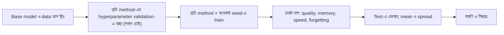

# Lecture 14 — Full, LoRA ও QLoRA-র ন্যায্য তুলনা

> আগে যা জানা থাকলে ভালো: [Lecture 02 — fine-tuning-এর পদ্ধতির তালিকা](lecture-02-finetuning-methods-map.md), [Lecture 10 — QLoRA-তে storage বনাম compute](lecture-10-precision-nf4-and-qlora-practice.md) এবং [train/validation/test ভাগ](../module-05-data-preparation-and-splits/lecture-03-train-validation-test-split.md)। এই lecture শেষে পারবে: একটা তুলনা-সারণি নকশা করতে, আর বলতে কোন ভুলে তুলনা অন্যায্য হয়ে যায়।

## সমস্যাটা কী?

একজন বলল, "LoRA প্রায় full fine-tuning-এর সমান, আর QLoRA-তে memory চার ভাগের এক ভাগ।" কিন্তু তিনটা run-এর learning rate আলাদা ছিল, data-র ক্রম আলাদা ছিল, আর প্রতিটা একবারই চালানো হয়েছে। এই ফল দেখে সিদ্ধান্ত নিলে ভুল পথে খরচ হয়। কোন পদ্ধতি তোমার কাজে সত্যিই ভালো, জানতে হলে তুলনা এমনভাবে সাজাতে হবে যাতে একটাই জিনিস বদলায়: পদ্ধতি।

## ধারণাটা সহজ ভাষায়



### কী স্থির থাকবে, কী বদলাবে

| স্থির | বদলায় |
|---|---|
| একই base checkpoint | Trainable অংশ: সব / LoRA / 4-bit base + LoRA |
| একই train, validation, test ভাগ ([leakage](../module-05-data-preparation-and-splits/lecture-04-data-leakage.md) ছাড়া) | Method-এর নিজস্ব setting: rank, `α`, learning rate |
| একই prompt format ও tokenizer | |
| একই মোট কতগুলো উদাহরণ দেখা হলো, একই effective batch size | |
| একই metric ও একই output বের করার নিয়ম (যেমন decoding) | |

Method-এর নিজস্ব setting স্থির রাখা মানে সব method-এ একই learning rate নয়। সাধারণত LoRA-র জন্য full fine-tuning-এর চেয়ে আলাদা (প্রায়ই বড়) learning rate লাগে; এটা সাধারণ অভিজ্ঞতা, কোনো নিশ্চিত নিয়ম নয়। তাই প্রতিটা method নিজের learning rate validation set-এ খুঁজবে, **সমান সংখ্যক চেষ্টায়**।

### চারটা মাপ এবং কীভাবে মাপবে

**১. Quality।** Held-out test set-এ তোমার task-এর metric। একটা মাত্র run নয়; কয়েকটা seed (random শুরুর মান ও data-র ক্রম) চালিয়ে গড় ও ছড়ানো (spread)।

**২. Memory।** প্রথমে একটা অনুমান করা যায়, তারপর অবশ্যই মাপতে হয়। প্রতি parameter-এর খরচ: weight, gradient ও optimizer state। Adam-এ দুটো state। একটা সাধারণ setup-এ weight bf16 (2 byte) + gradient bf16 (2) + Adam-এর দুই state fp32 (8) = প্রতি trainable parameter-এ 12 byte। Activation ও framework-এর বাড়তি memory এই অনুমানে নেই; setup ভেদে হিসাবও আলাদা হয়। তাই আসল মাপ হলো training চলাকালে সর্বোচ্চ GPU memory (peak), একই batch size, sequence length ও gradient checkpointing সেটিংয়ে।

**৩. Speed।** প্রতি সেকেন্ডে কত token বা প্রতি step-এ কত সময়। শুরুর কয়েক step বাদ দাও। একই hardware-এ মাপো। আরেকটা মাপ: নির্দিষ্ট quality-তে পৌঁছাতে মোট সময়। QLoRA-তে dequantize-এর বাড়তি কাজ আছে ([Lecture 10](lecture-10-precision-nf4-and-qlora-practice.md)), তাই সাধারণত bf16 LoRA-র চেয়ে ধীর হতে পারে; তোমার setup-এ মেপে নাও।

**৪. Forgetting।** নতুন task শেখানোর পর আগের ক্ষমতা কতটা নষ্ট হলো। Fine-tuning-এর আগে ও পরে একটা পুরোনো-ক্ষমতার set-এ (যেমন সাধারণ প্রশ্নোত্তর বা আগের ভাষা) score মাপো; পার্থক্যই forgetting। Biderman ও অন্যান্য (2024) "LoRA Learns Less and Forgets Less" paper-এ তাদের setup-এ দেখেছেন LoRA নতুন domain-এ full fine-tuning-এর চেয়ে কম শেখে কিন্তু পুরোনো ক্ষমতা বেশি ধরে রাখে। এটা একটা অনুমান যা পরীক্ষা করার, সব task-এর নিয়ম নয়। বিস্তারিত: [Module 15-এর forgetting ও evaluation](../module-15-domain-and-task-adaptation/lecture-07-forgetting-and-evaluation.md)।

### তুলনা-সারণির নকশা

প্রতি method-এর জন্য একটা সারি; `—` ঘরগুলো তোমাকে মেপে ভরতে হবে:

| Method | Trainable parameter | Memory অনুমান | Peak memory (মাপা) | Speed (token/s) | নতুন task-এর test (গড় ± std) | পুরোনো ক্ষমতা: আগে → পরে |
|---|---|---|---|---|---|---|
| Full | সব | 84 GB | — | — | — | — |
| LoRA | LoRA-র A, B | 14.1 GB | — | — | — | — |
| QLoRA | LoRA-র A, B | 3.7 GB | — | — | — | — |

Memory অনুমানের ঘর ৭ বিলিয়ন weight ধরে হিসাব করা, নিচের code-এর ফল। শুধু ঘর ভরলেই হবে না; প্রতিটা ঘরের পাশে কোন seed, কোন config, কোন commit-এর run তাও লিখে রাখো।

## ছোট একটা উদাহরণ

নিচে কাল্পনিক ফল: তিন method, প্রতিটায় তিন seed, test accuracy (%)। সঙ্গে memory-র অনুমান।

```python
from statistics import mean, stdev

# ১) Seed-এর শব্দ: কাল্পনিক test accuracy (%), প্রতি method-এ ৩টা seed
runs = {"Full": [81.2, 80.5, 81.9], "LoRA": [80.1, 80.9, 79.6], "QLoRA": [79.8, 80.4, 79.1]}
for k, v in runs.items():
    print(f"{k:6s} mean {mean(v):.2f}  std {stdev(v):.2f}  range {min(v)}–{max(v)}")
print("Full - LoRA  =", round(mean(runs["Full"]) - mean(runs["LoRA"]), 2))
print("LoRA - QLoRA =", round(mean(runs["LoRA"]) - mean(runs["QLoRA"]), 2))

# ২) Memory-র মোটামুটি অনুমান (শুধু weight + gradient + optimizer; activation ছাড়া)
n, GB = 7e9, 1e9
adapter = 4_194_304                      # Lecture 13-এর কাল্পনিক LoRA (q,v, r=8)
per_param_train = 2 + 2 + 8              # weight bf16 + grad bf16 + Adam-এর দুই state (fp32)
est = {
    "Full":  n * per_param_train,
    "LoRA":  n * 2 + adapter * per_param_train,
    "QLoRA": n * (4 + 8 / 64 + 32 / (64 * 256)) / 8 + adapter * per_param_train,
}
for k, b in est.items():
    print(f"{k:6s} অনুমান {b / GB:5.1f} GB")
# output:
# Full   mean 81.20  std 0.70  range 80.5–81.9
# LoRA   mean 80.20  std 0.66  range 79.6–80.9
# QLoRA  mean 79.77  std 0.65  range 79.1–80.4
# Full - LoRA  = 1.0
# LoRA - QLoRA = 0.43
# Full   অনুমান  84.0 GB
# LoRA   অনুমান  14.1 GB
# QLoRA  অনুমান   3.7 GB
```

ফল পড়ার উপায়:

- **LoRA বনাম QLoRA:** গড়ের পার্থক্য 0.43, কিন্তু প্রতিটার std প্রায় 0.65। পার্থক্যটা seed-এর ওঠানামার চেয়ে ছোট; দুটোর মধ্যে কোনটা ভালো, বলা যায় না। দাম বিবেচনায় memory-র পার্থক্য (14.1 বনাম 3.7 GB) বেশি অর্থবহ।
- **Full বনাম LoRA:** পার্থক্য 1.0, std-র দেড় গুণের মতো, আর range-ও আংশিক মিলে যাচ্ছে (80.5–80.9)। তিন seed-এ এটা জোরালো প্রমাণ নয়; আরও seed লাগবে।
- **Memory:** অনুমান বলছে full-এ প্রায় 84 GB, LoRA-তে 14.1 GB, QLoRA-তে 3.7 GB। এটা অনুমান; activation ও overhead যোগ হলে বাড়বে। সিদ্ধান্তের আগে peak মাপো।

## ঝুঁকির তালিকা: তুলনা যেভাবে ভুল হয়

1. **অসম tuning:** একটা method-এর learning rate যত্ন করে বাছা, অন্যটার ডিফল্ট। তাহলে পার্থক্য method-এর নয়, tuning-এর।
2. **Test set দিয়ে বাছা:** Learning rate বা checkpoint test score দেখে বাছলে test আর নিরপেক্ষ থাকে না। বাছা হবে validation-এ, test শেষে একবার।
3. **এক seed:** একটা run-এর পার্থক্য seed-এর ওঠানামাও হতে পারে (উপরের উদাহরণ)।
4. **ভিন্ন data exposure:** একটা method-কে বেশি step বা বড় effective batch দেওয়া। সমান সংখ্যক উদাহরণ দেখানো হচ্ছে কি না মিলিয়ে নাও।
5. **Memory মাপে ভিন্ন setup:** আলাদা batch size, sequence length বা gradient checkpointing। তুলনার আগে এগুলো স্থির করো।
6. **Forgetting না মাপা:** শুধু নতুন task-এ ভালো দেখলে full fine-tuning জিতে যায়; পুরোনো ক্ষমতার ক্ষতি চোখে পড়ে না।
7. **QLoRA-র মূল্যায়ন কোন রূপে:** 4-bit base + adapter আলাদা চালানো এবং adapter merge করা model-এর ফল এক নাও হতে পারে (4-bit base-এ merge করলে আবার rounding আসার কথা; এখানে যাচাই করা হয়নি)। যে রূপে deploy করবে, সেই রূপই মাপো।
8. **সেরা run বাছা:** অনেক run-এর সেরাটা দেখালে ফল ফুলে ওঠে। সব run-এর গড় ও spread দেখাও।

## মনে রাখার সারকথা

- ন্যায্য তুলনায় শুধু পদ্ধতি বদলায়; base, data ভাগ, দেখা উদাহরণের সংখ্যা ও metric স্থির, আর প্রতি method সমান চেষ্টায় নিজের hyperparameter বাছে।
- চারটা মাপ আলাদা: quality, memory, speed, forgetting। Memory অনুমান করা যায়, কিন্তু সিদ্ধান্তের আগে peak মাপতে হয়।
- পার্থক্য seed-এর ছড়ানোর (std) চেয়ে ছোট হলে "কোনটা ভালো" বলা যায় না।

## নিজে করো

১. তিন seed-এ একটা method-এর ফল 78, 79, 80। গড় ও std কত? আরেকটা method-এর গড় 79.5, std 1 হলে কি বলা যায় কোনটা ভালো?
২. 3 বিলিয়ন weight, উপরের 12 byte/parameter হিসাবে full fine-tuning-এর weight + gradient + optimizer memory কত GB?
৩. কেউ learning rate বেছে নিয়েছে test accuracy দেখে। সমস্যা কী?
৪. একটা তুলনায় full fine-tuning-কে 3 epoch, LoRA-কে 1 epoch দেওয়া হলো। কোন স্থির জিনিস ভাঙল?

<details><summary>উত্তর</summary>

১. গড় 79, std 1.0। অন্য method-এর গড় 79.5; পার্থক্য 0.5, std 1-এর অর্ধেক। তিন seed-এ কোনটা ভালো বলা যায় না।
২. `3e9 × 12 byte = 36 GB`।
৩. Test set-এর তথ্য দিয়ে সিদ্ধান্ত নেওয়ায় test আর নিরপেক্ষ থাকেনি (leakage)। Learning rate validation set-এ বাছতে হবে।
৪. সমান সংখ্যক উদাহরণ দেখার শর্ত ভেঙেছে। Method-এর পার্থক্য আর বেশি training-এর প্রভাব আলাদা করা যাচ্ছে না।

</details>

## পরের পাঠ

Module 13-এর তালিকা এখানে শেষ। এই তুলনার ধাঁচ কাজে লাগবে [Module 15-এর adaptation experiment](../module-15-domain-and-task-adaptation/lecture-08-adaptation-experiment.md)-এ, আর OCR case study-র [CER/WER ও version তুলনায়](../module-14-ocr-system-case-study/lecture-08-cer-wer-and-version-comparison.md)।

**References:** [LoRA Learns Less and Forgets Less](https://arxiv.org/abs/2405.09673), [QLoRA](https://arxiv.org/abs/2305.14314)।
