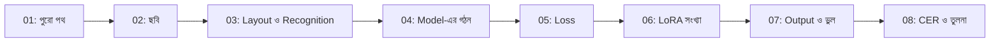

# Module 14 — বাস্তব OCR System: ধারণা থেকে Code

[কেন্দ্রীয় Model ও Math Map](../01-learning-map.md) · [Course Outline](../00-course-outline.md) · [লেখার নিয়ম](../00-writing-style-guide.md)

## Status: লেখা প্রস্তুত; শেখা নয়

আটটা lecture লেখা হয়েছে। এগুলো পড়া, হাতে হিসাব মেলানো আর অনুশীলন করা সম্পন্ন ধরা হয়নি। প্রতিটা lecture-এ ধারণা আগে, তারপর বাস্তব project `ocr-benchmark`-এর docs ও code। সব তথ্য ওই project থেকে শুধু পড়ে নেওয়া (কিছু বদলানো বা training চালানো হয়নি)। Project-এর অবস্থা ২০২৬-০৯-২৯-এর docs ও তার পরের code অনুযায়ী: production model v19, engine vLLM।

নতুন শব্দের তালিকা মুখস্থ করা এই module-এর উদ্দেশ্য নয়। উদ্দেশ্য: আগের module-এর ধারণা বাস্তব system-এ কোথায় আছে দেখা।

## আগে যা দরকার

- [Module 09](../module-09-model-architecture/README.md): architecture, parameter ও count
- [Module 10](../module-10-neural-network-training/README.md): loss, optimizer, batch/step/epoch
- [Module 11](../module-11-image-representation-and-vision/README.md): ছবি, patch, encoder, resize
- [Module 12](../module-12-text-sequences-and-multimodal-models/README.md): token, লেখা তৈরি, image + text
- [Module 13](../module-13-pretraining-finetuning-and-lora/README.md): fine-tuning, LoRA
- Lecture 08-এর জন্য [Module 05](../module-05-data-preparation-and-splits/README.md) ও [Module 06](../module-06-model-evaluation-and-baselines/README.md)-এর split, leakage ও metric

## Lecture-এর তালিকা

| # | Lecture | এক লাইনে |
|---|---|---|
| 01 | [OCR Project: কোন অংশ কী কাজ করে](lecture-01-ocr-project-architecture-and-lora.md) | Pipeline-এর পাঁচ ধাপ; কোন অংশ neural model, কোনটা code, কোনটা শেখানো হয় |
| 02 | [ছবি Pipeline-এ ঢোকে](lecture-02-image-enters-the-pipeline.md) | পাতা পরিষ্কার, resize, patch; image token গোনা |
| 03 | [Layout ও Recognition](lecture-03-layout-vs-recognition.md) | "কোথায় কী" আর "কী লেখা" আলাদা কাজ; code-এর সিদ্ধান্ত |
| 04 | [Recognition-এ Encoder ও Decoder](lecture-04-encoder-decoder-in-recognition.md) | Vision encoder → image token → language decoder; token গোনা |
| 05 | [Training উদাহরণ ও Loss](lecture-05-training-example-and-loss.md) | একটা training row; কোন token-এ loss; label smoothing; step গোনা |
| 06 | [LoRA Config ও Parameter Count](lecture-06-lora-config-and-parameter-count.md) | `r × (d_in + d_out)` দিয়ে 190,382,080 মেলানো; version-এর সংখ্যা |
| 07 | [Output Formatting ও Error-এর উৎস](lecture-07-output-formatting-and-error-sources.md) | Final লেখায় ভুল কোন ধাপ থেকে আসে |
| 08 | [CER, WER ও Version তুলনা](lecture-08-cer-wer-and-version-comparison.md) | হাতে CER/WER; ন্যায্য তুলনার শর্ত |

## কোন ক্রমে পড়বে

01 থেকে 08, ক্রমানুসারে। প্রতিটা lecture ছোট, এক ধারণা, এক উদাহরণ। কোনো lecture কঠিন লাগলে তার শুরুর "আগে যা জানা থাকলে ভালো" লাইনের lecture-এ ফিরে যাও, তারপর আবার এসো। Lecture 01 পুরো পথের মানচিত্র; 02 থেকে 08 তার এক একটা অংশ।

## উৎসের সীমা

- এখানে যা আছে তার মধ্যে project-এর docs, code, adapter ও base model file-এর header থেকে নিজে মিলিয়ে নেওয়া সংখ্যা এবং docs-এ লেখা কিন্তু আমি আবার না চালানো দাবি আছে। প্রতিটা lecture-এর শুরুতে উৎস-ফাইল লেখা আছে, আর যেখানে যাচাই করা হয়নি সেখানে সেটা বলা আছে।
- Project এখনো চলমান: v20 ও "As-Sunnah OCR 1" নামে নতুন কাজ শুরু হয়েছে। এই module সেগুলোকে ধরে না।
