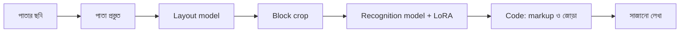

# Lecture 01 — OCR Project: কোন অংশ কী কাজ করে

> আগে যা জানা থাকলে ভালো: [Training ও fine-tuning](../module-13-pretraining-finetuning-and-lora/lecture-01-training-and-finetuning.md) এবং [Fine-tuning পদ্ধতির map](../module-13-pretraining-finetuning-and-lora/lecture-02-finetuning-methods-map.md)। এই lecture শেষে পারবে: ছবি থেকে লেখা বের হওয়ার পথটা পাঁচ ধাপে বলতে, আর বলতে কোন অংশ neural model, কোন অংশ সাধারণ code এবং কোন অংশটা শেখানো হয়।
> তথ্যের উৎস: `ocr-benchmark/README.md`, `ocr-benchmark/docs/HISTORY_bn.md` (১ ও ২ নং অংশ), `ocr-benchmark/surya_finetune/block_pipeline.py`, `ocr-benchmark/surya_finetune/vllm_inference_service.py`, `ocr-benchmark/surya_finetune/train_lora.py`, `ocr-benchmark/as_sunnah_ocr_1/docs/MODEL_ARCHITECTURE.md`। সংখ্যাগুলো `lora_out_v19/final_lora_adapter` আর base model file-এর header গুনে মিলিয়ে নিয়েছি।

## সমস্যাটা কী?

ধরো ফোনে তোলা খাতার একটা পাতা থেকে বাংলা লেখা বের করতে হবে। সহজ ভাবনা হলো: একটা বড় model, ছবি ঢুকবে, লেখা বেরোবে। বাস্তবে এভাবে হয় না। পাতায় শিরোনাম থাকে, অনুচ্ছেদ থাকে, ছবি থাকে, ফাঁকা জায়গাও থাকে। তাই কাজটা কয়েকটা ছোট কাজে ভাগ হয়।

এই ভাগ জানা দরকার, কারণ final লেখায় ভুল পেলে প্রশ্ন ওঠে: ভুলটা কোথায়? Model-এ, ছবি তৈরিতে, নাকি লেখা জোড়ার code-এ? অংশগুলো না চিনলে ভুল জায়গায় সময় যায়। যেমন code-এর ভুল সারাতে model আবার train করা বৃথা।

## ধারণাটা সহজ ভাষায়

**OCR** মানে ছবিতে থাকা লেখাকে text-এ বদলানো। এই project বাংলা (সঙ্গে ইংরেজি ও আরবি) ছাপা আর হাতের লেখার পাতা পড়ে। লক্ষ্যে গণিত আর table থাকলেও এদের জন্য আলাদা ব্যবস্থা code-এ এখনো বসেনি (`block_pipeline.py`-র মন্তব্যে "deferred" লেখা)।

এখানকার সব তথ্য ২০২৬-০৯-২৯-এর docs ও তার পরের code থেকে। তখন production model **v19**, আর model চালানোর engine **vLLM**।



ধাপগুলো:

1. **পাতা প্রস্তুত:** পাতা কেটে সোজা করা, ছায়া কমানো, contrast ঠিক করা ([Lecture 02](lecture-02-image-enters-the-pipeline.md))।
2. **Layout model:** পাতার কোথায় কী ধরনের অংশ (শিরোনাম, অনুচ্ছেদ, ছবি) তা বলে। এটা আলাদা ছোট model ([Lecture 03](lecture-03-layout-vs-recognition.md))।
3. **Block crop:** প্রতিটা অংশ কেটে নেওয়া। ছবি বা ফাঁকা অংশ বাদ। এটা সাধারণ code।
4. **Recognition model:** প্রতিটা crop-এ কী লেখা আছে পড়ে। এটাই আমরা fine-tune করি ([Lecture 04](lecture-04-encoder-decoder-in-recognition.md) থেকে [06](lecture-06-lora-config-and-parameter-count.md))।
5. **Code দিয়ে জোড়া:** শিরোনামের আগে `##` বসানো, অংশগুলো জুড়ে final লেখা ([Lecture 07](lecture-07-output-formatting-and-error-sources.md))। Production-এ এর সঙ্গে পুরো পাতা একবারে পড়ার একটা ফলও মেশানো হয়; একে বলে **merged** output।

**Recognition model কী:** base হলো `datalab-to/surya-ocr-2`, একটা **vision-language model**। অর্থাৎ সে ছবি আর লেখার নির্দেশ (prompt) নিয়ে লেখা তৈরি করে। তার মোট parameter 665,701,440 (প্রায় ৬৬.৫৭ কোটি): ছবি বোঝার অংশে প্রায় ১০.০৬ কোটি, লেখা তৈরির অংশে প্রায় ৫৬.৫১ কোটি।

**কোন অংশটা শেখানো হয়:** শুধু recognition model। তার মূল weight-গুলো **frozen** থাকে, মানে optimizer সেগুলো বদলায় না। বদলে মূল matrix-এর পাশে **LoRA** নামের ছোট adapter matrix বসানো হয়, আর শুধু সেগুলোর মান শেখানো হয়। শেখার data হলো "ছবি আর তার সঠিক লেখা", তাই একে বলে **SFT** (supervised fine-tuning)। সব মিলিয়ে এটা **LoRA + SFT**।

| অংশ | কী | শেখানো হয়? |
|---|---|---|
| পাতা প্রস্তুত | নিয়মভিত্তিক code | না |
| Layout model | আলাদা object detector | না (project কখনো train করেনি) |
| Block বাছাই, ফাঁকা বাদ | সাধারণ code | না |
| Recognition-এর মূল weight | Surya OCR 2 | না (frozen) |
| LoRA adapter | নতুন ছোট matrix | **হ্যাঁ** |
| Markup, জোড়া | সাধারণ code | না |

সাবধান: `ocr-benchmark/docs/ARCHITECTURE.md` এই pipeline-এর নয়। ওটা প্রথম দিকের Docling/doctr benchmark app-এর বিবরণ।

## ছোট একটা হিসাব

Adapter যোগ করলে মোট parameter কত হয়, আর তার কতটা শেখানো হয়?

```python
base = 665_701_440        # মূল model, frozen
trainable = 190_382_080   # v19-এর LoRA adapter
print(base + trainable, round(trainable / (base + trainable) * 100, 2))
# output:
# 856083520 22.24
```

মোট 856,083,520। তার 22.24% শেখানো হয়, বাকিটা স্থির। HISTORY-র সারসংক্ষেপ table-এও এই দুটো সংখ্যা আছে। Adapter কীভাবে গোনা হয়, সেটা [Lecture 06](lecture-06-lora-config-and-parameter-count.md)-এ।

আরও একটা কথা: সব layer-এ LoRA আছে মানে full fine-tuning নয়। v19-এর adapter file-এ ভাষা-অংশের ২৪টা layer আর ছবি-অংশের ১২টা block, সবখানেই LoRA আছে। তবু মূল weight একটাও বদলায় না। এর ভিত্তি `train_lora.py`-র নিয়ম: adapter বসানোর পর মূল weight unfreeze করার কোনো নির্দেশ নেই, আর model `bfloat16`-এ load হয়, 4-bit quantization ছাড়া। তাই এটা QLoRA-ও নয়।

## আগের পাঠের ধারণা এখানে কোথায়

| ধারণা | আগের পাঠ | এই project-এ |
|---|---|---|
| Input → computation → output | [Module 09, Lecture 01](../module-09-model-architecture/lecture-01-input-computation-output.md) | ছবি ও prompt ঢোকে, লেখা বেরোয় |
| Parameter ও hyperparameter | [Module 09, Lecture 02](../module-09-model-architecture/lecture-02-parameters-and-hyperparameters.md) | LoRA matrix-এর মান parameter; rank, learning rate hyperparameter |
| Architecture বনাম training | [Module 09, Lecture 08](../module-09-model-architecture/lecture-08-architecture-vs-training.md) | Model-এর গঠন আলাদা, LoRA-র শেখা আলাদা |
| ছবি থেকে representation | [Module 11, Lecture 06](../module-11-image-representation-and-vision/lecture-06-encoder.md) | Vision encoder |
| Token ও লেখা তৈরি | [Module 12, Lecture 07](../module-12-text-sequences-and-multimodal-models/lecture-07-autoregressive-decoder-and-stopping.md) | Decoder অক্ষর অক্ষর করে লেখে |
| Fine-tuning ও LoRA | [Module 13, Lecture 04](../module-13-pretraining-finetuning-and-lora/lecture-04-lora-matrix-pairs-and-effective-weights.md) | Frozen W-র পাশে trainable A ও B |

## মনে রাখার সারকথা

- OCR system একটা model নয়; কয়েকটা ধাপের pipeline, যার কিছু neural model আর কিছু সাধারণ code।
- শেখানো হয় শুধু recognition model-এর ওপর বসানো LoRA adapter; মূল weight, layout model আর বাকি code শেখানো হয় না।
- Base 665,701,440 + adapter 190,382,080 = মোট 856,083,520; তার 22.24% trainable।

## নিজে করো

১. Layout model কি project-এ train করা হয়?
২. Final লেখায় শিরোনামের আগে `##` কে বসায়: recognition model, নাকি সাধারণ code?
৩. কারো কথা: "সব layer-এ LoRA আছে, তাই এটা full fine-tuning।" এটা ঠিক কি না, এক বাক্যে লেখো।

<details><summary>উত্তর</summary>

১. না। Layout model Surya-র আগে শেখানো অবস্থাতেই ব্যবহার হয়, এই project তাকে train করেনি।
২. সাধারণ code। Layout model যে label দেয় (যেমন SectionHeader), তা থেকে code `##` বসায়।
৩. ঠিক নয়। LoRA সব layer-এ আছে, কিন্তু শেখানো হয় শুধু adapter matrix; 665,701,440টা মূল weight অপরিবর্তিত থাকে।

</details>

## পরের পাঠ

পাঁচ ধাপের প্রথমটা: ছবি model-এ ঢোকার আগে কী কী বদলায়। [Lecture 02 — ছবি Pipeline-এ ঢোকে](lecture-02-image-enters-the-pipeline.md)।
