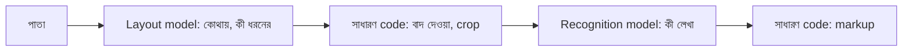

# Lecture 03 — Layout ও Recognition: দুটো আলাদা কাজ

> আগে যা জানা থাকলে ভালো: [Input, computation, output](../module-09-model-architecture/lecture-01-input-computation-output.md) এবং [Architecture design](../module-09-model-architecture/lecture-09-designing-a-model-architecture.md)-এর ধারণা যে একটা কাজ কয়েকটা অংশে ভাগ হতে পারে। এই lecture শেষে পারবে: "কোথায় কী আছে" আর "কী লেখা আছে" আলাদা করতে, আর বলতে কোন সিদ্ধান্ত কোন অংশ নেয়।
> তথ্যের উৎস: `ocr-benchmark/surya_finetune/block_pipeline.py` (`SKIP_LABELS`, `is_blank_crop`, `apply_markup`, `_plan_blocks`), `ocr-benchmark/docs/MODEL_SPEC.md`, `ocr-benchmark/as_sunnah_ocr_1/docs/MODEL_ARCHITECTURE.md` (১৪ নং অংশ), `ocr-benchmark/docs/HISTORY_bn.md` (v14, v15 ও ৩ক অংশ), `ocr-benchmark/plan.md` (২০২৬-১০-১৪ এন্ট্রি)।

## সমস্যাটা কী?

একটা পাতায় শিরোনাম আছে, অনুচ্ছেদ আছে, একটা ছবি আছে, নিচে ফাঁকা জায়গা। এক model-কে দিয়ে সবকিছু করালে সে দুটো আলাদা প্রশ্নের উত্তর একসঙ্গে দেয়: কোথায় কী ধরনের অংশ, আর সেখানে কী লেখা। এতে একটা প্রশ্নের ভুল অন্যটায় ঢুকে যায়।

Project-এ এটা সত্যিই ঘটেছিল। HISTORY অনুযায়ী v14-এ model-কে "গঠন ধরে রেখে লেখো" বলা হয়েছিল। ফলে সাধারণ অনুচ্ছেদেও সে বিনা কারণে `**বোল্ড**` markdown বসাতে শুরু করল। তাই v15 থেকে কাজ ভাগ হলো: গঠন বোঝে একটা আলাদা model, লেখা পড়ে recognition model, আর markup বসায় সাধারণ code।

## ধারণাটা সহজ ভাষায়

**Layout model:** ছবিতে কোথায় কোন ধরনের অংশ আছে খোঁজে। ফল হলো কয়েকটা বাক্স (box), প্রতিটার একটা **label** (Text, SectionHeader, ListGroup, Picture ইত্যাদি) আর পড়ার ক্রম। Project-এ এটা `FastLayoutPredictor`, একটা ছোট object detector (RF-DETR, প্রায় 129 MB, GPU ছাড়াও চলে)। Project একে কখনো train করেনি।

**Recognition model:** একটা অংশ (crop) দেখে শুধু বলে সেখানে কী লেখা। সে label বা markup ঠিক করে না। এটাই LoRA দিয়ে fine-tune করা model।

মাঝখানে কিছু সিদ্ধান্ত নেয় সাধারণ code, কোনো neural model নয়:

| সিদ্ধান্ত | কে নেয় |
|---|---|
| পাতার কোথায় কোন block | Layout model |
| Block-এর label | Layout model |
| Picture/Figure পড়া হবে কি না | সাধারণ code (label দেখে বাদ) |
| Block ফাঁকা কি না | সাধারণ code (কালির পরিমাণ মেপে) |
| Block-এ কী লেখা | Recognition model |
| শিরোনামের আগে `##` | সাধারণ code (label থেকে) |



## ছোট একটা উদাহরণ

পাঁচটা block ধরি। ফাঁকা কি না বোঝার সীমা `block_pipeline.py`-তে `BLANK_INK_DENSITY_THRESHOLD = 0.03`: কালির অংশ (ink fraction) এর চেয়ে কম হলে block ফাঁকা। Code-এ comment আছে, লেখা-থাকা crop মাপে 0.05 থেকে 0.09, ফাঁকা crop 0.001 থেকে 0.017।

```python
SKIP_LABELS = {"Figure", "Picture", "Diagram", "BlankPage"}
BLANK = 0.03

def apply_markup(label, text):
    if not text:
        return None
    if label == "SectionHeader":
        return f"## {text}"
    if label == "ListGroup":
        return "\n".join(f"- {l.strip()}" for l in text.splitlines() if l.strip())
    return text

# layout model-এর ফল (বানানো): label, উপর থেকে দূরত্ব, কালির অংশ, recognition-এর ফল
blocks = [("Text", 300, 0.08, "আমি ভাত খাই।"),
          ("SectionHeader", 100, 0.06, "আমার দিন"),
          ("Picture", 500, 0.20, ""),
          ("Text", 700, 0.01, ""),
          ("ListGroup", 900, 0.07, "চাল\nডাল")]
parts = []
for label, y, ink, text in sorted(blocks, key=lambda b: b[1]):   # উপর থেকে নিচে
    if label in SKIP_LABELS:
        print(y, label, "-> বাদ (label)"); continue
    if ink < BLANK:
        print(y, label, "-> বাদ (ফাঁকা)"); continue
    print(y, label, "-> recognition পড়ল")
    parts.append(apply_markup(label, text))
print("\n\n".join(parts))
# output:
# 100 SectionHeader -> recognition পড়ল
# 300 Text -> recognition পড়ল
# 500 Picture -> বাদ (label)
# 700 Text -> বাদ (ফাঁকা)
# 900 ListGroup -> recognition পড়ল
# ## আমার দিন
#
# আমি ভাত খাই।
#
# - চাল
# - ডাল
```

Picture আর ফাঁকা block recognition-এর কাছে পৌঁছায়ইনি। Markup বসেছে label থেকে, model-এর কথায় নয়।

## ভুল কোথায় পড়ে

Layout ভুল করলে recognition-এর কিছু করার থাকে না। ধরো layout একটা অনুচ্ছেদকে ভুল করে Picture বলল। তখন code সেটা বাদ দেবে এবং recognition model সেটা কখনো দেখবেই না। Final লেখায় পুরো অনুচ্ছেদ নেই, অথচ model খারাপ নয়।

সাধারণ code-ও ভুল করে। plan.md-র ২০২৬-১০-১৪ এন্ট্রি: একটা ছবির শেষ দুই লাইন সত্যিই লেখা ছিল, কিন্তু ফাঁকা-পরীক্ষায় তাদের কালির অংশ 0.0282, অর্থাৎ 0.03-এর নিচে। ফলে লাইন দুটো বাদ পড়ে। পরে `rescue_sparse_gap_blocks` নামের আলাদা ধাপ যোগ করে এটা সারানো হয়। সীমা (threshold) মাপা সংখ্যার ওপর বসানো, তাই কিছু ছবিতে ভুল করে।

## আগের পাঠের ধারণা এখানে কোথায়

| ধারণা | আগের পাঠ | এই project-এ |
|---|---|---|
| Input → computation → output | [Module 09, Lecture 01](../module-09-model-architecture/lecture-01-input-computation-output.md) | Layout-এর output (box, label) হলো recognition-এর input তৈরির উপাদান |
| Architecture design: কাজ ভাগ করা | [Module 09, Lecture 09](../module-09-model-architecture/lecture-09-designing-a-model-architecture.md) | Layout, recognition, markup আলাদা অংশ |
| Architecture বনাম training | [Module 09, Lecture 08](../module-09-model-architecture/lecture-08-architecture-vs-training.md) | কোন অংশ train হয় (শুধু recognition-এর LoRA), কোনটা নয় |
| Threshold ও ভুল ধরনের তুলনা | [Module 06, Lecture 04](../module-06-model-evaluation-and-baselines/lecture-04-threshold-imbalance-and-metric-choice.md) | কালির সীমা 0.03: বেশি হলে ফাঁকা block লেখা হয়, কম হলে সত্যিকারের লাইন বাদ যায় |

## মনে রাখার সারকথা

- Layout model বলে কোথায় কী ধরনের অংশ; recognition model বলে কী লেখা। দুটো আলাদা প্রশ্ন।
- Markup, ফাঁকা বাদ দেওয়া, ছবি বাদ দেওয়া, এগুলো সাধারণ code-এর কাজ।
- Final লেখার অনুপস্থিত অংশ layout বা code-এর ভুলও হতে পারে, model-এর পড়ার ভুল নাও হতে পারে।

## নিজে করো

১. উপরের উদাহরণে ListGroup-এর recognition ফল `"চাল\nডাল"` কে markup কী বানাল?
২. কালির অংশ 0.02 হলে block পড়া হবে কি, 0.03 সীমায়?
৩. Layout একটা শিরোনামকে SectionHeader-এর বদলে Text বলল। Final লেখায় কী বদলাবে, আর recognition model-এর পড়ায় কী?

<details><summary>উত্তর</summary>

১. `- চাল` আর `- ডাল`, দুটো আলাদা লাইনে। (`apply_markup` প্রতি লাইনের আগে `- ` বসায়।)
২. না। 0.02 < 0.03, তাই block ফাঁকা ধরা হয় এবং বাদ যায়।
৩. Final লেখায় শিরোনামের আগে `##` থাকবে না, কারণ markup label থেকে আসে। Recognition model-এর পড়া একই থাকবে, কারণ সে label দেখে না, শুধু crop দেখে।

</details>

## পরের পাঠ

Recognition model-এর ভেতরে ছবি আর লেখা কীভাবে জোড়া লাগে: [Lecture 04 — Recognition-এ Encoder ও Decoder](lecture-04-encoder-decoder-in-recognition.md)।
