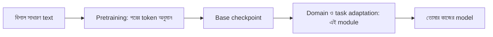

# Lecture 01 — Pretraining-এর লক্ষ্য ও Checkpoint

> আগে যা জানা থাকলে ভালো: [Next-token prediction ও cross-entropy](../module-12-text-sequences-and-multimodal-models/lecture-04-next-token-and-cross-entropy.md) এবং [Training ও Fine-tuning](../module-13-pretraining-finetuning-and-lora/lecture-01-training-and-finetuning.md)। এই lecture শেষে পারবে: বলতে পারবে pretrained checkpoint কী, তার ভেতরে কী থাকে, আর কেন সেখান থেকে শুরু করলে কাজ সহজ হয়।
> Map-এ অবস্থান: [Learning Map](../01-learning-map.md) → শেখানোর শুরুর মান (আগে শেখা parameter)। এখানে নতুন loss বা update নেই।

## সমস্যাটা কী?

ধরো তুমি ব্যাংকের গ্রাহকসেবার জন্য একটা language model চাও। শূন্য থেকে train করলে model প্রথমে ভাষাই জানে না। তাকে বিশাল পরিমাণ লেখা পড়াতে হবে, আর তাতে অনেক GPU ও অনেক দিন লাগে। অথচ কোনো গবেষণা-দল বা কোম্পানি আগেই বিশাল লেখায় model শিখিয়ে সেটা সংরক্ষণ করে রেখেছে। সেখান থেকে শুরু করা যায়। তার জন্য জানতে হবে সেই model আসলে কী শিখেছে, আর কী শেখেনি।

## ধারণাটা সহজ ভাষায়

**Pretraining** হলো খুব বড় আর নানা বিষয়ের লেখায় প্রথম দফা training। লক্ষ্য একটাই: এ পর্যন্ত লেখা দেখে পরের token অনুমান করা। লেখাটাই নিজের উত্তর বলে দেয়, তাই কোনো মানুষকে label দিতে হয় না। এমন শেখাকে **self-supervised** বলে, মানে label আসে data-র ভেতর থেকেই।

এই লক্ষ্যে শিখতে শিখতে model ভাষার গঠন, শব্দের সম্পর্ক আর অনেক সাধারণ তথ্য ধরে ফেলে। কিন্তু দুটো জিনিস সে শেখেনি:
- "প্রশ্ন পেলে উত্তর দাও" ধরনের নির্দিষ্ট আচরণ। সে শুধু লেখা চালিয়ে যেতে শিখেছে।
- তোমার ব্যাংকের নিয়ম, শব্দ ও ভাষার ধরন।

এই module-এর পুরো কাজ এই দুটো ফাঁক ভরানো।

**Checkpoint** হলো training-এর কোনো এক মুহূর্তে model-কে সংরক্ষণ করা। সাধারণত তাতে থাকে:

| কী | কেন লাগে |
|---|---|
| Weights (parameters-এর মান) | শেখা জ্ঞান এখানেই |
| Config | Architecture-এর মাপ, যেমন layer ও unit-এর সংখ্যা |
| Tokenizer | Text থেকে token ও id বানানোর নিয়ম; সাধারণত আলাদা file-এ থাকে |
| Optimizer-এর অবস্থা ও step নম্বর | থেমে যাওয়া training ঠিক সেখান থেকে চালানোর (resume) জন্য |

শুধু inference বা fine-tuning শুরুর জন্য weights, config ও tokenizer-ই যথেষ্ট। Optimizer-এর অবস্থা থাকলে file অনেক বড় হয়।

**Base model** বলতে সাধারণত pretraining শেষের checkpoint বোঝায়। কেউ কেউ SFT করা সংস্করণও আলাদা নামে (যেমন "instruct") প্রকাশ করেন। নামের নিয়ম প্রকাশকের ওপর নির্ভর করে, তাই model card পড়ে দেখো কোনটা কোন ধাপের।

সাবধান: checkpoint-এর tokenizer বদলানো যায় না। Weights একটা নির্দিষ্ট token-id-র সঙ্গে বাঁধা। অন্য tokenizer ব্যবহার করলে id-র মানে বদলে যায়, আর শেখা জ্ঞান উল্টোপাল্টা হয়ে যায়।

Training চলার সময় অনেক checkpoint save হয়। কোনটা নেবে, তা সাধারণত validation loss দেখে ঠিক করা হয় ([Module 10-এর training loop](../module-10-neural-network-training/lecture-07-training-loop-and-validation.md))।

## ছোট একটা উদাহরণ

বাক্য: "আমি ভাত খাই `<end>`"। এতে তিনটা target: ভাত, খাই, `<end>`। Vocabulary ধরো 50,000 token।

- **শূন্য থেকে শুরু:** model কিছুই জানে না, প্রায় সব token-কে সমান সম্ভাবনা দেয়। প্রতি target-এ `p = 1/50000`, loss `−ln(1/50000) = 10.82`।
- **Checkpoint থেকে শুরু:** model ভাষা কিছুটা জানে। ধরো সে তিন target-কে 0.20, 0.50, 0.40 probability দেয় (শেখানোর জন্য বানানো সংখ্যা)। loss হয় 1.609, 0.693, 0.916। গড় 1.073।

শুরুতেই loss প্রায় দশ ভাগের এক ভাগ। এখান থেকে শুরু করলে training অনেক ছোট ও সস্তা হয়।

## কোড

```python
import math

V = 50000
scratch_p = [1 / V] * 3            # কিছু না জানা model: সব token-এ সমান
ckpt_p = [0.20, 0.50, 0.40]        # checkpoint-এর (বানানো) probability

def losses(ps):
    ls = [-math.log(p) for p in ps]
    return [round(l, 3) for l in ls], round(sum(ls) / len(ls), 3)

print("scratch:", losses(scratch_p))
print("ckpt   :", losses(ckpt_p))
params = 1_000_000_000             # ১০০ কোটি parameter
print("16-bit weights GB:", params * 2 / 1e9)   # প্রতি parameter ২ byte
```

```text
# output:
scratch: ([10.82, 10.82, 10.82], 10.82)
ckpt   : ([1.609, 0.693, 0.916], 1.073)
16-bit weights GB: 2.0
```

`−ln(p)` হলো সঠিক token-এর probability থেকে ভুলের মাপ। এটা Module 12-এর cross-entropy-ই। শেষ লাইনে দেখা গেল, ১০০ কোটি parameter-এর শুধু weights প্রায় 2 GB। Optimizer-এর অবস্থাও রাখলে resume-checkpoint আরও বড় হয়।

## ছবি



## মনে রাখার সারকথা
- Pretraining-এর লক্ষ্য পরের token অনুমান; label আসে text থেকেই।
- Checkpoint = সংরক্ষিত weights, সঙ্গে config ও tokenizer; resume-এর জন্য optimizer-এর অবস্থাও রাখা হয়।
- Checkpoint থেকে শুরু করলে loss শুরুতেই অনেক কম থাকে, কিন্তু tokenizer সেই checkpoint-এর সঙ্গেই চালাতে হবে।

## নিজে করো

১. Vocabulary 1000 token হলে সব token-এ সমান probability দেওয়া model-এর loss কত?
২. Checkpoint দুটি target-কে 0.5 ও 0.25 probability দেয়। গড় loss কত?
৩. ৭০০ কোটি (7 billion) parameter, প্রতিটি 16-bit। শুধু weights কত GB?

<details><summary>উত্তর</summary>

১. `−ln(1/1000) = ln 1000 = 6.908`।
২. `−ln 0.5 = 0.693`, `−ln 0.25 = 1.386`। গড় `(0.693 + 1.386) / 2 = 1.040`।
৩. 16 bit = 2 byte। `7e9 × 2 = 14e9 byte = 14 GB`।

</details>

## পরের পাঠ

Base model এখনো প্রশ্নের উত্তর দিতে শেখেনি। প্রশ্ন-উত্তরের জোড়া দিয়ে সেটা শেখানো: [Lecture 02 — SFT ও Instruction Tuning](lecture-02-sft-and-instruction-tuning.md)।
