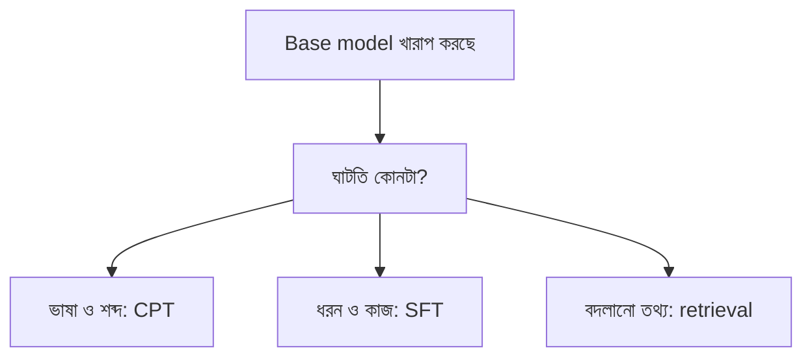

# Lecture 03 — Domain Adaptation: কী ঘাটতি, কোন Data

> আগে যা জানা থাকলে ভালো: [Lecture 02 — SFT](lecture-02-sft-and-instruction-tuning.md) এবং [Train/validation/test split](../module-05-data-preparation-and-splits/lecture-03-train-validation-test-split.md), [Data leakage](../module-05-data-preparation-and-splits/lecture-04-data-leakage.md)। এই lecture শেষে পারবে: base model-এর ঘাটতিকে চার ভাগে চিনতে, আর training data বাছাইয়ের ছোট নিয়ম চালাতে।
> Map-এ অবস্থান: [Learning Map](../01-learning-map.md) → কোন data থেকে শেখানো হবে। Output, loss বা update-এর হিসাব এখানে বদলায়নি।

## সমস্যাটা কী?

ব্যাংকের গ্রাহকসেবার প্রশ্নে base model খারাপ করছে। কিন্তু "খারাপ" মানে একটা জিনিস নয়। কেউ domain-এর শব্দই চেনে না। কেউ শব্দ চেনে, কিন্তু উত্তর দেয় এলোমেলো ধরনে। কেউ চেনে ও ঠিক ধরনে বলে, কিন্তু তথ্যটাই জানে না। ঘাটতি না বুঝে ওষুধ বাছলে সময় ও খরচ দুই-ই নষ্ট হয়। আর হাতের সব চিঠি ঢেলে দিলে গ্রাহকের ব্যক্তিগত তথ্যও training-এ ঢুকে যেতে পারে।

## ধারণাটা সহজ ভাষায়

**Domain adaptation** মানে একটা নির্দিষ্ট বিষয়-এলাকার (domain) data দিয়ে model-কে সেই এলাকায় মানিয়ে নেওয়া। এটা একটা উদ্দেশ্য; পদ্ধতি আলাদা। কোন পদ্ধতি লাগবে, তা ঘাটতির ধরনের ওপর নির্ভর করে।

| ঘাটতি | লক্ষণ | সম্ভাব্য উপায় |
|---|---|---|
| ভাষা ও শব্দ | domain-এর শব্দে loss বেশি, অদ্ভুত বাক্য | Domain text-এ আরও pretraining ([Lecture 04](lecture-04-continued-pretraining-dapt-tapt.md)) |
| ধরন ও ফরম্যাট | তথ্য জানে, কিন্তু ভুল ধরনে উত্তর দেয় | SFT ([Lecture 02](lecture-02-sft-and-instruction-tuning.md)) |
| তথ্য | নির্দিষ্ট নিয়ম বা সংখ্যা জানে না | CPT কিছুটা; তথ্য প্রায়ই বদলালে retrieval ([Lecture 08](lecture-08-adaptation-experiment.md)) |
| নির্দিষ্ট কাজ | যেমন অভিযোগ বাছাই করা | Task-এর জোড়া দিয়ে SFT |

এটা শুরুর অনুমান, প্রমাণ নয়। একই সমস্যায় একাধিক ঘাটতি থাকতে পারে, আর কোন উপায় সত্যিই কাজ করল তা পরীক্ষায় দেখতে হয় (Lecture 08)।

## Data বাছাইয়ের পাঁচ প্রশ্ন

প্রতিটা নথির জন্য ক্রমে জিজ্ঞেস করো:
1. **Split আগে।** Test-এর নথি আগেই আলাদা করে রাখা হয়েছে? (না হলে leakage; [Module 05](../module-05-data-preparation-and-splits/lecture-04-data-leakage.md))
2. **প্রাসঙ্গিক?** Domain-এর বিষয়ের সঙ্গে মেলে?
3. **ডুপ্লিকেট নয়?** একই লেখা বারবার থাকলে model সেটাই বেশি ভাগে শেখে।
4. **মান ঠিক?** খুব ছোট, ভাঙা বা অর্থহীন লেখা নয়?
5. **নিরাপদ ও অনুমোদিত?** ব্যক্তিগত তথ্য (ফোন, account নম্বর) নেই, আর data ব্যবহারের অনুমতি আছে?

বাস্তবে প্রাসঙ্গিকতা মাপতে সাধারণত ছোট classifier বা মানুষের পরীক্ষা লাগে। নিচের নিয়ম খুবই সরল, শুধু ধরনটা দেখানোর জন্য।

## ছোট একটা উদাহরণ

ছয়টা নথি। প্রাসঙ্গিকতার score = নথির কত অংশ শব্দ domain-এর তালিকায় আছে।

| # | নথি | Score | সিদ্ধান্ত |
|---|---|---:|---|
| 0 | কার্ড ব্লক করতে হলে পিন রিসেট করুন | 0.57 | রাখো |
| 1 | (#0-এর হুবহু কপি) | 0.57 | বাদ: ডুপ্লিকেট |
| 2 | আজ আকাশ মেঘলা তাই ছাতা নিন | 0.00 | বাদ: অপ্রাসঙ্গিক |
| 3 | ঋণ নিলে সুদ দিতে হয় টাকা | 0.50 | রাখো |
| 4 | অ্যাকাউন্ট নম্বর 0171 ফোন দিন | 0.20 | বাদ: সংখ্যা আছে, ব্যক্তিগত তথ্যের সন্দেহ |
| 5 | পিন | 1.00 | বাদ: খুব ছোট |

#5-এর score সবচেয়ে বেশি, তবু বাদ গেল। শুধু একটা মাপের ওপর ভরসা করা যায় না; পাঁচটা প্রশ্নই লাগে।

## কোড

```python
domain_words = {"কার্ড", "পিন", "ঋণ", "সুদ", "অ্যাকাউন্ট", "ব্লক", "রিসেট", "টাকা"}
docs = [
    "কার্ড ব্লক করতে হলে পিন রিসেট করুন",
    "কার্ড ব্লক করতে হলে পিন রিসেট করুন",
    "আজ আকাশ মেঘলা তাই ছাতা নিন",
    "ঋণ নিলে সুদ দিতে হয় টাকা",
    "অ্যাকাউন্ট নম্বর 0171 ফোন দিন",
    "পিন",
]

def score(text):
    toks = text.split()
    return sum(t in domain_words for t in toks) / len(toks)

seen, keep = set(), []
for i, d in enumerate(docs):
    s = round(score(d), 2)
    reason = None
    if d in seen: reason = "duplicate"
    elif len(d.split()) < 3: reason = "too short"
    elif any(ch.isdigit() for ch in d): reason = "has digits"
    elif s < 0.2: reason = "low relevance"
    seen.add(d)
    print(i, s, reason or "KEEP")
    if reason is None: keep.append(i)
print("kept:", keep)
```

```text
# output:
0 0.57 KEEP
1 0.57 duplicate
2 0.0 low relevance
3 0.5 KEEP
4 0.2 has digits
5 1.0 too short
kept: [0, 3]
```

## ছবি



## মনে রাখার সারকথা
- Domain adaptation একটা উদ্দেশ্য; ঘাটতি (ভাষা, ধরন, তথ্য, কাজ) চিনে তবেই পদ্ধতি বাছতে হয়।
- Data বাছাইয়ে আগে test আলাদা করো, তারপর প্রাসঙ্গিকতা, ডুপ্লিকেট, মান ও ব্যক্তিগত তথ্য দেখো।
- একটা সরল score যথেষ্ট নয়; আসল কাজে classifier বা মানুষের পরীক্ষা লাগে।

## নিজে করো

১. "কার্ড পিন ছাড়া" নথির score কত? (domain-এর তালিকা উপরের মতো।)
২. উদাহরণে #4-এর score 0.2, আর কাটার সীমা `s < 0.2`। তাহলে সে কোন নিয়মে বাদ গেল?
৩. এই তিনটা লক্ষণের জন্য শুরুতে কোন উপায় ভাববে? (ক) model সবসময় লম্বা প্রবন্ধ লেখে, অথচ তথ্য ঠিক। (খ) নিয়ম গত সপ্তাহে বদলেছে। (গ) domain-এর শব্দই অচেনা।

<details><summary>উত্তর</summary>

১. তিন শব্দের মধ্যে `কার্ড` ও `পিন` তালিকায় আছে। `2 / 3 = 0.667`।
২. Score 0.2 সীমার নিচে নয়, তাই প্রাসঙ্গিকতার নিয়মে বাদ যায়নি। বাদ গেছে "সংখ্যা আছে" নিয়মে।
৩. (ক) SFT, কারণ ঘাটতি ধরনের। (খ) Retrieval, কারণ তথ্য প্রায়ই বদলায়, weights বদলাতে হয় না। (গ) CPT, কারণ ঘাটতি ভাষা ও শব্দের।

</details>

## পরের পাঠ

ভাষা ও শব্দের ঘাটতি ভরাতে label ছাড়া domain text-ই যথেষ্ট: [Lecture 04 — Continued Pretraining: DAPT ও TAPT](lecture-04-continued-pretraining-dapt-tapt.md)।
