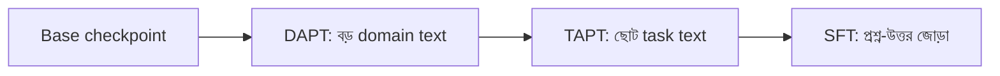

# Lecture 04 — Continued Pretraining: DAPT ও TAPT

> আগে যা জানা থাকলে ভালো: [Lecture 01 — Pretraining ও checkpoint](lecture-01-pretraining-objective-and-checkpoint.md) এবং [Lecture 03 — ঘাটতি চেনা](lecture-03-domain-adaptation-and-data-selection.md)। এই lecture শেষে পারবে: বলতে পারবে label ছাড়া domain text দিয়ে কীভাবে model-কে শেখানো যায়, আর DAPT ও TAPT-এর পার্থক্য কী।
> Map-এ অবস্থান: [Learning Map](../01-learning-map.md) → শেখার লক্ষ্য একই (next-token loss), বদলেছে data। SFT-এর সঙ্গে পার্থক্য: এখানে loss mask নেই।

## সমস্যাটা কী?

ব্যাংকের কাছে পঞ্চাশ হাজার নথি আছে: নীতিমালা, নোটিশ, পুরোনো চিঠি। কিন্তু কোনো প্রশ্ন-উত্তরের জোড়া নেই। তাই SFT করা যাচ্ছে না। তবু model-কে এই এলাকার শব্দ ও বাক্যের ধরনের সঙ্গে পরিচিত করা দরকার। নথিগুলো কি তাহলে অকাজের?

## ধারণাটা সহজ ভাষায়

নথিগুলো কাজে লাগে। লেখাই নিজের label দেয় ([Lecture 01](lecture-01-pretraining-objective-and-checkpoint.md))। তাই checkpoint থেকে শুরু করে একই pretraining-লক্ষ্যে, মানে পরের token অনুমানে, নতুন text-এ আরও training চালানো যায়। একে বলে **continued pretraining (CPT)**।

SFT-এর সঙ্গে পার্থক্য দুটো:
- Data-তে প্রশ্ন-উত্তরের জোড়া লাগে না, শুধু text।
- সব token-এই loss গোনা হয়, mask নেই (সব `mᵢ = 1`)।

CPT-র দুটো পরিচিত নাম আছে, data কোথা থেকে আসছে তার ভিত্তিতে:
- **DAPT (Domain-Adaptive Pretraining):** বড় domain text, যেমন ব্যাংকের সব নথি। উদ্দেশ্য domain-এর ভাষা ও শব্দের সঙ্গে পরিচিত করা।
- **TAPT (Task-Adaptive Pretraining):** সরাসরি সেই কাজের input text, ছোট ও আরও কাছের, যেমন শুধু গ্রাহকের অভিযোগের মূল লেখা (উত্তর বা label ছাড়া)।

নামগুলো এসেছে Gururangan ও অন্যদের ২০২০ সালের গবেষণা থেকে: [Don't Stop Pretraining](https://arxiv.org/abs/2004.10964)। প্রচলিত ক্রম হলো base → DAPT → TAPT → SFT। এটা শুরুর ধারণা; তোমার কাজে এটা সত্যিই লাভজনক কি না, তুলনা করে দেখতে হয় ([Lecture 08](lecture-08-adaptation-experiment.md))।

সীমা: CPT model-কে "প্রশ্ন পেলে উত্তর দাও" শেখায় না, কারণ তার লক্ষ্য শুধু লেখা চালিয়ে যাওয়া। সেই আচরণের জন্য SFT লাগে।

## ছোট একটা উদাহরণ

আসল neural model চালানো এখানে সম্ভব নয়। তাই একটা খেলনা model নিচ্ছি, যে শুধু গোনে "এই শব্দের পরে কোন শব্দ কতবার এসেছে"। "Training" মানে এখানে আরও text গোনা। সংখ্যা হিসাবের ধরন একই, তবে এটা neural network-এর update নয়।

Base model সাধারণ বাক্য গুনে শিখেছে। CPT-তে সে ব্যাংকের পাঁচটা বাক্য গোনে (যেমন "আমি কার্ড ব্লক করি")। ধরো শব্দ ১৫টা আর `<end>` মিলিয়ে vocabulary 16।

হাতে একটা ধাপ: "ব্লক"-এর পরে "করি" আসার probability। গোনা কম থাকলে একটু হিসাবে ধরা হয় (add-0.5 smoothing: প্রতিটা সম্ভাবনায় 0.5 যোগ)।
- Base-এ "ব্লক" কখনো আসেনি: `p = 0.5 / (0 + 0.5 × 16) = 0.0625`, loss `−ln 0.0625 = 2.773`।
- CPT-র পরে "ব্লক করি" দুবার, "ব্লক করে" একবার: `p = (2 + 0.5) / (3 + 8) = 0.227`, loss `1.482`।

পুরো বাক্যে (কোডের ফল):

| Model | Domain-এর নতুন বাক্যে loss | সাধারণ বাক্যে loss |
|---|---:|---:|
| Base | 2.874 | 1.666 |
| CPT-র পরে | 1.682 | 1.738 |

Domain বাক্যে loss অনেক কমেছে। সাধারণ বাক্যে সামান্য বেড়েছে; এটা [Lecture 07](lecture-07-forgetting-and-evaluation.md)-এ দেখা হবে। দুই test বাক্যই training-এ ছিল না।

## কোড

```python
import math, copy
from collections import defaultdict

general = ["আমি রোজ ভাত খাই", "আমি রোজ ভাত খাই", "আমি রোজ পানি খাই",
           "সে রোজ বই পড়ে", "সে রোজ বই পড়ে", "আমি বই পড়ি"]
domain = ["আমি কার্ড ব্লক করি", "আমি কার্ড ব্লক করি", "আমি পিন রিসেট করি",
          "আমি কার্ড রিসেট করি", "সে পিন ব্লক করে"]
test_general, test_domain = ["আমি রোজ বই পড়ি"], ["আমি পিন ব্লক করি"]
V = 16  # সব শব্দ + <end>

def train(sentences, counts=None):          # "training" = শুধু গুনে রাখা
    c = counts if counts is not None else defaultdict(lambda: defaultdict(float))
    for s in sentences:
        t = s.split() + ["<end>"]
        for a, b in zip(t[:-1], t[1:]):
            c[a][b] += 1
    return c

def loss(c, sentences, k=0.5):              # next-word cross-entropy
    ls = []
    for s in sentences:
        t = s.split() + ["<end>"]
        for a, b in zip(t[:-1], t[1:]):
            p = (c[a][b] + k) / (sum(c[a].values()) + k * V)
            ls.append(-math.log(p))
    return sum(ls) / len(ls)

base = train(general)                        # আগে শেখা checkpoint
cpt = train(domain, copy.deepcopy(base))     # তার উপর আরও domain text গোনা
for name, m in [("base", base), ("cpt ", cpt)]:
    print(name, "general:", round(loss(m, test_general), 3),
          "domain:", round(loss(m, test_domain), 3))
```

```text
# output:
base general: 1.666 domain: 2.874
cpt  general: 1.738 domain: 1.682
```

## ছবি



## মনে রাখার সারকথা
- CPT মানে checkpoint-এর ওপর নতুন text-এ একই next-token লক্ষ্যে আরও training; label ও mask লাগে না।
- DAPT বড় domain text দিয়ে ভাষা ও শব্দে পরিচিত করে; TAPT ছোট, কাজের কাছের text দিয়ে।
- CPT উত্তর দেওয়ার আচরণ শেখায় না; সেটা SFT-র কাজ।

## নিজে করো

১. CPT-তে কোন token-এ loss গোনা হয়?
২. CPT-র পরে "ব্লক"-এর পরে "করি"-র probability 0.25 হলে loss কত?
৩. ব্যাংকের কাছে (ক) পঞ্চাশ হাজার label-হীন নথি, (খ) গ্রাহকের দুই হাজার অভিযোগের মূল লেখা (label ছাড়া), (গ) দুইশো (অভিযোগ, category) জোড়া। প্রতিটা কোন ধাপে কাজে লাগবে?

<details><summary>উত্তর</summary>

১. সব token-এ। Mask নেই।
২. `−ln 0.25 = 1.386`।
৩. (ক) DAPT। (খ) TAPT। (গ) SFT, কারণ এখানে input-এর সঙ্গে সঠিক output আছে।

</details>

## পরের পাঠ

একাধিক কাজ বা ভাষার data একসঙ্গে মেশাতে হলে কোনটা কত ভাগ নেবে: [Lecture 05 — Multi-task ও Multilingual Tuning](lecture-05-multitask-and-multilingual-tuning.md)।
