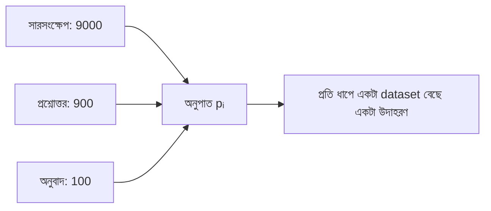

# Lecture 05 — Multi-task ও Multilingual Tuning: Data মেশানোর অনুপাত

> আগে যা জানা থাকলে ভালো: [Lecture 02 — SFT](lecture-02-sft-and-instruction-tuning.md) এবং [Probability-র প্রাথমিক ধারণা](../module-04-math-foundations-practice/lecture-03-mean-variance-and-probability.md)। এই lecture শেষে পারবে: কয়েকটা dataset থেকে নমুনা নেওয়ার probability হাতে বের করতে, আর বলতে পারবে অনুপাত বদলালে কী বদলায়।
> Map-এ অবস্থান: [Learning Map](../01-learning-map.md) → শেখার data। Loss ও update একই; বদলেছে প্রতি ধাপে কোন dataset থেকে উদাহরণ আসবে।

## সমস্যাটা কী?

একই model-কে তিনটা কাজ শেখাতে চাও, প্রতিটার আলাদা dataset:

| কাজ | উদাহরণের সংখ্যা |
|---|---:|
| সারসংক্ষেপ | 9000 |
| প্রশ্নোত্তর | 900 |
| অনুবাদ | 100 |

সব এক বস্তায় ঢেলে এলোমেলো করলে প্রতি ধাপে সারসংক্ষেপ আসে 90% বার আর অনুবাদ 1%। অনুবাদ প্রায় শেখাই হয় না। উল্টে তিন কাজকে সমান ভাগ দিলে অনুবাদের মাত্র ১০০ উদাহরণ বারবার ঘুরে আসে, আর model সেগুলো মুখস্থ করে ফেলতে পারে। দুই দিকেই সমস্যা, তাই অনুপাতটা সিদ্ধান্তের বিষয়।

## ধারণাটা সহজ ভাষায়

**Multi-task tuning** মানে একই model-কে একাধিক কাজ শেখানো। **Multilingual tuning**-এ কাজের বদলে ভাগটা ভাষার, যেমন বাংলা, ইংরেজি, হিন্দি। হিসাবের ছক দুটোতেই এক।

**Data mixture** হলো প্রতিটা dataset থেকে কত ভাগ নমুনা আসবে তার অনুপাত। প্রতি ধাপে একটা dataset বেছে তার থেকে একটা উদাহরণ নেওয়া হয়। বাছাইয়ের probability ঠিক করে এই সূত্র:

`pᵢ = nᵢ^α / Σⱼ nⱼ^α`

- `nᵢ`: i-তম dataset-এর উদাহরণের সংখ্যা।
- `α`: একটা সংখ্যা, 0 থেকে 1। এটা অনুপাত "আকারের" দিকে কতটা ঝুঁকবে ঠিক করে।
- `α = 1`: আকারের অনুপাতে (বড় dataset বেশি)। `α = 0`: সব dataset সমান। মাঝের মান (যেমন 0.5): আপস, ছোট dataset কিছুটা বেশি ভাগ পায়।

এই `α` বদলানোকে অনেকে temperature sampling বলেন।

আরেকটা ঝামেলা: কাজে কাজে চাহিদা বিরোধী হতে পারে। এক কাজে এক শব্দের উত্তর চাই, অন্যটায় বিস্তারিত। তখন prompt-এ কাজের নাম বা নির্দেশ রাখা হয়, যাতে model জানে এখন কোন কাজ। আর কাজ (বা ভাষা) ধরে আলাদা validation দেখতে হয়। শুধু গড় দেখলে এক কাজের পিছিয়ে পড়া চাপা পড়ে যায়। ছোট ভাষা বড় ভাষার সাহায্য পেতেও পারে, ক্ষতিও হতে পারে; তাই পরীক্ষা করে দেখো।

## ছোট একটা উদাহরণ

মোট `N = 100,000` নমুনা নেওয়া হলো।

**`α = 1`:** `p = [0.9, 0.09, 0.01]`। অনুবাদ পায় `100000 × 0.01 = 1000` নমুনা। তার dataset-এ আছে 100টা, তাই প্রতিটা উদাহরণ গড়ে 10 বার দেখা হয়। সারসংক্ষেপ: `90000 / 9000 = 10` বার। তিন কাজই 10 বার করে।

**`α = 0.5`:** ওজন `√9000 = 94.87`, `√900 = 30`, `√100 = 10`। যোগফল 134.87। `p = [0.703, 0.222, 0.074]`। অনুবাদ পায় প্রায় 7400 নমুনা, অর্থাৎ প্রতিটা উদাহরণ গড়ে প্রায় 74 বার।

**`α = 0`:** সবার `p = 1/3`। অনুবাদের উদাহরণ ঘোরে প্রায় 333 বার।

| α | সারসংক্ষেপ | প্রশ্নোত্তর | অনুবাদ | অনুবাদের উদাহরণ কত বার ঘোরে |
|---|---:|---:|---:|---:|
| 1.0 | 0.900 | 0.090 | 0.010 | 10 |
| 0.5 | 0.703 | 0.222 | 0.074 | 74 |
| 0.0 | 0.333 | 0.333 | 0.333 | 333 |

α কমালে ছোট কাজ বেশি ভাগ পায়, কিন্তু তার ছোট dataset অনেক বেশি বার ঘোরে। এই দুইয়ের মাঝামাঝি একটা ভারসাম্য খুঁজতে হয়, আর কোন α ভালো তা validation-এ দেখে ঠিক হয়।

## কোড

```python
import random

sizes = {"সারসংক্ষেপ": 9000, "প্রশ্নোত্তর": 900, "অনুবাদ": 100}

def mixture(sizes, alpha):
    w = {k: n ** alpha for k, n in sizes.items()}   # n^alpha
    z = sum(w.values())
    return {k: v / z for k, v in w.items()}

N = 100_000                                          # মোট training নমুনা
for alpha in (1.0, 0.5, 0.0):
    p = mixture(sizes, alpha)
    epochs = {k: round(N * p[k] / n, 1) for k, n in sizes.items()}
    print(alpha, {k: round(v, 3) for k, v in p.items()})
    print("   epochs:", epochs)

random.seed(0)                                       # এক ধাপে একটা task বেছে নেওয়া
p = mixture(sizes, 0.5)
picks = random.choices(list(p), weights=list(p.values()), k=1000)
print({k: picks.count(k) for k in sizes})
```

```text
# output:
1.0 {'সারসংক্ষেপ': 0.9, 'প্রশ্নোত্তর': 0.09, 'অনুবাদ': 0.01}
   epochs: {'সারসংক্ষেপ': 10.0, 'প্রশ্নোত্তর': 10.0, 'অনুবাদ': 10.0}
0.5 {'সারসংক্ষেপ': 0.703, 'প্রশ্নোত্তর': 0.222, 'অনুবাদ': 0.074}
   epochs: {'সারসংক্ষেপ': 7.8, 'প্রশ্নোত্তর': 24.7, 'অনুবাদ': 74.1}
0.0 {'সারসংক্ষেপ': 0.333, 'প্রশ্নোত্তর': 0.333, 'অনুবাদ': 0.333}
   epochs: {'সারসংক্ষেপ': 3.7, 'প্রশ্নোত্তর': 37.0, 'অনুবাদ': 333.3}
{'সারসংক্ষেপ': 709, 'প্রশ্নোত্তর': 219, 'অনুবাদ': 72}
```

শেষ লাইনে 1000 বার বাছাইয়ের একটা সিমুলেশন: প্রত্যাশিত 703, 222, 74-এর কাছাকাছি, কিন্তু ঠিক সমান নয়। সেটাই স্বাভাবিক, কারণ বাছাই র‍্যান্ডম।

## ছবি



## মনে রাখার সারকথা
- Data mixture = কোন dataset থেকে কত ভাগ নমুনা আসবে; `pᵢ = nᵢ^α / Σ nⱼ^α`।
- α = 1 আকারের অনুপাত, α = 0 সমান ভাগ; কমালে ছোট dataset বেশি ভাগ পায় কিন্তু বেশি বার ঘোরে।
- কাজ বা ভাষা ধরে আলাদা validation দেখো; গড় একটা কাজের পিছিয়ে পড়া লুকিয়ে দেয়।

## নিজে করো

১. দুই dataset: A-তে 400, B-তে 100। `α = 1`-এ আর `α = 0` -এ B-র probability কত?
২. একই dataset-এ `α = 0.5`-এ A ও B-র probability কত?
৩. ২ নম্বরের mixture-এ মোট 1000 নমুনা নিলে B-র প্রতিটা উদাহরণ গড়ে কতবার ঘোরে?

<details><summary>উত্তর</summary>

১. `α = 1`: `100 / 500 = 0.2`। `α = 0`: সবার ওজন 1, তাই `0.5`।
২. ওজন `√400 = 20`, `√100 = 10`। `A = 20/30 = 0.667`, `B = 10/30 = 0.333`।
৩. B পায় `1000 × 0.333 = 333.3` নমুনা। Dataset-এ 100টা, তাই `333.3 / 100 = 3.33` বার।

</details>

## পরের পাঠ

Model-এর নিজের ভুল থেকেও data বানানো যায়: [Lecture 06 — Correction Dataset ও Hard Examples](lecture-06-correction-dataset-and-hard-examples.md)।
