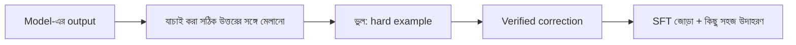

# Lecture 06 — Correction Dataset ও Hard Examples

> আগে যা জানা থাকলে ভালো: [Lecture 02 — SFT](lecture-02-sft-and-instruction-tuning.md) এবং [Correction থেকে target, preference ও reward](../module-17-reinforcement-learning-and-feedback/lecture-01-correction-target-preference-and-reward.md) (CER-এর পরিচয় সেখানে)। এই lecture শেষে পারবে: model-এর ভুল আর যাচাই করা সঠিক উত্তর থেকে SFT data বানাতে, আর hard example বাছার ঝুঁকিগুলো বলতে।
> Map-এ অবস্থান: [Learning Map](../01-learning-map.md) → শেখার data। Training objective একই SFT loss; নতুন হলো data তৈরির নিয়ম।

## সমস্যাটা কী?

Model প্রতিদিন কিছু ভুল করছে, যেমন ছবি থেকে "বই"-কে "বউ" পড়ছে। এই ভুল ফেলে দিলে কিছু শেখা হয় না। আবার model-এর নিজের ভুল উত্তরকেই target বানালে তাকে ভুলই শেখানো হয়। ঠিক পথ: ভুলটা ধরো, কোনো নির্ভরযোগ্য উৎস দিয়ে সঠিক উত্তর যাচাই করো, তারপর সেই সঠিক উত্তরকে target বানাও।

## ধারণাটা সহজ ভাষায়

**Correction record** একটা উদাহরণের পুরো গল্প রাখে:

```text
input:             (একটা ছবি)
model_output:      বউ
verified_target:   বই
verified_by:       মানুষ বা নির্ভরযোগ্য উৎস
```

SFT-এর target হলো `verified_target`, কখনো `model_output` নয়। ভুল output-টা ফেলে দেওয়ার দরকার নেই: পরে preference-এ "পছন্দের" ও "অপছন্দের" জোড়ার অপছন্দের দিক হিসেবে কাজে লাগে ([Module 16](../module-16-preference-learning-and-dpo/lecture-01-preference-data.md))। এখানে শুধু SFT জোড়া বানানো।

**Hard example** হলো যে উদাহরণে model বারবার ভুল করে বা যার loss বেশি। এগুলো থেকে শেখার সুযোগ বেশি, তাই আলাদা করে বেছে নেওয়া হয়। কিন্তু তিনটা ঝুঁকি আছে:

1. **Label-ই ভুল হতে পারে।** Model বারবার একই উদাহরণে "ভুল" করলে কখনো দোষ model-এর নয়, label-এর। Hard example-এ ভুল label-এর হার সাধারণত বেশি, তাই আগে যাচাই, তারপর training।
2. **শুধু hard নিলে সহজ ক্ষেত্র ভুলতে পারে।** Training-এ কিছু সহজ উদাহরণও মেশাও ([Lecture 07](lecture-07-forgetting-and-evaluation.md))।
3. **Test-এর উদাহরণ ঢুকে যেতে পারে।** Test-এর কোনো উদাহরণ correction data-য় এলে test দূষিত হয়। Split আগে।

আরেকটা কথা: মাপের সংখ্যা ছোট মানেই ক্ষতি ছোট নয়। নিচের উদাহরণে "টাকা 500"-এর বদলে "টাকা 5000" হলে error হার মাত্র 0.111, কিন্তু অঙ্কের ক্ষতি বিশাল। কোন ভুল কত গুরুতর, সেটাও বিচার করতে হয়।

## ছোট একটা উদাহরণ

ছয়টা ছবি। প্রতিটায় model-এর output ও যাচাই করা সঠিক উত্তর। ভুল মাপা হচ্ছে **CER** (Character Error Rate) দিয়ে: সঠিক উত্তর পেতে কয়টা অক্ষর বসাতে, মুছতে বা বদলাতে হয়, সেটা সঠিক উত্তরের দৈর্ঘ্য দিয়ে ভাগ।

| model-এর output | সঠিক উত্তর | বদলাতে হয় | CER |
|---|---|---:|---:|
| বই | বই | 0 | 0.000 |
| বউ | বই | 1 | 0.500 |
| টাকা 500 | টাকা 5000 | 1 | 0.111 |
| কলম | কলম | 0 | 0.000 |
| মান | মাস | 1 | 0.333 |
| পিন | পিন | 0 | 0.000 |

CER শূন্যের বেশি, এমন তিনটা hard example। তাদের সঠিক উত্তর SFT-এর target: `বই`, `টাকা 5000`, `মাস`। যে তিনটা ঠিক ছিল, সেগুলোর কিছু সহজ উদাহরণ হিসেবে training-এ মেশানো যায়।

সাবধান: এখানে "অক্ষর" মানে Unicode-এর একেকটা code point। বাংলায় স্বরচিহ্ন (যেমন `া`) আলাদা code point, তাই দৈর্ঘ্য চোখে দেখা অক্ষরের সংখ্যার সঙ্গে না-ও মিলতে পারে।

## কোড

```python
def edit_distance(a, b):                 # insert / delete / replace = 1 each
    d = list(range(len(b) + 1))
    for i, x in enumerate(a, 1):
        prev, d[0] = d[0], i
        for j, y in enumerate(b, 1):
            prev, d[j] = d[j], min(d[j] + 1, d[j - 1] + 1, prev + (x != y))
    return d[len(b)]

def cer(pred, ref):
    return edit_distance(pred, ref) / len(ref)

# (model-এর output, verified সঠিক উত্তর)
rows = [("বই", "বই"), ("বউ", "বই"), ("টাকা 500", "টাকা 5000"),
        ("কলম", "কলম"), ("মান", "মাস"), ("পিন", "পিন")]
for pred, ref in rows:
    print(pred, "|", ref, "| CER =", round(cer(pred, ref), 3))

hard = [(p, r) for p, r in rows if cer(p, r) > 0]
print("hard:", hard)
print("SFT pairs (input -> target):", [r for _, r in hard])
```

```text
# output:
বই | বই | CER = 0.0
বউ | বই | CER = 0.5
টাকা 500 | টাকা 5000 | CER = 0.111
কলম | কলম | CER = 0.0
মান | মাস | CER = 0.333
পিন | পিন | CER = 0.0
hard: [('বউ', 'বই'), ('টাকা 500', 'টাকা 5000'), ('মান', 'মাস')]
SFT pairs (input -> target): ['বই', 'টাকা 5000', 'মাস']
```

## ছবি



## মনে রাখার সারকথা
- Correction record-এ ভুল output ও verified correction দুটোই থাকে; SFT-এর target শুধু verified correction।
- Hard example শেখার সুযোগ বাড়ায়, কিন্তু label ভুল, সহজ ক্ষেত্র ভোলা ও test দূষণের ঝুঁকি আছে।
- Error হারের সংখ্যা ছোট হলেও ক্ষতি বড় হতে পারে; ভুলের গুরুত্বও দেখো।

## নিজে করো

১. Model "ব" লিখেছে, সঠিক "বই"। CER কত?
২. Model "টাকা 50" লিখেছে, সঠিক "টাকা 5000"। CER কত?
৩. Model "বউ" লিখেছে, সঠিক "বই", কিন্তু কেউ যাচাই করেনি। এই জোড়ার SFT target কী হবে?

<details><summary>উত্তর</summary>

১. একটা অক্ষর বসাতে হয়, দৈর্ঘ্য 2। `1 / 2 = 0.5`।
২. দুটো "0" বসাতে হয়, "টাকা 5000"-এর দৈর্ঘ্য 9। `2 / 9 = 0.222`।
৩. "বউ" কখনো target নয়। আবার সঠিক উত্তর "বই" যাচাই না হওয়া পর্যন্ত training-এ ঢোকানো যাবে না। আগে যাচাই করো, তারপর target হবে "বই"।

</details>

## পরের পাঠ

Tuning-এর পরে কী শিখল আর কী ভুলল, সেটা কীভাবে মাপব: [Lecture 07 — Forgetting ও Evaluation](lecture-07-forgetting-and-evaluation.md)।
