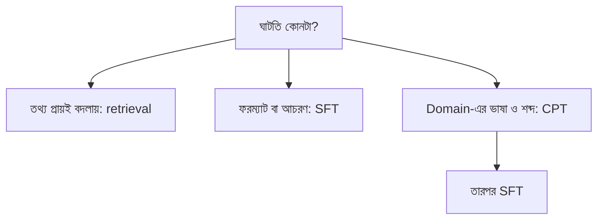

# Lecture 08 — তুলনার নকশা: Base, CPT, SFT ও Retrieval

> আগে যা জানা থাকলে ভালো: এই module-এর [Lecture 02 (SFT)](lecture-02-sft-and-instruction-tuning.md), [Lecture 04 (CPT)](lecture-04-continued-pretraining-dapt-tapt.md) ও [Lecture 07 (মূল্যায়ন)](lecture-07-forgetting-and-evaluation.md), আর [Cross-validation ও final test](../module-06-model-evaluation-and-baselines/lecture-05-cross-validation-and-final-test.md)। এই lecture শেষে পারবে: কয়েকটা adaptation উপায় একই নিয়মে তুলনার একটা পরীক্ষা সাজাতে।
> Map-এ অবস্থান: [Learning Map](../01-learning-map.md) → এই module-এর সব ধারণা একসঙ্গে। এখানে কোনো নতুন formula নেই।

## সমস্যাটা কী?

এখন তিনটা পথ হাতে: CPT, SFT, আর retrieval। কোনটা কোন সমস্যায় লাগে, বইয়ের কথায় ভরসা করলে চলে না। নিজের কাজে পরীক্ষা করে দেখতে হয়। কিন্তু পরীক্ষা এলোমেলো হলে (এক উপায়ে বেশি data, অন্যটায় আলাদা test) ফলের তুলনা অর্থহীন। তাই আগে নকশা।

## ধারণাটা সহজ ভাষায়

**Retrieval** (প্রায়ই RAG বলা হয়) মানে model-এর weights না বদলিয়ে ব্যবহারের সময় প্রশ্নের সঙ্গে প্রাসঙ্গিক নথি খুঁজে prompt-এ জুড়ে দেওয়া। Model নথি পড়ে উত্তর দেয়। তাই তথ্য বদলালে শুধু নথি বদলালেই হয়, নতুন training লাগে না। এটা fine-tuning নয় ([Module 13-এর map](../module-13-pretraining-finetuning-and-lora/lecture-02-finetuning-methods-map.md))।

**তুলনার নকশা:** পাঁচটা জিনিস সব উপায়ে একই রাখো, শুধু উপায়টা বদলাও।
1. **একই base checkpoint।**
2. **একই test**, যা training-এর আগেই আলাদা করা এবং কখনো training-এ ঢোকেনি (leakage নয়)।
3. **একই budget:** training token বা সময়।
4. **একই prompt-এর ছাঁচ।**
5. **একাধিকবার চালানো** (আলাদা random seed), যাতে একবারের ভাগ্য ফল না বদলে।

Test-এর প্রশ্ন চার ভাগে রাখো, কারণ প্রতিটা উপায় আলাদা ভাগে সাহায্য করে:

| ভাগ | কী মাপে |
|---|---|
| জ্ঞান | Domain-এর ভাষা ও তথ্যে ঠিক উত্তর |
| ফরম্যাট | চাওয়া ধরনে উত্তর |
| নতুন তথ্য | Training-এর পরে বদলানো তথ্য |
| সাধারণ | আগে যা পারত, [Lecture 07](lecture-07-forgetting-and-evaluation.md) অনুযায়ী |

শুরুর প্রত্যাশা (যা পরীক্ষায় যাচাই হবে): CPT জ্ঞান ও ভাষায়, SFT ফরম্যাটে, retrieval নতুন বা প্রায়ই-বদলানো তথ্যে সাহায্য করে।

## ছোট একটা উদাহরণ

নিচের সংখ্যা **কাল্পনিক**, কোনো বাস্তব পরীক্ষার ফল নয়। শুধু দেখাচ্ছে, সংখ্যা পেলে কীভাবে পড়বে। প্রতিটা ঘরে সঠিক উত্তরের হার।

| উপায় | জ্ঞান (৪টা) | ফরম্যাট (৪টা) | নতুন তথ্য (২টা) | সাধারণ (৪টা) |
|---|---:|---:|---:|---:|
| Base | 0.25 | 0.25 | 0.00 | 1.00 |
| Base + retrieval | 0.75 | 0.25 | 1.00 | 1.00 |
| CPT | 0.75 | 0.25 | 0.00 | 0.75 |
| SFT | 0.50 | 1.00 | 0.00 | 0.75 |
| CPT + SFT | 0.75 | 1.00 | 0.00 | 0.75 |

এই কাল্পনিক ছক থেকে পড়া:
- ফরম্যাটে লাভ শুধু SFT-ওয়ালাদের, `+0.75`।
- নতুন তথ্যে লাভ শুধু retrieval-এ, `+1.00`। Weights বদলায়নি বলে "সাধারণ"-এ ক্ষতিও নেই।
- তিনটা training-ওয়ালা উপায়ের "সাধারণ" ভাগে `−0.25` ক্ষতি, অর্থাৎ ১টা প্রশ্ন।

সাবধান: ভাগে মাত্র ৪টা প্রশ্ন, তাই একটা প্রশ্ন বদলালেই হার 0.25 নড়ে। এত ছোট test-এ কোনো সিদ্ধান্ত নেওয়া যায় না। বাস্তবে প্রতি ভাগে অনেক প্রশ্ন দরকার।

## কোড

```python
# কাল্পনিক ফল (1 = সঠিক, 0 = ভুল): শুধু হিসাবের কাঠামো দেখানোর জন্য
categories = ["জ্ঞান", "ফরম্যাট", "নতুন তথ্য", "সাধারণ"]
results = {
    "base":            [[0, 0, 1, 0], [0, 1, 0, 0], [0, 0], [1, 1, 1, 1]],
    "base+retrieval":  [[1, 0, 1, 1], [0, 1, 0, 0], [1, 1], [1, 1, 1, 1]],
    "CPT":             [[1, 0, 1, 1], [0, 1, 0, 0], [0, 0], [1, 1, 1, 0]],
    "SFT":             [[0, 1, 1, 0], [1, 1, 1, 1], [0, 0], [1, 1, 0, 1]],
    "CPT+SFT":         [[1, 0, 1, 1], [1, 1, 1, 1], [0, 0], [1, 1, 0, 1]],
}

def accuracy(sys_name):
    return [sum(r) / len(r) for r in results[sys_name]]

base = accuracy("base")
print("system".ljust(16), categories)
for name in results:
    acc = accuracy(name)
    delta = [round(a - b, 2) for a, b in zip(acc, base)]
    print(name.ljust(16), [round(a, 2) for a in acc], "বদল:", delta)
```

```text
# output:
system           ['জ্ঞান', 'ফরম্যাট', 'নতুন তথ্য', 'সাধারণ']
base             [0.25, 0.25, 0.0, 1.0] বদল: [0.0, 0.0, 0.0, 0.0]
base+retrieval   [0.75, 0.25, 1.0, 1.0] বদল: [0.5, 0.0, 1.0, 0.0]
CPT              [0.75, 0.25, 0.0, 0.75] বদল: [0.5, 0.0, 0.0, -0.25]
SFT              [0.5, 1.0, 0.0, 0.75] বদল: [0.25, 0.75, 0.0, -0.25]
CPT+SFT          [0.75, 1.0, 0.0, 0.75] বদল: [0.5, 0.75, 0.0, -0.25]
```

## কম খরচ বনাম পূর্ণ পথ

নিজের কাজে শুরু করতে হলে (খরচের সংখ্যা নির্ভর করে model ও hardware-এর ওপর, তাই এখানে সংখ্যা দেওয়া হলো না):

| পথ | কী করবে | কখন |
|---|---|---|
| কম খরচ | Base + retrieval; দরকার হলে ছোট SFT (যেমন LoRA, [Module 13](../module-13-pretraining-finetuning-and-lora/README.md)) | প্রথম প্রোটোটাইপ, তথ্য বদলায়, GPU কম |
| পূর্ণ | CPT → SFT, সঙ্গে retrieval, বড় ও আলাদা test | Domain-এর ভাষা অনেক আলাদা, স্থায়ী ও নিয়ন্ত্রিত কাজ |

সুপারিশ: আগে কম খরচের পথে একটা base-line ও test বানাও। তার ফল দেখে ঠিক করো পূর্ণ পথ লাগবে কি না। আগেই CPT-তে ঝাঁপ দিলে লাভ হলো কি না বোঝার তুলনার জায়গা থাকে না।

## ছবি



এটা শুরুর অনুমানের ছবি। শেষ সিদ্ধান্ত পরীক্ষার ফলে।

## মনে রাখার সারকথা
- Retrieval weights বদলায় না; তথ্য বদলালে নথি বদলায়। CPT ভাষা, SFT আচরণে বেশি কাজে লাগে বলে প্রত্যাশা, যা পরীক্ষায় দেখতে হয়।
- তুলনায় একই checkpoint, test, budget, prompt-ছাঁচ রাখো, আর একাধিকবার চালাও।
- ফল ভাগ ধরে পড়ো, বিশেষ করে "সাধারণ" ভাগে ক্ষতি; আর খুব ছোট test থেকে সিদ্ধান্ত নিয়ো না।

## নিজে করো

১. কাল্পনিক ছকে SFT-র "ফরম্যাট" ভাগে base-এর তুলনায় লাভ কত?
২. কোন উপায়ে "নতুন তথ্য" ভাগ বেড়েছে? কেন, সংক্ষেপে বলো।
৩. "সাধারণ" ভাগে কোন উপায়গুলোর ক্ষতি হয়েছে? ৪টা প্রশ্নের test-এ এই ক্ষতি নিয়ে সিদ্ধান্ত নেওয়া কেন ঠিক নয়?

<details><summary>উত্তর</summary>

১. `1.00 − 0.25 = 0.75`।
২. শুধু base + retrieval, `0.00` থেকে `1.00`। কারণ উত্তরের তথ্য প্রশ্নের সঙ্গে prompt-এ চলে আসে; weights-এ থাকা লাগে না।
৩. CPT, SFT ও CPT + SFT, প্রতিটার `−0.25`, মানে ১টা প্রশ্ন। ৪টা প্রশ্নে ১টার ফারাক 0.25। এটা ভাগ্যের ওঠানামাও হতে পারে; সিদ্ধান্তের জন্য আরও অনেক প্রশ্ন ও একাধিক run লাগবে।

</details>

## পরের পাঠ

এই module-এ উত্তর সঠিক target দিয়ে শেখানো হয়েছে। দুটো উত্তরের মধ্যে কোনটা ভালো, সেই তুলনা দিয়ে শেখানো: [Module 16 — Preference ও DPO](../module-16-preference-learning-and-dpo/lecture-01-preference-data.md)।
