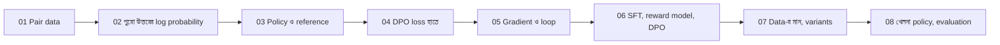

# Module 16 — Preference Learning ও DPO

[কেন্দ্রীয় map](../01-learning-map.md) · [Course outline](../00-course-outline.md) · [লেখার নিয়ম](../00-writing-style-guide.md)

## Status

**লেখা প্রস্তুত; শেখা নয়।** আটটা lecture লেখা হয়েছে এবং সংখ্যা ও Python code চালিয়ে মেলানো হয়েছে। পড়া ও নিজে অনুশীলন করা বাকি; লেখা থাকা মানে শেখা সম্পন্ন হওয়া নয়।

## এই module কী নিয়ে?

SFT-তে একটা prompt-এর জন্য একটা "আদর্শ উত্তর" দেওয়া হয়। কিন্তু অনেক সময় আদর্শ উত্তর লেখার চেয়ে দুটো উত্তরের মধ্যে ভালোটা বাছা সহজ। এই module শেখায় সেই **preference pair** (prompt, chosen, rejected) থেকে model কীভাবে শেখে, এবং **DPO** (Direct Preference Optimization) নামের পদ্ধতিতে সেটা কীভাবে একটা সরল loss হয়ে দাঁড়ায়। DPO-তে আলাদা reward model বা উত্তর-বানানোর (rollout) RL loop লাগে না। সেটা পাবে [Module 17](../module-17-reinforcement-learning-and-feedback/README.md)-এ।

## Prerequisites

| কী লাগবে | কোথায় |
|---|---|
| SFT-র ধারণা | [Module 15 — SFT ও instruction tuning](../module-15-domain-and-task-adaptation/lecture-02-sft-and-instruction-tuning.md) |
| Sigmoid ও log loss (`−ln p`) | [Sigmoid](../module-03-logistic-regression/lecture-01-sigmoid.md), [Log loss](../module-03-logistic-regression/lecture-03-log-loss.md) |
| Token probability ও cross-entropy | [Module 12 — Next-token ও cross-entropy](../module-12-text-sequences-and-multimodal-models/lecture-04-next-token-and-cross-entropy.md) |
| Gradient descent-এর ধারণা | [Module 02 — Gradient descent](../module-02-linear-regression/lecture-03-gradient-descent-training.md) |
| Correction থেকে preference | [Module 17 — Correction, target, preference ও reward](../module-17-reinforcement-learning-and-feedback/lecture-01-correction-target-preference-and-reward.md) |

অজানা অংশ (যেমন log-এ গুণ-যোগ) lecture-এর ভেতরেই ছোট উদাহরণে শেখানো হয়েছে।

## কোন ক্রমে পড়বে

প্রতিটা lecture ছোট, একটা মূল ধারণা। ক্রম ধরে পড়ো; আগের lecture-এর সংখ্যাই পরেরটায় ফিরে আসে (একই chosen/rejected pair)।

## Lecture-এর তালিকা

| ক্রম | Lecture | এক লাইনে |
|---|---|---|
| 01 | [Preference data](lecture-01-preference-data.md) | Prompt, chosen, rejected; ranking থেকে pair; পছন্দ মানেই সত্য নয় |
| 02 | [পুরো উত্তরের probability ও log-ratio](lecture-02-sequence-probability-and-log-ratio.md) | Token probability-র গুণ → log-এর যোগ; policy বনাম reference-এর log-ratio |
| 03 | [Reference model ও policy](lecture-03-reference-model-and-policy.md) | কোন model শেখে, কোনটা স্থির মাপকাঠি; শুরুতে log-ratio শূন্য |
| 04 | [DPO objective হাতে হিসাব](lecture-04-dpo-objective-by-hand.md) | `−ln σ(β × m)` ছয় ধাপে; প্রতিটা symbol; `β`-র ভূমিকা |
| 05 | [DPO gradient ও training loop](lecture-05-dpo-gradient-and-training-loop.md) | Chosen-এর log probability বাড়ে, rejected-এর কমে; batch, masking, full/LoRA, offline data |
| 06 | [SFT, reward model ও DPO](lecture-06-sft-reward-model-and-dpo.md) | তিন loss পাশাপাশি; implicit reward; DPO-তে rollout নেই |
| 07 | [Preference quality ও variants](lecture-07-preference-quality-and-variants.md) | Length bias, noisy pair; IPO/ORPO/SimPO কোন অংশ বদলায় |
| 08 | [ছোট DPO practical ও evaluation](lecture-08-small-dpo-practical-and-evaluation.md) | Softmax table-এ DPO চালানো; held-out preference accuracy, task metric, style বনাম correctness |

## Map-এ অবস্থান

| প্রশ্ন | এই module-এ উত্তর |
|---|---|
| শেখার ধারা | Supervised-এর মতো স্থির data, কিন্তু label হলো "কোনটা ভালো"; rollout নেই |
| Output-এর হিসাব | পুরো উত্তরের log probability, policy ও reference থেকে |
| Objective | `−ln σ(β × [chosen-এর log-ratio − rejected-এর log-ratio])` |
| Update | Loss-এর gradient দিয়ে শুধু policy-র parameter; reference স্থির |
| একাধিক model | Policy (শেখে) আর reference (স্থির) |

## সীমা ও সতর্কতা

- Lecture 08-এর খেলনা policy একটা softmax table; তাতে এক prompt-এর শিক্ষা অন্য prompt-এ ছড়ায় না। বাস্তব model-এর behavior এতে প্রমাণ হয় না।
- Lecture 08-এর style বনাম correctness table **কাল্পনিক সংখ্যা**, বাস্তব experiment নয়।
- IPO, ORPO, SimPO-র সূত্র ইচ্ছে করে দেওয়া হয়নি; কেবল DPO-র কোন অংশ বদলায় তা বলা হয়েছে। ব্যবহারের আগে মূল paper মিলিয়ে নাও।
- Lecture 05-এর training loop একটা pseudo-code (চালানো হয়নি); কোনো library-র আসল API নয়।

## আরও পড়ার জন্য

- DPO-র মূল paper: "Direct Preference Optimization: Your Language Model is Secretly a Reward Model"।
- বাস্তব trainer: [Hugging Face TRL — DPO trainer](https://huggingface.co/docs/trl/dpo_trainer) (এখানে চালিয়ে যাচাই করা হয়নি)।

## পরের module

[Module 17 — Reinforcement Learning ও Feedback](../module-17-reinforcement-learning-and-feedback/README.md): rollout, reward, policy gradient, PPO/GRPO, RLHF।
