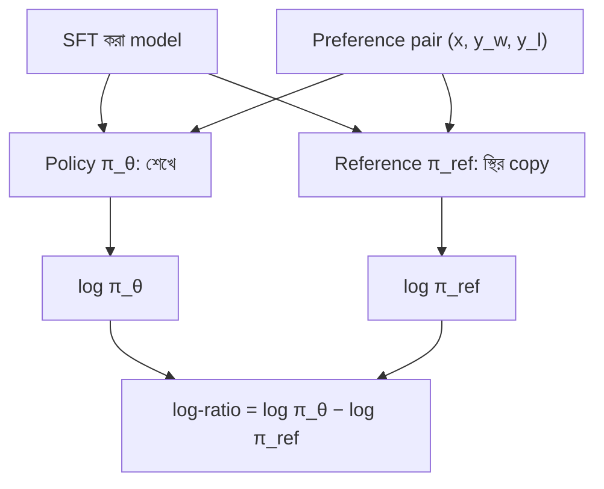

# Lecture 03 — Reference model ও policy: কে শেখে, কে মাপকাঠি

> আগে যা জানা থাকলে ভালো: [পুরো উত্তরের log probability ও log-ratio](lecture-02-sequence-probability-and-log-ratio.md)। এই lecture শেষে পারবে: policy আর reference model-এর পার্থক্য বলতে, আর কেন শুরুতে সব log-ratio শূন্য থাকে তা বুঝিয়ে বলতে। ([Map-এ অবস্থান](../01-learning-map.md): DPO-তে "একাধিক model একসঙ্গে ব্যবহার" — একটা শেখে, একটা স্থির থাকে। Loss এখনও আসেনি)

## সমস্যাটা কী?

ধরো preference data আছে আর আমরা চাই model chosen উত্তরকে বেশি সম্ভাব্য আর rejected-কে কম সম্ভাব্য করুক। যদি শুধু "chosen-এর probability বাড়াও" বলা হয়, model যত খুশি বদলাতে পারে। এমনকি এমনভাবে বদলাতে পারে যে অন্য সব কাজের ক্ষমতা নষ্ট হয়ে যায়। দরকার এমন একটা মাপকাঠি, যা বলবে "শুরুর model-এর তুলনায় এই উত্তরের probability কতটা বদলেছে"। এই মাপকাঠি হলো একটা স্থির copy: **reference model**।

## ধারণাটা সহজ ভাষায়

DPO-তে একই architecture-এর দুটো model থাকে।

**Policy `π_θ`:** যে model-কে শেখানো হচ্ছে। `θ` (থিটা) হলো এর parameter-গুলো, যেগুলো update হয়। "Policy" মানে এখানে model-এর সেই নিয়ম যা prompt দেখে উত্তরের probability ঠিক করে। (Policy-র বিস্তারিত RL-এর [Module 17](../module-17-reinforcement-learning-and-feedback/README.md)-এ আসবে।)

**Reference model `π_ref`:** শুরুতে policy যেমন ছিল তার একটা **স্থির (frozen) copy**। এর parameter কখনো বদলায় না। এর কাজ শুধু log probability দেওয়া, যাতে policy-র সঙ্গে তুলনা করা যায়।

সাধারণত reference হিসেবে নেওয়া হয় **SFT করা model**। কারণ preference data-র উত্তরগুলো যে ধরনের লেখা, আগে SFT করা model সেই ধরনের উত্তরকে ন্যায্য probability দিতে পারে। মূল (base) model সেখানে অনেক কম probability দিতে পারে, তখন log-ratio-র তুলনা ভরসাযোগ্য থাকে না। সাধারণ চর্চা এটাই, কিন্তু কোনো সূত্রের বাধ্যবাধকতা নয়; [Lecture 06](lecture-06-sft-reward-model-and-dpo.md)-এ SFT-র সঙ্গে সম্পর্ক আসবে।



দুই model একই `(x, y_w, y_l)` দেখে। পার্থক্য শুধু এটাই যে policy-র ক্ষেত্রে পরে gradient বইবে আর parameter বদলাবে, reference-এর ক্ষেত্রে নয়।

## ছোট একটা উদাহরণ

আগের lecture-এর chosen উত্তর "রাজধানী ঢাকা।" আর একটা rejected উত্তর "জানি না।" নিই। Reference-এর log probability: chosen `−1.309`, rejected `−1.897`।

**শুরুতে:** policy হলো reference-এর হুবহু copy, তাই তার log probability-ও একই।

| উত্তর | `log π_θ` | `log π_ref` | log-ratio |
|---|---:|---:|---:|
| chosen | −1.309 | −1.309 | 0 |
| rejected | −1.897 | −1.897 | 0 |

দুটো log-ratio-ই শূন্য। এর মানে "এখনও কিছু বদলায়নি", আর DPO-র প্রথম step এই অবস্থা থেকেই শুরু হয়।

**Training-এর পরে:** ধরো policy-র মান বদলে chosen-এর `−1.022` আর rejected-এর `−2.303` হয়েছে। Reference আগের মতোই।

| উত্তর | `log π_θ` | `log π_ref` | log-ratio |
|---|---:|---:|---:|
| chosen | −1.022 | −1.309 | +0.287 |
| rejected | −2.303 | −1.897 | −0.406 |

Chosen-এর log-ratio ধনাত্মক, rejected-এর ঋণাত্মক। অর্থাৎ policy **শুরুর অবস্থার তুলনায়** chosen-কে বেশি আর rejected-কে কম সম্ভাব্য মনে করছে। DPO-র loss এই দুটো সংখ্যাকেই কাজে লাগায়: [পরের lecture](lecture-04-dpo-objective-by-hand.md)-এ।

## কোড

```python
# reference: স্থির; policy: শুরুতে copy
ref = {"chosen": -1.309, "rejected": -1.897}
policy = dict(ref)

def log_ratios(policy, ref):
    return {k: round(policy[k] - ref[k], 3) for k in ref}

print("শুরুতে :", log_ratios(policy, ref))

policy["chosen"], policy["rejected"] = -1.022, -2.303   # training-এর ফল (ধরে নেওয়া)
print("পরে    :", log_ratios(policy, ref))
# output:
# শুরুতে : {'chosen': 0.0, 'rejected': 0.0}
# পরে    : {'chosen': 0.287, 'rejected': -0.406}
```

## মনে রাখার সারকথা

- Policy `π_θ` শেখে (parameter বদলায়); reference `π_ref` শুরুর স্থির copy, শুধু তুলনার জন্য।
- সাধারণত reference হয় SFT করা model; শুরুতে policy = reference, তাই সব log-ratio ০।
- Log-ratio বলে policy শুরুর তুলনায় কোন উত্তরকে বেশি বা কম সম্ভাব্য মনে করছে।

## নিজে করো

১. শুরুতে policy ও reference-এর chosen log probability দুটোই `−2.0`। log-ratio কত?
২. Training-এর পরে policy-র rejected log probability `−3.0`, reference-এর `−2.5`। log-ratio কত? মানে কী?
৩. Reference model-এর log probability একবার হিসাব করে রেখে দিলে চলে কেন? Policy-র ক্ষেত্রে চলে না কেন?

<details><summary>উত্তর</summary>

১. `−2.0 − (−2.0) = 0`।
২. `−3.0 − (−2.5) = −0.5`। Policy এখন ওই rejected উত্তরকে শুরুর চেয়ে কম সম্ভাব্য মনে করছে (যা চাওয়া হয়েছিল)।
৩. Reference-এর parameter বদলায় না আর data (offline) স্থির, তাই প্রতিটা `(x, y)`-এর জন্য তার মান সবসময় একই। Policy-র parameter প্রতি step-এ বদলায়, তাই তার log probability প্রতিবার নতুন করে হিসাব করতে হয়।

</details>

## পরের পাঠ

দুই log-ratio হাতে আছে। এখন এগুলো থেকে DPO-র একটা loss সংখ্যা কীভাবে বানানো হয়, ধাপে ধাপে: [Lecture 04 — DPO objective হাতে হিসাব](lecture-04-dpo-objective-by-hand.md)।
