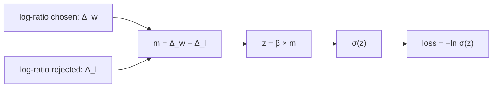

# Lecture 04 — DPO objective হাতে হিসাব

> আগে যা জানা থাকলে ভালো: [Policy ও reference-এর log-ratio](lecture-03-reference-model-and-policy.md), [sigmoid](../module-03-logistic-regression/lecture-01-sigmoid.md) ও [log loss](../module-03-logistic-regression/lecture-03-log-loss.md)। এই lecture শেষে পারবে: একটা preference pair-এর DPO loss ছয় ধাপে হাতে বের করতে, আর সূত্রের প্রতিটা symbol-এর কাজ বলতে। ([Map-এ অবস্থান](../01-learning-map.md): training objective, অর্থাৎ ভুল মাপা। এখানে parameter বদলানো হয় না; বদলানো [Lecture 05](lecture-05-dpo-gradient-and-training-loop.md)-এ)

## সমস্যাটা কী?

আগের lecture-এ chosen আর rejected, দুটোর আলাদা log-ratio পাওয়া গেছে। Training চালাতে এক জোড়া উদাহরণের জন্য **একটা** সংখ্যা চাই, যা বলবে "এই pair-এ model এখন কতটা ভুল বা ঠিক"। সংখ্যাটা ছোট হওয়া উচিত যদি policy শুরুর তুলনায় chosen-কে বেশি আর rejected-কে কম সম্ভাব্য বানিয়ে থাকে। DPO-র loss ঠিক এই সংখ্যা।

## ধারণাটা সহজ ভাষায়: ছয় ধাপ

একটা pair-এর সংখ্যাগুলো আগের lecture থেকে নেওয়া:

| | `log π_θ` | `log π_ref` |
|---|---:|---:|
| chosen `y_w` | −1.022 | −1.309 |
| rejected `y_l` | −2.303 | −1.897 |

**ধাপ ১ — chosen-এর log-ratio:** `Δ_w = −1.022 − (−1.309) = 0.287`।
**ধাপ ২ — rejected-এর log-ratio:** `Δ_l = −2.303 − (−1.897) = −0.406`।

**ধাপ ৩ — দুটোর পার্থক্য:** `m = Δ_w − Δ_l = 0.287 − (−0.406) = 0.693`।
`m` বলে "chosen কতটা বেশি এগিয়েছে rejected-এর চেয়ে"। `m` ধনাত্মক ও বড় হওয়াই ভালো।

**ধাপ ৪ — β দিয়ে গুণ:** `β` (বিটা) একটা সংখ্যা যা আমরা নিজে ঠিক করি। এখানে `β = 1`, তাই `z = β × m = 0.693`।

**ধাপ ৫ — sigmoid:** `σ(0.693) = 1 ÷ (1 + e^(−0.693)) = 0.6667`।
এই সংখ্যাকে পড়া যায় এভাবে: "model-এর মতে chosen জেতার সম্ভাবনা ০.৬৬৬৭"।

**ধাপ ৬ — `−ln`:** `loss = −ln(0.6667) = 0.4055 ≈ 0.406`।

শুরুতে `m = 0`, তাই `σ(0) = 0.5` আর `loss = −ln(0.5) = ln 2 = 0.693`। Training-এর পরে loss ০.৪০৬-এ নেমেছে, মানে policy ঠিক দিকে গেছে।

## Formula

উপরের ছয় ধাপের সংক্ষিপ্ত রূপ:

```
L = − log σ( β × [ (log π_θ(y_w|x) − log π_ref(y_w|x)) − (log π_θ(y_l|x) − log π_ref(y_l|x)) ] )
```

| symbol | মানে |
|---|---|
| `x` | prompt |
| `y_w`, `y_l` | chosen ও rejected উত্তর |
| `π_θ(y ∣ x)` | policy-র দেওয়া পুরো উত্তরের probability |
| `π_ref(y ∣ x)` | reference-এর দেওয়া probability (স্থির) |
| `log π_θ − log π_ref` | log-ratio (ধাপ ১ ও ২) |
| `[ ... − ... ]` | ধাপ ৩-এর `m` |
| `β` | পার্থক্য কতটা বড় করে sigmoid-এ দেব; হাইপারপ্যারামিটার |
| `σ` | sigmoid |
| `− log` | log loss; `σ` বড় হলে loss ছোট |

ছোট করে লিখলে: `L = −ln σ(β × m)`।

### কেন শুধু `log π_θ(y_w)` বাড়াই না?

কারণ সেটা SFT হয়ে যেত, আর rejected-এর খবর থাকত না। DPO-তে দুটোই দেখা হয়: chosen-এর log-ratio বাড়ুক **আর** rejected-এরটা কমুক, দুটোই `m`-কে বাড়ায়। আবার log-ratio ব্যবহার করায় তুলনাটা শুরুর model-এর সাপেক্ষে হচ্ছে, অর্থাৎ policy কতদূর সরেছে তার উপর।

### Module 03-র সঙ্গে সম্পর্ক

`L = −ln σ(z)` হলো ঠিক [log loss](../module-03-logistic-regression/lecture-03-log-loss.md), যেখানে সত্যি label `y = 1` আর score `z = β × m`। অর্থাৎ DPO একটা ছোট binary classifier-এর মতো: "chosen কি rejected-এর চেয়ে ভালো?" প্রশ্নের উত্তর সবসময় "হ্যাঁ" ধরা আছে, আর model-এর কাজ সেই "হ্যাঁ"-এর probability বাড়ানো।

## `m` আর `β` বদলালে

**`β = 1` ধরে `m` বদলালে:**

| `m` | −2 | −1 | 0 | 0.693 | 2 | 5 |
|---|---:|---:|---:|---:|---:|---:|
| `loss` | 2.127 | 1.313 | 0.693 | 0.406 | 0.127 | 0.007 |

`m` ঋণাত্মক হলে মানে policy উল্টো দিকে গেছে (rejected-কে বেশি পছন্দ করছে); loss বড়। `m` যত বাড়ে, loss শূন্যের দিকে যায়।

**`m = 0.693` ধরে `β` বদলালে:**

| `β` | 0.1 | 0.5 | 1 | 2 |
|---|---:|---:|---:|---:|
| `loss` | 0.659 | 0.535 | 0.406 | 0.223 |

একই `m`-এ `β` বড় হলে loss কম দেখায়। তাই `β` বড় হলে ছোট বদলেই "যথেষ্ট ভালো" মনে হয় এবং policy reference-এর কাছাকাছি থাকে।

বাস্তব model-এ পুরো উত্তরের log-ratio-র পার্থক্য `m` প্রায়ই দশ-বিশ বা আরও বড় হয়, কারণ উত্তরে অনেক token। তাই `β` ছোট (প্রায়ই ০.১-এর আশেপাশের মান দেখা যায়) রাখা হয়: `m = 10`, `β = 0.1` হলে `z = 1`, loss ০.৩১৩। কোন `β` কাজে ভালো, তা পরীক্ষা করে ঠিক করার বিষয়; একটা সংখ্যা সবখানে চলে না।

## কোড

```python
import math

def sigmoid(z):
    return 1 / (1 + math.exp(-z))

lp_w, ref_w = -1.022, -1.309      # chosen: policy, reference
lp_l, ref_l = -2.303, -1.897      # rejected: policy, reference
beta = 1.0

d_w = lp_w - ref_w                # ধাপ ১
d_l = lp_l - ref_l                # ধাপ ২
m = d_w - d_l                     # ধাপ ৩
z = beta * m                      # ধাপ ৪
s = sigmoid(z)                    # ধাপ ৫
loss = -math.log(s)               # ধাপ ৬
print("d_w =", round(d_w, 3), " d_l =", round(d_l, 3))
print("m =", round(m, 3), " sigmoid =", round(s, 3), " loss =", round(loss, 3))
# output:
# d_w = 0.287  d_l = -0.406
# m = 0.693  sigmoid = 0.667  loss = 0.406
```

## ছবি



## মনে রাখার সারকথা

- DPO loss = `−ln σ(β × m)`, যেখানে `m` = chosen-এর log-ratio − rejected-এর log-ratio।
- `m` বাড়লে loss কমে; শুরুতে `m = 0` আর loss = `ln 2 = 0.693`।
- `β` পার্থক্যের স্কেল ঠিক করে; এটা একটা hyperparameter, শেখা হয় না।

## নিজে করো

১. `Δ_w = 0.5`, `Δ_l = 0.1`, `β = 2`। loss কত?
২. `Δ_w = −0.3`, `Δ_l = 0.2`, `β = 1`। loss কত? `m` কোন চিহ্নের, কেন?
৩. প্রশ্ন ১-এর দুটো log-ratio-তেই ১.০ যোগ করলে (`1.5` ও `1.1`) `β = 1` ধরে loss কত? `0.5` ও `0.1` নিয়ে `β = 1`-এর loss-ও বের করো।
৪. `m = 20`, `β = 0.1`। loss কত?

<details><summary>উত্তর</summary>

১. `m = 0.5 − 0.1 = 0.4`, `z = 0.8`, `σ(0.8) = 0.690`, `loss = −ln(0.690) = 0.371`।
২. `m = −0.3 − 0.2 = −0.5`, `σ(−0.5) = 0.378`, `loss = 0.974`। `m` ঋণাত্মক: chosen-এর log-ratio কমেছে আর rejected-এরটা বেড়েছে, মানে policy ভুল দিকে।
৩. `m` একই থাকে (`1.5 − 1.1 = 0.4`), তাই `β = 1`-এ loss `−ln σ(0.4) = 0.513`; `0.5` ও `0.1` নিলেও `m = 0.4` আর একই loss 0.513। শুধু **পার্থক্য** গুরুত্বপূর্ণ; দুটো একসঙ্গে বাড়লে লাভ হয় না।
৪. `z = 2`, `σ(2) = 0.881`, `loss = −ln(0.881) = 0.127`।

</details>

## পরের পাঠ

Loss বের হলো; এখন policy-র মান কোন দিকে, কতটা বদলাবে? Gradient-এর দিক আর পুরো training loop: [Lecture 05 — DPO gradient ও training loop](lecture-05-dpo-gradient-and-training-loop.md)।
