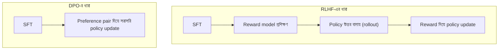

# Lecture 06 — SFT, reward model ও DPO: কী এক, কী আলাদা

> আগে যা জানা থাকলে ভালো: [DPO loss ও gradient](lecture-05-dpo-gradient-and-training-loop.md) এবং SFT-র ধারণা ([Module 15](../module-15-domain-and-task-adaptation/lecture-02-sft-and-instruction-tuning.md))। এই lecture শেষে পারবে: SFT, reward model আর DPO-র loss পাশাপাশি রেখে তুলনা করতে, আর বলতে DPO-তে কেন আলাদা reward model বা rollout loop লাগে না। ([Map-এ অবস্থান](../01-learning-map.md): একই "পছন্দ থেকে শেখা" লক্ষ্যে তিনটা আলাদা objective। এখানে নতুন formula নেই; আগের formula-গুলোকে পাশাপাশি বসানো)

## সমস্যাটা কী?

Model-কে মানুষের পছন্দের দিকে নিতে অনেক নাম শোনা যায়: SFT, reward model, RLHF, DPO। একসঙ্গে দেখলে মনে হয় সব আলাদা বিশাল পদ্ধতি। আসলে এরা কয়েকটা ছোট অংশ জোড়া দিয়ে তৈরি, আর DPO-র বিশেষত্ব হলো কিছু অংশ বাদ দেওয়া। কোন অংশ বাদ গেল বুঝলে বাকি সব সহজ হয়ে যায়।

## ধারণাটা সহজ ভাষায়

**SFT:** chosen উত্তরটা সঠিক target ধরে তার probability বাড়ায়: `loss = −log π_θ(y_w|x)`। Rejected-এর কোনো ভূমিকা নেই।

**Reward model:** আলাদা একটা model, যে প্রতিটা উত্তরকে একটা সংখ্যা (score `r`) দেয়। Preference pair থেকে শেখে: chosen-এর score rejected-এর চেয়ে বেশি হওয়া উচিত। এর loss: `−ln σ(r_w − r_l)`। (এটা Bradley–Terry ধরনের pairwise loss।)

**DPO:** আলাদা reward model ছাড়াই সরাসরি policy শেখায়। এর loss: `−ln σ(β × (Δ_w − Δ_l))`, যেখানে `Δ = log π_θ − log π_ref`।

শেষ দুটোর আকার একই: `−ln σ(দুই উত্তরের score-এর পার্থক্য)`। পার্থক্য শুধু "score" কোথা থেকে আসছে:

| | score কী | কোথা থেকে |
|---|---|---|
| Reward model | `r(x, y)` | আলাদা একটা model-এর output |
| DPO | `β × (log π_θ − log π_ref)` | policy ও reference-এর log-ratio |

তাই DPO-র `β × Δ` কে অনেক সময় **implicit reward** (অন্তর্নিহিত reward) বলা হয়: আলাদা reward model নেই, কিন্তু policy-র ভেতরেই score লুকানো। (এই সম্পর্কটা DPO-র মূল গবেষণার একটা কেন্দ্রীয় ধারণা।)

## ছোট একটা উদাহরণ: একই pair, তিন loss

আগের সংখ্যা: chosen `log π_θ = −1.022`, `log π_ref = −1.309`; rejected `log π_θ = −2.303`, `log π_ref = −1.897`। Reward model-এর score কাল্পনিক `r_w = 1.2`, `r_l = 0.4`।

| পদ্ধতি | হিসাব | loss |
|---|---|---:|
| SFT | `−log π_θ(y_w)` = −(−1.022) | 1.022 |
| Reward model | `−ln σ(1.2 − 0.4)` = `−ln σ(0.8)` | 0.371 |
| DPO (`β = 1`) | `−ln σ(0.287 − (−0.406))` = `−ln σ(0.693)` | 0.406 |

তিন loss তিন আলাদা জিনিস মাপছে, তাই সংখ্যাগুলো তুলনা করে "কোনটা ভালো" বলা যায় না। শুধু গঠনটা দেখো: প্রথমটায় একা chosen, বাকি দুটোয় chosen বনাম rejected।

```python
import math

def sigmoid(z):
    return 1 / (1 + math.exp(-z))

lp_w, ref_w = -1.022, -1.309
lp_l, ref_l = -2.303, -1.897
r_w, r_l, beta = 1.2, 0.4, 1.0            # r_w, r_l কাল্পনিক

sft = -lp_w
rm  = -math.log(sigmoid(r_w - r_l))
dpo = -math.log(sigmoid(beta * (lp_w - ref_w) - beta * (lp_l - ref_l)))
print("SFT :", round(sft, 3))
print("RM  :", round(rm, 3))
print("DPO :", round(dpo, 3))
# output:
# SFT : 1.022
# RM  : 0.371
# DPO : 0.406
```

## Pipeline-এ কী বাদ গেল



| | SFT | RLHF-ধারা (reward model + RL) | DPO |
|---|---|---|---|
| Data | prompt → একটা উত্তর | pair (reward model-এর জন্য) + prompt (rollout-এর জন্য) | pair |
| আলাদা reward model | নেই | আছে | নেই |
| Training-এর সময় নতুন উত্তর বানানো (rollout) | নেই | আছে | **নেই** |
| Reference model | নেই | সাধারণত আছে (policy কাছাকাছি রাখতে) | আছে (loss-এর ভেতরে) |
| Loss-এর মূল গঠন | `−log π_θ(y_w)` | reward-ভিত্তিক RL objective | `−ln σ(β(Δ_w − Δ_l))` |

প্রধান কথা: **DPO-তে explicit rollout RL loop নেই।** Data আগে থেকে জমা থাকে, training সময় model নতুন উত্তর বানায় না, কোনো reward-ও গোনা হয় না। তাই এটা supervised-এর মতো সরল দেখায়। কিন্তু উল্টো দিকে, data-র বাইরের উত্তরের উপর DPO-র সরাসরি নিয়ন্ত্রণ থাকে না, আর data-র মান সরাসরি ফলকে প্রভাবিত করে ([পরের lecture](lecture-07-preference-quality-and-variants.md))। RLHF-এর বিস্তারিত [Module 17](../module-17-reinforcement-learning-and-feedback/lecture-09-rlhf-and-reward-modeling.md)-এ।

সাবধান: DPO-র নানা বিকল্প (যেমন নতুন উত্তর বানিয়ে আবার pair তৈরি করা) আছে। এখানে "DPO" বলতে স্ট্যান্ডার্ড offline রূপ বোঝানো হয়েছে।

## মনে রাখার সারকথা

- SFT শুধু chosen শেখায়; reward model আর DPO দুটোই `−ln σ(পার্থক্য)` ধরনের pairwise loss।
- DPO-তে score আসে `β × log-ratio` থেকে (implicit reward); আলাদা reward model লাগে না।
- Standard DPO-তে rollout/reward loop নেই; data স্থির, তাই সরল, কিন্তু data-র মানের উপর নির্ভরশীল।

## নিজে করো

১. Reward model-এ `r_w = 2.0`, `r_l = 0.5`। loss কত?
২. DPO-তে `β = 0.5`, `Δ_w = 0.4`, `Δ_l = −0.2`। implicit reward দুটো আর loss কত?
৩. DPO-তে training চলার সময় কোন কোন model চালাতে হয়? Rollout লাগে কি?

<details><summary>উত্তর</summary>

১. `−ln σ(1.5) = 0.201`।
২. `β × Δ_w = 0.2`, `β × Δ_l = −0.1`, পার্থক্য `0.3`; `loss = −ln σ(0.3) = 0.554`।
৩. Policy (শেখে) আর reference (স্থির, শুধু log probability দেয়)। Rollout লাগে না, কারণ উত্তরগুলো data-তেই আছে।

</details>

## পরের পাঠ

DPO data-র উপরেই নির্ভরশীল; তাই data খারাপ হলে কী হয়, আর DPO-র কয়েকটা পরিচিত বিকল্প কোন অংশ বদলায়: [Lecture 07 — Preference quality ও variants](lecture-07-preference-quality-and-variants.md)।
