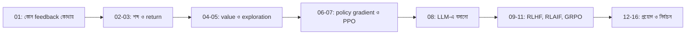

# Module 17 — Reinforcement Learning ও Feedback

[কেন্দ্রীয় map](../01-learning-map.md) · [Course outline](../00-course-outline.md) · [লেখার নিয়ম](../00-writing-style-guide.md)

## Status

লেখা প্রস্তুত; শেখা নয়। নিচের ১৬টা lecture-এর প্রতিটা ছোট, এক ধারণার এবং ছোট সংখ্যার উদাহরণসহ লেখা হয়েছে। লেখা থাকা মানে বিষয়টা শেখা হয়ে গেছে, এমন নয়।

## আগে যা জানা থাকলে ভালো

- Module 01-এর [Q-learning পরিচয়](../module-01-ml-fundamentals-and-math-basics/lecture-05-how-reinforcement-learning-works.md) (Lecture 02–05-এর ভিত্তি)।
- Module 10-এর training-এর মূল ধারণা: loss, gradient, update।
- LLM অংশের (Lecture 08 থেকে) আগে Module 12-এর [softmax](../module-12-text-sequences-and-multimodal-models/lecture-03-logits-and-softmax.md), [next-token](../module-12-text-sequences-and-multimodal-models/lecture-04-next-token-and-cross-entropy.md) ও [decoder](../module-12-text-sequences-and-multimodal-models/lecture-07-autoregressive-decoder-and-stopping.md), আর [Module 16-এর reference model ও log-ratio](../module-16-preference-learning-and-dpo/lecture-03-reference-model-and-policy.md)।

Expectation (সম্ভাবনা-ভারিত গড়) আলাদা করে আগে পড়তে হয় না; Lecture 06-এ হাতে হিসাব করে দেখানো হয়েছে।

## Lecture-এর সারণি

| ক্রম | Lecture | কী শেখা যায় | Status |
|---|---|---|---|
| 01 | [ভুল ধরা পড়লে model-কে কীভাবে শেখানো যায়](lecture-01-correction-target-preference-and-reward.md) | একই ভুল থেকে SFT-এর target, preference-জোড়া বা RL-এর reward; OCR reward হাতে | লেখা প্রস্তুত; শেখা নয় |
| 02 | [Agent, environment, state, action, reward](lecture-02-agent-environment-state-action-reward.md) | করিডোরের একটা পুরো episode | লেখা প্রস্তুত; শেখা নয় |
| 03 | [Return, discount ও delayed reward](lecture-03-return-discount-delayed-reward.md) | দেরির reward-কে ছোট করে return বের করা | লেখা প্রস্তুত; শেখা নয় |
| 04 | [Policy, value ও Q-learning](lecture-04-policy-value-and-q-learning.md) | Q-table, update, আর table থেকে function approximation | লেখা প্রস্তুত; শেখা নয় |
| 05 | [Exploration, on-policy ও off-policy](lecture-05-exploration-on-off-policy.md) | ε-greedy কেন লাগে; data সংগ্রহ বনাম শেখার policy | লেখা প্রস্তুত; শেখা নয় |
| 06 | [Policy gradient ও advantage](lecture-06-policy-gradient-and-advantage.md) | দুই action-এর policy-তে expected reward ও gradient হাতে; baseline | লেখা প্রস্তুত; শেখা নয় |
| 07 | [Actor-critic ও PPO](lecture-07-actor-critic-and-ppo.md) | Critic দিয়ে advantage, ratio ও clipping-এর হাতে-হিসাব | লেখা প্রস্তুত; শেখা নয় |
| 08 | [LLM-এ policy ও rollout](lecture-08-policy-and-rollout-in-llm.md) | Token = action, উত্তর = episode, reference-এর শাস্তি | লেখা প্রস্তুত; শেখা নয় |
| 09 | [RLHF ও reward modeling](lecture-09-rlhf-and-reward-modeling.md) | মানুষের পছন্দ থেকে reward model, তারপর RL loop | লেখা প্রস্তুত; শেখা নয় |
| 10 | [RLAIF ও feedback quality](lecture-10-rlaif-and-feedback-quality.md) | AI judge, bias, rubric ও বিশেষজ্ঞের সঙ্গে তুলনা | লেখা প্রস্তুত; শেখা নয় |
| 11 | [RLVR ও GRPO](lecture-11-rlvr-and-grpo.md) | যাচাইযোগ্য outcome, group-relative advantage, হাতে-হিসাব | লেখা প্রস্তুত; শেখা নয় |
| 12 | [Correction ও self-correction](lecture-12-correction-and-self-correction.md) | ভুল উত্তর, feedback, retry; inference-এ retry বনাম weight update | লেখা প্রস্তুত; শেখা নয় |
| 13 | [Task case studies](lecture-13-task-case-studies.md) | Math/code, OCR, style, robotics ও tool-use; reward design | লেখা প্রস্তুত; শেখা নয় |
| 14 | [Domain-expert answer evaluation](lecture-14-domain-expert-answer-evaluation.md) | ফতোয়া-ধরনের উত্তরে উৎস, context, মতভেদ ও বিশেষজ্ঞ rubric | লেখা প্রস্তুত; শেখা নয় |
| 15 | [Reward hacking ও generalization](lecture-15-reward-hacking-and-generalization.md) | Proxy metric-এর ফাঁক, outcome বনাম process reward | লেখা প্রস্তুত; শেখা নয় |
| 16 | [ছোট practical ও method selection](lecture-16-practical-and-method-selection.md) | SFT/DPO/RL baseline, compute ও held-out মূল্যায়ন | লেখা প্রস্তুত; শেখা নয় |

## কোন ক্রমে পড়বে

- **প্রধান পথ:** 01 থেকে 08 ক্রমানুসারে। প্রতিটা lecture আগেরটার সংখ্যা ও উদাহরণ ব্যবহার করে (করিডোরের একই খেলা 02 থেকে 05 পর্যন্ত চলে)।
- **তাড়া থাকলে:** LLM-এর RL বুঝতে 06, 07, 08 সবচেয়ে জরুরি। 04-এর Q-learning আর 05-এর on/off-policy প্রথমবারে হালকা পড়ে নিয়ে পরে ফিরে আসা যায়।
- **09–11:** 08-এর পরে ক্রমানুসারে। Reward কোথা থেকে আসে (মানুষ, AI, verifier) তা এখানে।
- **12–16:** আগ্রহ অনুযায়ী আলাদা শাখা। 14 (বিশেষজ্ঞ-নির্ভর উত্তর) ও 15 (reward hacking) 09–11-এর পরে পড়লে সবচেয়ে ভালো বোঝা যায়। 16 সবার শেষে।

প্রতি lecture-এ একটা মূল ধারণা, আগে সমস্যা ও ছোট সংখ্যার উদাহরণ, তারপর formula, শেষে "নিজে করো"। একসঙ্গে সব symbol ঢোকানো হয়নি।
