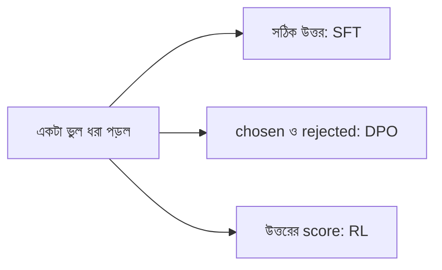

# Lecture 01 — ভুল ধরা পড়লে model-কে কীভাবে শেখানো যায়

> আগে যা জানা থাকলে ভালো: [loss ও gradient-এর পরিচয়](../module-10-neural-network-training/lecture-01-loss-gradient-and-backpropagation.md) এবং [fine-tuning-এর পদ্ধতির মানচিত্র](../module-13-pretraining-finetuning-and-lora/lecture-02-finetuning-methods-map.md)। এই lecture শেষে পারবে: একটা ভুল উত্তর থেকে SFT-এর target, preference-এর জোড়া আর RL-এর reward বানাতে, এবং বলতে কোনটা কখন লাগে। ([Map-এ অবস্থান](../01-learning-map.md): feedback-এর ধরন → training objective। Weight বদলানো এখানে নেই।)

## সমস্যাটা কী?

OCR model ছবিতে লেখা "বই" পড়তে গিয়ে "বউ" লিখল। ভুলটা আমরা ধরতে পারি। কিন্তু "ভুল ধরা" নিজে training-এর কোনো পদ্ধতি নয়। ভুলটাকে কোন আকারে model-কে দেখানো হবে, সেটা ঠিক করলে তবেই training শুরু হয়। একই ভুল থেকে তিন রকম জিনিস বানানো যায়, আর তিনটায় model আলাদাভাবে শেখে। তাই আগে এই তিনটা চিনতে হবে।

## ধারণাটা সহজ ভাষায়

ভুল উত্তরটা থেকে তিন রকম feedback তৈরি হতে পারে।

| পথ | কী দেখানো হয় | model কী শেখে |
|---|---|---|
| **SFT** (Supervised Fine-Tuning) | ছবি → সঠিক উত্তর "বই" | সঠিক উত্তরের probability বাড়ায় |
| **Preference** (পছন্দের জোড়া, DPO-তে লাগে) | একই ছবির দুটো উত্তর: chosen = "বই", rejected = "বউ" | "বই" "বউ"-এর চেয়ে ভালো, এই তুলনা |
| **RL** (Reinforcement Learning) | model নিজে উত্তর বানায়, আর সেই উত্তরের একটা score (**reward**) পায় | বেশি score পাওয়া উত্তরের সম্ভাবনা বাড়ায় |

প্রথম পথে model-কে সঠিক উত্তর হাতে ধরিয়ে দিই। দ্বিতীয় পথে শুধু বলি দুটোর মধ্যে কোনটা ভালো। তৃতীয় পথে সঠিক উত্তর দেখাই না। model নিজে চেষ্টা করে, আমরা শুধু নম্বর দিই।

RL-এ **policy** শব্দটা আসে। Policy মানে model কোন উত্তর বেছে নেবে তার নিয়ম। আমাদের OCR model-ই এখানে policy: ছবি দেখে সে একটা লেখা বেছে নেয়। RL-এর লক্ষ্য হলো এমনভাবে policy বদলানো, যাতে গড়ে বেশি reward পাওয়া যায়।

সাবধান: chat-এ model-কে বললে "তোমার উত্তর ভুল, আবার চেষ্টা করো", সে নতুন উত্তর দিতে পারে। কিন্তু এতে তার weight বদলায় না। কোনো training হয়নি। ভুলটা training data হয়ে model-এর weight বদলায় শুধু উপরের তিন পথের কোনো একটায়।

## ছোট একটা উদাহরণ: OCR reward

RL-এ আমাদের model-এর উত্তরকে একটা সংখ্যায় মাপতে হয়। OCR-এ সহজ একটা মাপ আছে: **CER** (Character Error Rate)। গুনতে হয় সঠিক লেখা থেকে আসল উত্তরে পৌঁছাতে কটা অক্ষর বসাতে, মুছতে বা বদলাতে হয়, তারপর সঠিক লেখার অক্ষর-সংখ্যা দিয়ে ভাগ করতে হয়।

সঠিক লেখা "বই" (২ অক্ষর):

| model-এর উত্তর | কটা অক্ষর বদলাতে হয় | CER | reward = `1 − min(CER, 1)` |
|---|---|---|---|
| বই | 0 | 0 / 2 = 0 | 1.0 |
| বউ | 1 (ই → উ) | 1 / 2 = 0.5 | 0.5 |
| ধউ | 2 | 2 / 2 = 1.0 | 0.0 |

Reward বেশি মানে উত্তর ভালো। `min(CER, 1)` কেন? উত্তর অনেক লম্বা হলে CER 1-এর বেশি হতে পারে ("বইবইবই" হলে CER = 4 / 2 = 2)। ওখানে reward ঋণাত্মক না করে 0-তে আটকে দেওয়া হয়েছে। একই কাজ ছোট Python code-এ:

```python
def edit_distance(a, b):
    prev = list(range(len(b) + 1))
    for i, ca in enumerate(a, 1):
        cur = [i]
        for j, cb in enumerate(b, 1):
            cur.append(min(prev[j] + 1, cur[j - 1] + 1, prev[j - 1] + (ca != cb)))
        prev = cur
    return prev[-1]

def reward(reference, output):
    cer = edit_distance(reference, output) / len(reference)
    return round(cer, 3), round(1 - min(cer, 1), 3)

for out in ["বই", "বউ", "ধউ"]:
    print(out, reward("বই", out))
# output:
# বই (0.0, 1.0)
# বউ (0.5, 0.5)
# ধউ (1.0, 0.0)
```

এখানে প্রতিটা Unicode code point-কে একটা "অক্ষর" ধরা হয়েছে। বাস্তব OCR-এ normalization, একাধিক বৈধ বানান আর reference-এর ভুল সামলাতে হয়। এটা একটা নকশার উদাহরণ, পরীক্ষিত project-এর recipe নয়।

## কোন পথ কখন?

| পরিস্থিতি | সাধারণত কোন পথ |
|---|---|
| যাচাই করা সঠিক উত্তর হাতে আছে | SFT। সবচেয়ে সরাসরি, আগে এটাই চেষ্টা করা হয় |
| সঠিক উত্তর নেই, কিন্তু দুটো উত্তরের মধ্যে ভালোটা বলা যায় | Preference জোড়া (DPO) |
| model-এর বানানো উত্তর যাচাই বা score করা যায়, কিন্তু একটাই "সঠিক" উত্তর নেই | RL |

RL স্বয়ংক্রিয়ভাবে SFT-এর চেয়ে ভালো হয় না। সঠিক উত্তর থাকলে SFT-ই ভালো baseline; RL ভালো কি না, পরীক্ষা করে দেখতে হয়।

কিছু কাজে RL-এর reward বানানো তুলনামূলক সহজ:

| কাজ | reward কোথা থেকে | সতর্কতা |
|---|---|---|
| Math | final answer মেলে কি না | উত্তর ঠিক হলেই প্রতিটা ধাপ ঠিক, এমন নয় |
| Code | test পাস করে কি না | দুর্বল test ফাঁকি দিয়ে পাস করা যায় |
| OCR | CER/WER | reference ভুল হলে reward-ও ভুল |
| Tool-use, game, robot | কাজ শেষ হলো কি না, খরচ কত | reward অনেক ধাপ পরে আসে, [Lecture 03](lecture-03-return-discount-delayed-reward.md)-এ দেখা হবে |
| ধর্মীয় বা বিশেষজ্ঞ-নির্ভর উত্তর | যোগ্য বিশেষজ্ঞের rubric ও উৎস | পছন্দের score "শুদ্ধতার প্রমাণ" নয়; এটা [Lecture 14](lecture-14-domain-expert-answer-evaluation.md)-এ আলাদা করে |

সব কাজে একটা নির্ভরযোগ্য automatic checker থাকে না। আর model-এর নিজের আত্মবিশ্বাসকে "ঠিক হওয়ার reward" ধরা যায় না।

## ছবি



Reward নিজে weight বদলায় না। Reward থেকে একটা training objective বানানো হয়, তারপর gradient দিয়ে weight বদলায়। সেই ধাপগুলোই এই module-এর বাকি lecture।

## মনে রাখার সারকথা

- একই ভুল থেকে SFT-এর target, preference-এর জোড়া বা RL-এর reward বানানো যায়; কোনটা বানাব তা নির্ভর করে হাতে কী আছে তার ওপর।
- RL-এ model নিজে উত্তর বানায়, আর reward পেয়ে বেশি reward-এর উত্তরের সম্ভাবনা বাড়ায়।
- Chat-এ ভুল ধরালে weight বদলায় না; training-এ গেলে তবেই বদলায়।

## নিজে করো

১. সঠিক লেখা "কলম", model লিখল "কমল"। CER ও reward (`1 − min(CER, 1)`) কত?
২. সঠিক লেখা "বই", model কিছুই লিখল না (খালি উত্তর)। CER ও reward কত?
৩. নিচের প্রতিটায় SFT, preference না RL-এর সুবিধা বেশি? (ক) ১০ হাজার ছবির যাচাই করা transcription আছে। (খ) প্রতিটা প্রশ্নের দুটো উত্তর পাশাপাশি রেখে একজন বিশেষজ্ঞ ভালোটা বেছেছেন। (গ) code বানানোর কাজ, আর test দিয়ে পাস/ফেল দেখা যায়।

<details><summary>উত্তর</summary>

১. "কলম" থেকে "কমল" করতে ২টা অক্ষর বদলাতে হয় (ল ↔ ম)। CER = 2 / 3 = 0.667, reward = 1 − 0.667 = 0.333।
২. খালি উত্তর থেকে "বই" বানাতে ২টা অক্ষর বসাতে হয়। CER = 2 / 2 = 1.0, reward = 0।
৩. (ক) SFT, কারণ সঠিক উত্তর হাতে আছে। (খ) Preference জোড়া (DPO), কারণ ভালো-খারাপ তুলনা আছে। (গ) RL, কারণ test থেকে reward পাওয়া যায়।

</details>

## পরের পাঠ

RL বুঝতে হলে আগে ছোট একটা খেলার জগৎ দিয়ে শব্দগুলো চিনতে হবে: agent, environment, state, action, reward। [Lecture 02](lecture-02-agent-environment-state-action-reward.md)-এ একটা করিডোরের পুরো এক খেলা দেখব।

Sources: [DPO trainer](https://huggingface.co/docs/trl/dpo_trainer), [GRPO ও reward functions](https://huggingface.co/docs/trl/grpo_trainer)।
