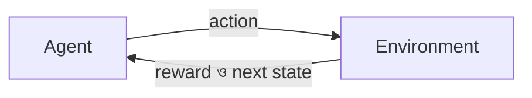

# Lecture 02 — Agent, Environment, State, Action, Reward

> আগে যা জানা থাকলে ভালো: [Lecture 01](lecture-01-correction-target-preference-and-reward.md)-এর "reward দিয়ে শেখা" এবং Module 01-এর [Reinforcement Learning পরিচয়](../module-01-ml-fundamentals-and-math-basics/lecture-05-how-reinforcement-learning-works.md)। এই lecture শেষে পারবে: একটা ছোট খেলার প্রতিটা ধাপ state, action, reward, next state-এর সারণিতে লিখতে। ([Map-এ অবস্থান](../01-learning-map.md): Reinforcement learning-এর শেখার ধারা। এখানে শুধু শব্দ ও data, শেখার formula পরে।)

## সমস্যাটা কী?

Supervised learning-এ প্রতিটা input-এর সঙ্গে সঠিক উত্তর থাকে। কিন্তু দাবা খেলায়, রোবট চালানোয় বা অনেক ধাপের কাজে কেউ প্রতিটা চালের "সঠিক উত্তর" বলে দেয় না। শুধু শেষে বলা হয় জিতলে কি না। এমন কাজ বোঝাতে কয়েকটা শব্দ লাগে, না হলে পরের সব lecture-এ আটকে যাবে। তাই আগে একটা খুব ছোট খেলা বানিয়ে শব্দগুলো তার ওপর বসাই।

## ধারণাটা সহজ ভাষায়

খেলাটা একটা করিডোর। চারটা ঘর পাশাপাশি: ঘর 0, 1, 2, 3। রোবট শুরু করে ঘর 0 থেকে। ঘর 3-এ পৌঁছালে খেলা শেষ।

```text
[ 0 ][ 1 ][ 2 ][ 3 = শেষ ]
```

প্রতি চালে রোবট **বাঁ** বা **ডান** যেতে পারে। বাঁ দিকে দেয়াল থাকলে (ঘর 0-তে বাঁ গেলে) সে একই ঘরে থাকে। Reward-এর নিয়ম: প্রতিটা চালে **−1** (সময় নষ্টের খরচ), আর শেষ ঘরে ঢুকলে **+10**।

এই খেলার অংশগুলোর নাম:

| শব্দ | মানে | এই খেলায় |
|---|---|---|
| **Agent** | যে সিদ্ধান্ত নেয় ও শেখে | রোবট |
| **Environment** | agent-এর বাইরের জগৎ; চাল নিলে সে ফল ফেরত দেয় | করিডোর ও তার নিয়ম |
| **State** | এই মুহূর্তে agent কোন অবস্থায় | কোন ঘরে আছে (0, 1, 2 বা 3) |
| **Action** | agent-এর চাল | বাঁ বা ডান |
| **Reward** | চালের পর environment যে সংখ্যা দেয় | −1 বা +10 |
| **Episode** | শুরু থেকে শেষ পর্যন্ত এক পুরো খেলা | ঘর 0 থেকে ঘর 3 |

Agent চাল বাছে কোন নিয়মে? সেই নিয়মের নাম **policy**। এখনো রোবট কিছু শেখেনি, তাই তার policy হলো "প্রতিবার এলোমেলো একটা চাল"। শেখা মানে এই policy-কে ভালো করা, সেটা পরের lecture-এ।

## ছোট একটা উদাহরণ

এলোমেলো চাল দিয়ে একটা পুরো episode। প্রতিটা সারি এক **step**: agent এই state দেখল, এই action নিল, এই reward পেল, আর এই নতুন state-এ (**next state**) গেল।

| step | state | action | reward | next state |
|---|---|---|---|---|
| 0 | 0 | ডান | −1 | 1 |
| 1 | 1 | বাঁ | −1 | 0 |
| 2 | 0 | ডান | −1 | 1 |
| 3 | 1 | ডান | −1 | 2 |
| 4 | 2 | ডান | +10 | 3 (শেষ) |

Reward-গুলো যোগ করলে −1 −1 −1 −1 + 10 = **6**। Episode শেষ।

খেয়াল করো, step 0-এর "ডান" চালে reward −1, অথচ সেই চাল ছাড়া শেষ ঘরে যাওয়া যেত না। Reward "এই চাল সঠিক ছিল কি না" বলে না। সে শুধু ওই মুহূর্তে একটা সংখ্যা দেয়। কোন চাল কাজে লেগেছিল, সেটা পরে বের করতে হয় ([Lecture 03](lecture-03-return-discount-delayed-reward.md))।

## কোড

একই খেলা Python-এ। `step` হলো environment: state আর action নিয়ে next state, reward ও খেলা শেষ কি না বলে দেয়।

```python
import random

GOAL = 3

def step(state, action):
    nxt = min(state + 1, GOAL) if action == "ডান" else max(state - 1, 0)
    if nxt == GOAL:
        return nxt, 10, True
    return nxt, -1, False

random.seed(47)
state, done, t = 0, False, 0
while not done:
    action = random.choice(["বাঁ", "ডান"])      # policy: এলোমেলো
    nxt, reward, done = step(state, action)
    print(t, state, action, reward, nxt)
    state, t = nxt, t + 1
# output:
# 0 0 ডান -1 1
# 1 1 বাঁ -1 0
# 2 0 ডান -1 1
# 3 1 ডান -1 2
# 4 2 ডান 10 3
```

Seed বদলালে অন্য episode হবে; এটা সেই seed-এর episode।

## ছবি



Agent চাল দেয়, environment ফল দেয়, আবার চাল। এই ঘূর্ণিই RL-এর মূল কাঠামো।

## OCR-এর সঙ্গে যোগ

OCR-এ state হলো ছবি, action হলো model-এর লেখা উত্তর, reward হলো `1 − min(CER, 1)`। সেখানে episode মাত্র এক step-এর: উত্তর দিলেই শেষ। করিডোরে episode-এ অনেক step, তাই আগের চালের ফল পরে এসে ধরা পড়ে।

## মনে রাখার সারকথা

- Agent চাল (action) দেয়, environment নতুন state আর reward ফেরত দেয়; এটা বারবার চলে।
- Episode হলো শুরু থেকে শেষ পর্যন্ত পুরো খেলা; প্রতিটা ধাপকে (state, action, reward, next state) চার সংখ্যায় লেখা যায়।
- Reward একটা চালের ঠিক-ভুল বলে না; শুধু সেই মুহূর্তের একটা সংখ্যা দেয়।

## নিজে করো

১. রোবট ঘর 2-এ, চাল "ডান"। Next state ও reward কত? খেলা কি শেষ?
২. রোবট ঘর 0-তে, চাল "বাঁ"। Next state ও reward কত?
৩. সোজা "ডান, ডান, ডান" চাললে reward-এর তালিকা ও তার যোগফল কত? উপরের episode-এর যোগফল (6)-এর চেয়ে বেশি কেন?

<details><summary>উত্তর</summary>

১. Next state 3, reward +10, খেলা শেষ।
২. দেয়ালে ধাক্কা, তাই next state 0 থাকে। Reward −1।
৩. ঘর 0 → 1 (−1), 1 → 2 (−1), 2 → 3 (+10)। তালিকা [−1, −1, 10], যোগফল 8। উপরের episode-এ দুটো বাড়তি চাল ছিল (বাঁ ও আবার ডান), প্রতিটায় −1, তাই 8 − 2 = 6।

</details>

## পরের পাঠ

Reward-এর যোগফল দিয়ে একটা episode মাপা যায়। কিন্তু আজকের −1 আর শেষের +10 কি সমান গুরুত্বের? [Lecture 03 — Return, discount ও delayed reward](lecture-03-return-discount-delayed-reward.md)।
