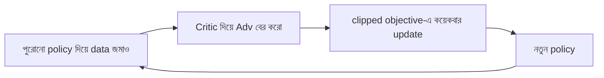

# Lecture 07 — Actor-critic ও PPO

> আগে যা জানা থাকলে ভালো: [Lecture 06](lecture-06-policy-gradient-and-advantage.md)-এর advantage (`reward − baseline`) আর [Lecture 04](lecture-04-policy-value-and-q-learning.md)-এর V(s)। এই lecture শেষে পারবে: critic-এর অনুমান দিয়ে advantage বের করতে, আর PPO-র clipping-এর পাঁচটা অবস্থা হাতে হিসাব করে বুঝিয়ে বলতে। ([Map-এ অবস্থান](../01-learning-map.md): objective = clipped objective; update = তার gradient দিয়ে policy বদলানো। Critic-এর শেখা আলাদা, তার নিজের ছোট loss আছে।)

## সমস্যাটা কী?

Lecture 06-এ baseline ছিল একটা মাত্র সাধারণ গড়। কিন্তু করিডোরে ঘর 2 আর ঘর 0 থেকে আশা করা return আলাদা। একই গড় দুই জায়গায় খাটে না। Baseline-কে প্রতি state-এর জন্য আলাদা করতে হবে।

দ্বিতীয় সমস্যা: policy gradient-এ একেকবার data জমিয়ে একটা update করা হয়। Data বানানো ব্যয়বহুল (LLM-এ প্রতিটা উত্তর বানাতে হয়)। তাই একই data থেকে কয়েকবার শিখতে ইচ্ছা করে। কিন্তু policy বদলাতে বদলাতে data-র policy থেকে অনেক সরে গেলে শেখা নষ্ট হয়ে যায়।

প্রথম সমস্যার সমাধান actor-critic, দ্বিতীয়টার PPO।

## ধারণাটা সহজ ভাষায়

### Actor-critic

দুটো অংশ:

- **Actor:** policy নিজে; action বাছে।
- **Critic:** প্রতি state-এর **value estimate** V(s) দেয়, অর্থাৎ "এই state থেকে সাধারণভাবে চললে return কত আসবে বলে আশা করি।"

Critic baseline-এর কাজ করে। Advantage বের হয় এভাবে: আমরা আশা করেছিলাম `V(s)`। চাল দিয়ে পেলাম `reward + γ × V(next state)`। এই দুটোর ফারাক:

`Adv = reward + γ × V(next state) − V(s)`

Actor শেখে এই Adv দিয়ে (Lecture 06-এর মতো)। Critic নিজে শেখে `reward + γ × V(next state)`-এর দিকে V(s)-কে সরিয়ে (Lecture 04-এর Q-learning update-এর মতোই)।

**উদাহরণ।** Critic-এর বর্তমান অনুমান V(ঘর 1) = 5, V(ঘর 2) = 10, V(ঘর 0) = 3। γ = 0.9।

| চাল | হিসাব | Adv | actor কী করে |
|---|---|---|---|
| ঘর 1-এ ডান (reward −1, next ঘর 2) | −1 + 0.9 × 10 − 5 | **+3** | "ডান" এর সম্ভাবনা বাড়ে |
| ঘর 1-এ বাঁ (reward −1, next ঘর 0) | −1 + 0.9 × 3 − 5 | **−3.3** | "বাঁ" এর সম্ভাবনা কমে |

Critic-ও শেখে। ডান চালের পর V(1)-এর target 8, α = 0.5 হলে নতুন `V(1) = 5 + 0.5 × (8 − 5) = 6.5`। অনুমানটা বাস্তবের দিকে এগোল।

### PPO

PPO (Proximal Policy Optimization) **একটা policy একবারে কতটুকু সরবে তার সীমা** টেনে দেয়। প্রথমে একটা মাপ লাগে: নতুন policy একটা action-কে পুরোনোর তুলনায় কতগুণ সম্ভাবনা দিচ্ছে।

`ratio = নতুন policy-র সম্ভাবনা / পুরোনো policy-র সম্ভাবনা`

যেমন পুরোনো policy X-কে দিত 0.30, নতুন দেয় 0.45। ratio = 0.45 / 0.30 = **1.5**। Ratio 1 মানে কোনো বদল নেই।

Lecture 06-এর `Adv × grad log p`-এর জায়গায় PPO objective ধরে `ratio × Adv`। শুরুতে ratio = 1, তখন দুটো একই gradient দেয়। কিন্তু policy সরতে থাকলে ratio 1 থেকে দূরে যায়। তাই **clip**: ratio-কে `[1 − ε, 1 + ε]`-এর মধ্যে আটকে দাও। ε সাধারণত 0.2, তাই সীমা [0.8, 1.2]। Objective হলো দুটোর ছোটটা:

`objective = min( ratio × Adv,  clip(ratio) × Adv )`

(`clip(ratio)` মানে ratio 1.2-এর বেশি হলে 1.2, 0.8-এর কম হলে 0.8, নইলে যা ছিল।) ছোটটা নেওয়া মানে সাবধানি অনুমান বেছে নেওয়া।

## ছোট একটা উদাহরণ: পাঁচটা অবস্থা

ε = 0.2। প্রতি সারিতে দুটো মান নিয়ে ছোটটা বেছে:

| ratio | Adv | `ratio × Adv` | `clip(ratio) × Adv` | objective (ছোটটা) | কী ঘটে |
|---|---|---|---|---|---|
| 1.1 | +2 | 2.2 | 1.1 × 2 = 2.2 | 2.2 | সীমার ভেতরে, স্বাভাবিক শেখা |
| 1.5 | +2 | 3.0 | 1.2 × 2 = 2.4 | **2.4** | clip: ভালো action যথেষ্ট বেড়েছে, আর ধাক্কা নেই |
| 1.5 | −2 | −3.0 | 1.2 × (−2) = −2.4 | **−3.0** | clip হয় না: খারাপ action উল্টে বেড়ে গেছে, শাস্তি থাকে |
| 0.5 | +2 | 1.0 | 0.8 × 2 = 1.6 | **1.0** | clip হয় না: ভালো action কমে গেছে, ফেরানোর ধাক্কা থাকে |
| 0.5 | −2 | −1.0 | 0.8 × (−2) = −1.6 | **−1.6** | clip: খারাপ action যথেষ্ট কমেছে, আর ধাক্কা নেই |

দ্বিতীয় সারিতে ratio 1.5 হোক বা 1.8, objective 2.4-ই থাকে (`min(3.6, 2.4)`)। Ratio বাড়লে objective বাড়ে না, তাই gradient শূন্য, policy ওই দিকে আর সরে না। নিয়মটা এক কথায়: **Adv ধনাত্মক হলে ratio 1.2-এর ওপরে, ঋণাত্মক হলে 0.8-এর নিচে গেলে আর ধাক্কা নেই। ভুল দিকে গেলে ধাক্কা থেকেই যায়।**

কোডে:

```python
def ppo_objective(ratio, adv, eps=0.2):
    clipped = max(1 - eps, min(1 + eps, ratio))
    return min(ratio * adv, clipped * adv)

for ratio, adv in [(1.1, 2), (1.5, 2), (1.8, 2), (1.5, -2), (0.5, 2), (0.5, -2)]:
    print(ratio, adv, round(ppo_objective(ratio, adv), 2))
# output:
# 1.1 2 2.2
# 1.5 2 2.4
# 1.8 2 2.4
# 1.5 -2 -3.0
# 0.5 2 1.0
# 0.5 -2 -1.6
```

## ছবি



আসল PPO-তে critic-এর নিজের loss, আর policy বেশি একরোখা হয়ে যাওয়া ঠেকানোর entropy bonus থাকে। Adv বের করার একটা মসৃণ রূপও (GAE) ব্যবহার হয়। এই lecture-এর মূল ধারণা বুঝতে এগুলো লাগে না।

## মনে রাখার সারকথা

- Actor-critic-এ actor policy, critic প্রতি state-এর V(s)। `Adv = reward + γ × V(next) − V(s)`: আশার চেয়ে বেশি পেলে ধনাত্মক।
- PPO-র ratio = নতুন সম্ভাবনা / পুরোনো সম্ভাবনা। Ratio-কে [0.8, 1.2]-এ আটকে policy-কে এক ধাপে বেশি সরতে দেওয়া হয় না।
- Objective `min(ratio × Adv, clip(ratio) × Adv)`: ভালো দিকে সীমা পেরোলে ধাক্কা বন্ধ, ভুল দিকে গেলে শাস্তি থাকে।

## নিজে করো

১. V(ঘর 1) = 4, V(ঘর 2) = 10, γ = 0.9। ঘর 1-এ ডান, reward −1, next ঘর 2। Adv কত?
২. পুরোনো সম্ভাবনা 0.4, নতুন 0.5, Adv = +1, ε = 0.2। ratio ও objective কত?
৩. পুরোনো সম্ভাবনা 0.5, নতুন 0.3, Adv = −1। ratio ও objective কত? Clip হলো কি না?

<details><summary>উত্তর</summary>

১. Adv = −1 + 0.9 × 10 − 4 = 4।
২. ratio = 0.5 / 0.4 = 1.25। `ratio × Adv = 1.25`, `clip(1.25) × Adv = 1.2 × 1 = 1.2`। ছোটটা 1.2। Clip হয়েছে।
৩. ratio = 0.3 / 0.5 = 0.6। `ratio × Adv = −0.6`, `clip(0.6) = 0.8`, তাই `0.8 × (−1) = −0.8`। ছোটটা −0.8। Clip হয়েছে: খারাপ action ইতিমধ্যে যথেষ্ট কমেছে, আর কমানোর ধাক্কা নেই।

</details>

## পরের পাঠ

Policy, reward, advantage, ratio, clip সব জানা হলো। এবার এই সবকিছু LLM-এ বসানো: কোনটা state, কোনটা action, আর reward কোথা থেকে আসে। [Lecture 08 — LLM-এ policy ও rollout](lecture-08-policy-and-rollout-in-llm.md)।
