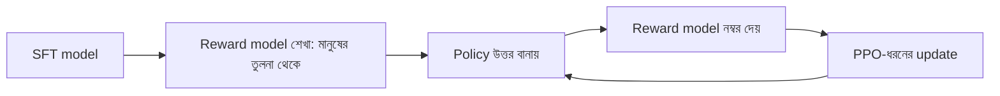

# Lecture 09 — RLHF: Preference থেকে Reward Model

> আগে যা জানা থাকলে ভালো: [LLM-এ policy ও rollout](lecture-08-policy-and-rollout-in-llm.md), [Preference data](../module-16-preference-learning-and-dpo/lecture-01-preference-data.md) এবং [Log loss](../module-03-logistic-regression/lecture-03-log-loss.md)। এই lecture শেষে পারবে: দুটো উত্তরের reward থেকে "chosen জিতবে" probability ও reward model-এর loss হাতে বের করতে, আর RLHF-এর পুরো loop এক নজরে বলতে। ([Map-এ অবস্থান](../01-learning-map.md): feedback হলো মানুষের তুলনা → objective হলো reward model-কে সেই তুলনা মেলানো → তারপর আলাদা ধাপে RL update।)

## সমস্যাটা কী?

RL-এ model-কে শেখাতে হলে প্রতিটা উত্তরের জন্য একটা **সংখ্যা** (reward) লাগে। কিন্তু মানুষকে যদি বলা হয় "এই উত্তরকে ১ থেকে ১০-এর মধ্যে নম্বর দাও", একজন দেয় ৭, আরেকজন ৯, আর একই মানুষ আজ ৭ দিলে কাল ৮ দিতে পারে। অথচ "দুটো উত্তরের কোনটা ভালো?" প্রশ্নের উত্তর অনেক সহজ ও বেশি সামঞ্জস্যপূর্ণ। আরেক সমস্যা: RL-এ হাজার হাজার উত্তর তৈরি হয়, প্রতিটার জন্য মানুষ বসানো যায় না।

সমাধান হলো দুই ধাপ। আগে মানুষের তুলনা থেকে একটা **reward model** শেখাও, যে নিজেই যেকোনো উত্তরকে নম্বর দিতে পারে। তারপর সেই নম্বর দিয়ে RL চালাও। এই পুরো পদ্ধতির নাম **RLHF** (Reinforcement Learning from Human Feedback)। InstructGPT-এর মতো assistant তৈরিতে এই pipeline ব্যবহার হয়েছে।

## ধারণাটা সহজ ভাষায়

**Reward model** একটা model, যে (prompt, response) পেয়ে একটা সংখ্যা `r` দেয়। বেশি `r` মানে "মানুষ এটাকে বেশি পছন্দ করত বলে মনে হয়"। সাধারণত এটা language model-এরই একটা রূপ, যার শেষে পরের token-এর বদলে একটা সংখ্যা বের হয়।

এর training data হলো preference pair: একই prompt-এ একটা `chosen` আর একটা `rejected` উত্তর। নিয়ম একটাই: **chosen-এর `r` বেশি হতে হবে।**

কতটা বেশি, সেটা মাপতে Bradley–Terry নামের একটা পুরনো ধারণা কাজে লাগে। ধরা হয়, chosen জেতার probability:

`P(chosen জেতে) = sigmoid(r_chosen − r_rejected)`

অর্থাৎ ব্যবধান `d = r_chosen − r_rejected` যত বড় positive, probability তত 1-এর কাছে। ব্যবধান 0 হলে probability 0.5, মানে model দুটোকে সমান মনে করছে। Sigmoid আগে [Lecture 01 (Module 03)](../module-03-logistic-regression/lecture-01-sigmoid.md)-এ দেখা হয়েছে।

Training-এর loss এখানে log loss-ই। কারণ "chosen জিতেছে" এই ঘটনা সত্যি, তাই সেই probability-র `−ln` নিলেই হলো: `loss = −ln(sigmoid(d))`।

একটা জিনিস খেয়াল করো: শুধু **ব্যবধান** গুরুত্বপূর্ণ। সব reward-এ ১০ যোগ করলেও `d` বদলায় না, তাই reward-এর পরম মানের কোনো নিজস্ব অর্থ নেই।

## ছোট একটা উদাহরণ

তিনটা অবস্থা:

| r_chosen | r_rejected | d | P(chosen জেতে) | loss |
|---|---|---|---|---|
| 1.2 | 0.4 | 0.8 | 0.690 | 0.371 |
| 0.4 | 1.2 | −0.8 | 0.310 | 1.171 |
| 0.8 | 0.8 | 0 | 0.500 | 0.693 |

Model ঠিক ক্রমে সাজালে loss ছোট, উল্টো সাজালে বড়। Loss কমানো মানে reward model-কে মানুষের পছন্দের ক্রমে আনা।

```python
import math

def sigmoid(z):
    return 1 / (1 + math.exp(-z))

def rm_loss(r_chosen, r_rejected):
    d = r_chosen - r_rejected          # reward-এর ব্যবধান
    return d, sigmoid(d), -math.log(sigmoid(d))

for rc, rr in [(1.2, 0.4), (0.4, 1.2), (0.8, 0.8)]:
    d, p, L = rm_loss(rc, rr)
    print(rc, rr, "d =", round(d, 2), "p =", round(p, 3), "loss =", round(L, 3))
# output:
# 1.2 0.4 d = 0.8 p = 0.69 loss = 0.371
# 0.4 1.2 d = -0.8 p = 0.31 loss = 1.171
# 0.8 0.8 d = 0.0 p = 0.5 loss = 0.693
```

## Reward model নিজে কীভাবে শেখে

আসল reward model-এ কোটি কোটি parameter, কিন্তু শেখার যুক্তি একই। এখানে সবচেয়ে ছোট রূপ: `r = w × x`, যেখানে `x` উত্তরের একটা সংখ্যা-বৈশিষ্ট্য আর `w` একমাত্র parameter। তিনটা pair-এর `(x_chosen, x_rejected)`: `(2.0, 1.0)`, `(3.0, 1.5)`, `(1.0, 2.0)`। তৃতীয় pair-এ chosen-এর `x` ছোট; বাস্তব data-তেও এমন "উল্টো" label থাকে।

শুরুতে `w = 0`, তাই সব `d = 0`, probability 0.5, loss 0.693। `loss`-এর `d`-এর সাপেক্ষে ঢাল `−(1 − sigmoid(d))` = `−0.5`। `d = w × (x_chosen − x_rejected)` বলে `w`-এর সাপেক্ষে ঢাল হয় ঢাল × `(x_chosen − x_rejected)`। তিন pair-এর গড় ঢাল `−0.5 × (1 + 1.5 − 1) / 3 = −0.25`। Learning rate 0.5 নিলে `w = 0 − 0.5 × (−0.25) = 0.125`।

```python
import math

def sigmoid(z):
    return 1 / (1 + math.exp(-z))

# (x_chosen, x_rejected): প্রতিটা উত্তরের একটা সংখ্যা-বৈশিষ্ট্য
pairs = [(2.0, 1.0), (3.0, 1.5), (1.0, 2.0)]
w, lr = 0.0, 0.5

for step in range(1, 4):
    loss, grad = 0.0, 0.0
    for xc, xr in pairs:
        d = w * (xc - xr)                      # r_chosen - r_rejected
        loss += -math.log(sigmoid(d))
        grad += -(1 - sigmoid(d)) * (xc - xr)  # dLoss/dw
    loss, grad = loss / len(pairs), grad / len(pairs)
    print("step", step, "w =", round(w, 3), "loss =", round(loss, 3), "grad =", round(grad, 3))
    w -= lr * grad

correct = sum(w * xc > w * xr for xc, xr in pairs)
print("w =", round(w, 3), "| chosen-কে বেশি দিয়েছে:", correct, "/", len(pairs))
# output:
# step 1 w = 0.0 loss = 0.693 grad = -0.25
# step 2 w = 0.125 loss = 0.665 grad = -0.206
# step 3 w = 0.228 loss = 0.645 grad = -0.17
# w = 0.313 | chosen-কে বেশি দিয়েছে: 2 / 3
```

Loss কমছে, আর ৩টার মধ্যে ২টা pair ঠিক ক্রমে এসেছে। তৃতীয় pair-টা কখনোই ঠিক হবে না, কারণ একটাই `w` দিয়ে "বেশি `x` ভালো" আর ওই উল্টো label একসঙ্গে মেলে না। Preference label-এর এই noise [Preference quality](../module-16-preference-learning-and-dpo/lecture-07-preference-quality-and-variants.md)-এর বিষয়।

## এরপর RL loop

Reward model তৈরি হলে RLHF-এর তিন ধাপ:



Update-এর অংশ [Lecture 07 (PPO)](lecture-07-actor-critic-and-ppo.md)-এ দেখা হয়েছে। এখানে নতুন শুধু reward-টা কোথা থেকে আসে। একটা বাড়তি শর্তও থাকে: policy যেন আগের (reference) model থেকে বেশি দূরে সরে না যায়। তাই reward-এ একটা জরিমানা বসে:

`মোট reward = r − β × (log π(y|x) − log π_ref(y|x))`

`π` এখন শেখানো policy, `π_ref` হলো SFT-এর পরের reference model, `β` জরিমানার ওজন। বন্ধনীর ভেতরের অংশ হলো এই উত্তরে policy আর reference-এর log probability-র ব্যবধান; [Module 16-এর log-ratio](../module-16-preference-learning-and-dpo/lecture-02-sequence-probability-and-log-ratio.md)-এর মতোই।

উদাহরণ: `r = 1.5`, `log π = −4.0`, `log π_ref = −5.0`, `β = 0.1`। ব্যবধান `−4.0 − (−5.0) = 1.0`, তাই মোট reward `1.5 − 0.1 × 1.0 = 1.4`।

```python
beta = 0.1
r = 1.5                       # reward model-এর score
logp_policy, logp_ref = -4.0, -5.0
log_ratio = logp_policy - logp_ref
print("log_ratio =", log_ratio, "| total reward =", round(r - beta * log_ratio, 2))
# output:
# log_ratio = 1.0 | total reward = 1.4
```

Reward model শেখা (preference data দিয়ে সাধারণ supervised training) আর RL (নতুন উত্তর তৈরি করে শেখা) দুটো আলাদা training।

## DPO-র সঙ্গে সংযোগ

[DPO](../module-16-preference-learning-and-dpo/lecture-06-sft-reward-model-and-dpo.md) একই preference pair থেকে শেখে, কিন্তু মাঝের reward model আর RL loop বাদ দেয়। কীভাবে? DPO-তে reward-এর জায়গায় বসে **implicit reward** `β × (log π(y|x) − log π_ref(y|x))`, অর্থাৎ policy-র ভেতরেই score লুকানো। এই score-কে `r` ধরে এই lecture-এর `−ln sigmoid(r_chosen − r_rejected)` loss-ই বসালে DPO-র loss পাওয়া যায়।

উদাহরণ: `β = 0.5`, chosen-এর log-ratio `0.4`, rejected-এর `−0.2`। Implicit reward `0.5 × 0.4 = 0.2` আর `0.5 × (−0.2) = −0.1`। ব্যবধান `0.3`, `sigmoid(0.3) = 0.574`, loss `−ln(0.574) = 0.554`। তফাত শুধু এই: RLHF-এ `r` আলাদা reward model দেয় এবং তারপর policy নতুন উত্তর বানিয়ে (rollout) শেখে; standard DPO-তে rollout নেই, কোনো নতুন উত্তর তৈরি বা reward গোনা হয় না, data আগে থেকে জমা থাকে। তাই DPO সরল, কিন্তু data-র বাইরের উত্তরের উপর তার নিয়ন্ত্রণ কম। Rollout কী, তা [Lecture 08](lecture-08-policy-and-rollout-in-llm.md)-এ আছে।

## বাস্তব library-তে কেমন (docs থেকে নেওয়া, চালানো হয়নি)

TRL-এর [Reward Modeling docs](https://huggingface.co/docs/trl/reward_trainer)-এ reward model শেখানোর সবচেয়ে ছোট উদাহরণ এমন। Dataset-এ `chosen` ও `rejected` column থাকে। ধারণা বোঝানোর জন্য এখানে দেখানো; চালানো হয়নি:

```python
from trl import RewardTrainer
from datasets import load_dataset

trainer = RewardTrainer(
    model="Qwen/Qwen3-0.6B",
    train_dataset=load_dataset("trl-lib/ultrafeedback_binarized", split="train"),
)
trainer.train()
```

## মনে রাখার সারকথা

- Reward model মানুষের তুলনা থেকে শেখে: `loss = −ln sigmoid(r_chosen − r_rejected)`; শুধু reward-এর ব্যবধান গুরুত্বপূর্ণ।
- RLHF = SFT → reward model শেখা → reward model-এর নম্বর দিয়ে RL, যেখানে reference model থেকে বেশি সরলে `β`-জরিমানা কাটে।
- Reward model একটা আন্দাজ-মেশিন, সত্যের মাপকাঠি নয়; তার ভুল পরের পাঠগুলোর বিষয়।

## নিজে করো

১. `r_chosen = 2.0`, `r_rejected = 1.0`। `d`, P(chosen জেতে) আর loss কত?
২. দুটো reward-এই ১০ যোগ করলে loss বদলাবে?
৩. `r = 2.0`, `log π = −3.0`, `log π_ref = −6.0`, `β = 0.2` হলে মোট reward কত?

<details><summary>উত্তর</summary>

১. `d = 1.0`, `sigmoid(1) = 0.731`, `loss = −ln(0.731) = 0.313`।
২. না। `d` একই থাকে (`12 − 11 = 1`), তাই probability ও loss একই।
৩. ব্যবধান `−3.0 − (−6.0) = 3.0`, জরিমানা `0.2 × 3.0 = 0.6`, মোট `2.0 − 0.6 = 1.4`।

</details>

## পরের পাঠ

মানুষের তুলনা ব্যয়বহুল। AI যদি judge হয়, তাহলে কী লাভ ও কী ঝুঁকি, আর feedback-এর মান কীভাবে মাপা যায়: [Lecture 10 — RLAIF ও Feedback-এর মান](lecture-10-rlaif-and-feedback-quality.md)।
