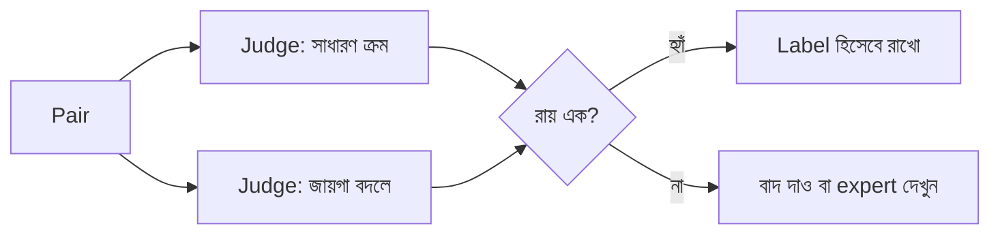

# Lecture 10 — RLAIF ও Feedback-এর মান

> আগে যা জানা থাকলে ভালো: [RLHF ও reward modeling](lecture-09-rlhf-and-reward-modeling.md) এবং [Preference quality (Module 16)](../module-16-preference-learning-and-dpo/lecture-07-preference-quality-and-variants.md)। এই lecture শেষে পারবে: AI judge-এর দুটো সহজ পরীক্ষা (expert-এর সঙ্গে মিল, জায়গা বদলানোর পরীক্ষা) হাতে করতে, আর বলতে পারবে rubric কেন সাহায্য করে। ([Map-এ অবস্থান](../01-learning-map.md): এটা feedback-এর উৎস ও মান নিয়ে; objective বা update-এর নতুন formula নেই।)

## সমস্যাটা কী?

Reward model শেখাতে হাজার হাজার preference pair লাগে। মানুষ দিয়ে এতগুলো label করানো ধীর ও ব্যয়বহুল। তাই অনেক জায়গায় আরেকটা language model-কে বলা হয় "এই দুটোর কোনটা ভালো?" এই model হলো **AI judge**, আর তার label দিয়ে training করানোকে বলে **RLAIF** (Reinforcement Learning from AI Feedback)। খরচ কমে, গতি বাড়ে।

কিন্তু প্রশ্ন ওঠে: judge-এর রায় কতটা ভরসাযোগ্য? Judge ভুল label দিলে reward model সেই ভুল শেখে, আর RL সেই ভুলকে আরও জোর দিয়ে বাড়ায়। মানুষের label-ও নিখুঁত নয়, কিন্তু AI judge-এর ভুলগুলো একটা নির্দিষ্ট ধরনে জমে। তাই feedback ব্যবহারের আগে তার **মান মাপতে** হয়।

## ধারণাটা সহজ ভাষায়

গবেষণায় LLM-judge-এর কয়েকটা পরিচিত পক্ষপাত দেখা গেছে:

- **Position bias:** কোন উত্তর আগে দেখানো হলো, তার উপর রায় নির্ভর করে। অনেক সময় প্রথমটাকেই বেশি পছন্দ হয়।
- **Length bias:** লম্বা উত্তরকে ভালো ধরে নেওয়া, অথচ বেশি লেখা মানেই বেশি সঠিক নয়।
- **Self-preference:** judge নিজের মতো ভাষা বা style-কে বেশি নম্বর দেয়।

এগুলো কমানোর তিনটা সহজ উপায়:

1. **Rubric:** "ভালো" কথাটা ভেঙে কয়েকটা যাচাইযোগ্য প্রশ্ন বানানো, প্রতিটার ওজনসহ। তখন judge "মোটের উপর" রায় না দিয়ে একটা একটা প্রশ্নের উত্তর দেয়।
2. **দুই ক্রমে জিজ্ঞাসা:** একই pair দুইবার দেখানো, দ্বিতীয়বার A/B জায়গা বদলে। দুই ক্রমে রায় না মিললে সেই pair-এ judge-এর কথা ধরা হয় না।
3. **Expert-এর ছোট gold set:** কিছু pair বিশেষজ্ঞ নিজে label করেন। Judge-এর রায় সেগুলোর সঙ্গে মিলিয়ে দেখা হয়। মানে judge-কে **পরীক্ষা** করা হয়, বিশ্বাস করে বসানো হয় না।

## ছোট একটা উদাহরণ

১০টা pair-এর expert label আছে। Judge-কে প্রতিটা দুবার দেখানো হলো, একবার সাধারণ ক্রমে, একবার জায়গা বদলে। Judge কোন **জায়গা** বেছেছে, তার তালিকা:

| | expert-এর রায় | judge: সাধারণ ক্রমে | judge: জায়গা বদলে |
|---|---|---|---|
| ১–১০ | A B A A B B A B A B | A A A A B A A B A A (প্রথম জায়গা ৮ বার) | A A A B A A A A B A (প্রথম জায়গা ৮ বার) |

জায়গা বদলালে "জায়গা A" আসলে আসল উত্তর B। তাই দ্বিতীয় তালিকা মূল নামে আনতে উল্টে নিতে হয়।

```python
# ১০টা pair। expert: কোন উত্তর ভালো ('A' নাকি 'B')
expert = ['A', 'B', 'A', 'A', 'B', 'B', 'A', 'B', 'A', 'B']
# judge-কে একই pair দুইবার দেখানো হলো: একবার সাধারণ ক্রমে, একবার A/B জায়গা বদলে
pos_normal  = ['A', 'A', 'A', 'A', 'B', 'A', 'A', 'B', 'A', 'A']  # judge কোন জায়গা বেছেছে
pos_swapped = ['A', 'A', 'A', 'B', 'A', 'A', 'A', 'A', 'B', 'A']

# swapped ক্রমে জায়গা A মানে আসলে উত্তর B, তাই ফল উল্টে মূল নামে আনতে হবে
flip = {'A': 'B', 'B': 'A'}
verdict_normal  = pos_normal
verdict_swapped = [flip[p] for p in pos_swapped]

n = len(expert)
print("expert-এর সঙ্গে মিল (সাধারণ):", sum(e == v for e, v in zip(expert, verdict_normal)), "/", n)
print("expert-এর সঙ্গে মিল (বদলানো):", sum(e == v for e, v in zip(expert, verdict_swapped)), "/", n)
print("জায়গা বদলালেও একই রায়:", sum(a == b for a, b in zip(verdict_normal, verdict_swapped)), "/", n)
print("প্রথম জায়গা বেছেছে:", pos_normal.count('A'), "/", n, "এবং", pos_swapped.count('A'), "/", n)
# output:
# expert-এর সঙ্গে মিল (সাধারণ): 7 / 10
# expert-এর সঙ্গে মিল (বদলানো): 7 / 10
# জায়গা বদলালেও একই রায়: 4 / 10
# প্রথম জায়গা বেছেছে: 8 / 10 এবং 8 / 10
```

ফল পড়ো:

- প্রতিবার expert-এর সঙ্গে মিল ৭/১০। প্রথম দেখায় ভালোই লাগে। তুলনা: যে judge সবসময় "A" বলে, সে-ও এই data-তে ৫/১০ মেলাত, কারণ expert ৫ বার A বলেছেন।
- কিন্তু জায়গা বদলালে মাত্র ৪/১০ pair-এ রায় একই থাকে। ১০ বারের ৮ বারই প্রথম জায়গা বেছেছে। এটাই position bias-এর লক্ষণ: judge উত্তরের চেয়ে জায়গার দিকে বেশি তাকাচ্ছে।

সিদ্ধান্ত: এই judge-এর রায় সরাসরি training-এ দেওয়া ঠিক নয়। হয় prompt বদলে আবার পরীক্ষা করো, নয়তো যে ৪টা pair-এ দুই ক্রমে রায় মেলে শুধু সেগুলো রাখো (বাকিগুলো মানুষের কাছে পাঠাও)।

সাবধান: ১০টা pair শুধু হিসাব বোঝার জন্য। বাস্তবে gold set-এ অন্তত কয়েকশো pair লাগে, নইলে ১–২টা pair-এর ফারাক আকস্মিক হতে পারে। Length bias মাপার পদ্ধতিও একই: judge কতবার লম্বা উত্তর বাছে আর expert কতবার, সেই দুই হার মেলাও।

## Rubric-এর একটা ছোট উদাহরণ

ধরো rubric: তথ্য সঠিক (ওজন ২), প্রশ্নের উত্তর দিয়েছে (১), ভাষা পরিষ্কার (১), মোট ৪।

| উত্তর | তথ্য | উত্তর দিয়েছে | ভাষা | মোট |
|---|---|---|---|---|
| ১: সুন্দর ভাষা, কিন্তু তথ্য ভুল | ০ | ১ | ১ | ২/৪ |
| ২: সাদামাটা ভাষা, তথ্য ঠিক | ২ | ১ | ০ | ৩/৪ |

Rubric ছাড়া judge হয়তো ১ নম্বরকে "পরিপাটি" বলে এগিয়ে দিত। Rubric ছিল বলে তথ্যের ওজন বেশি ধরা পড়ল। তবে rubric-এর ওজনও মানুষেরই সিদ্ধান্ত, আর expert-এর সঙ্গে মিলিয়ে ঠিক করা ভালো।



## কখন কী

যেখানে উত্তর সহজে যাচাই করা যায় না (যেমন ধর্মীয় বা আইনি উত্তর), সেখানে AI judge শুধু প্রাথমিক ছাঁকনি হতে পারে; চূড়ান্ত মান expert-এর হাতে। এর বিস্তারিত [Lecture 14](lecture-14-domain-expert-answer-evaluation.md)-এ। আর যেখানে সরাসরি যাচাই করা যায় (math, code), সেখানে judge-এর দরকারই কম, [Lecture 11](lecture-11-rlvr-and-grpo.md) দেখো।

## মনে রাখার সারকথা

- AI judge খরচ কমায়, কিন্তু position, length ও self-preference পক্ষপাত আনতে পারে।
- Judge-কে বিশ্বাস করার আগে পরীক্ষা করো: expert-এর gold set-এর সঙ্গে মিল আর জায়গা বদলানোর পরীক্ষা।
- Rubric "ভালো" কথাটাকে ছোট যাচাইযোগ্য প্রশ্নে ভাঙে, ফলে রায় বেশি স্থির হয়।

## নিজে করো

১. Judge-এর রায়ের সঙ্গে expert-এর রায় ১০টার মধ্যে ৬টায় মিলেছে। যদি সবসময় "A" বলা judge-ও ৫টায় মেলাত, ৬/১০ কি ভালো মান?
২. উপরের rubric-এ একটা উত্তরে তথ্য ঠিক, উত্তর দেওয়া হয়নি, ভাষা পরিষ্কার। মোট কত?
৩. জায়গা বদলানোর পরীক্ষায় ২০টা pair-এর ১৪টায় রায় একই। consistency কত শতাংশ?

<details><summary>উত্তর</summary>

১. ভালো বলার মতো নয়। এটা মাত্র ১টা pair বেশি, আর ১০টা pair-এ এতটুকু ফারাক আকস্মিক হতে পারে। বেশি pair নিয়ে আবার মাপতে হবে।
২. তথ্য ২ + উত্তর ০ + ভাষা ১ = ৩/৪।
৩. `14 / 20 = 0.70`, অর্থাৎ ৭০%।

</details>

## পরের পাঠ

যেখানে feedback-এর বদলে সরাসরি সঠিক/ভুল যাচাই করা যায়, সেখানে reward model ছাড়াই RL চলে: [Lecture 11 — RLVR ও GRPO](lecture-11-rlvr-and-grpo.md)।
