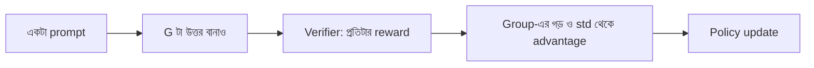

# Lecture 11 — RLVR ও GRPO: গ্রুপের গড়ের সঙ্গে তুলনা

> আগে যা জানা থাকলে ভালো: [Policy gradient ও advantage](lecture-06-policy-gradient-and-advantage.md) এবং [LLM-এ policy ও rollout](lecture-08-policy-and-rollout-in-llm.md)। এই lecture শেষে পারবে: ৪টা উত্তরের reward থেকে group-relative advantage হাতে বের করতে, আর বলতে পারবে এটা কেন আলাদা critic model ছাড়াই কাজ চালায়। ([Map-এ অবস্থান](../01-learning-map.md): feedback = automatic verifier-এর 0/1; objective = সঠিক উত্তরের probability বাড়ানো; update-এর সংকেত = advantage।)

## সমস্যাটা কী?

Math প্রশ্নের উত্তর ৪২ কি না, বা code-এর সব test পাস করেছে কি না, এটা মেশিনই যাচাই করতে পারে। এখানে reward model বানানো বা মানুষ বসানোর দরকার নেই, আর reward model-এর ভুলেরও ঝুঁকি নেই। যাচাইযোগ্য ফল থেকে সরাসরি reward নিয়ে RL চালানোর নাম **RLVR** (Reinforcement Learning with Verifiable Rewards)।

কিন্তু একটা প্রশ্ন বাকি: একটা উত্তর ঠিক হয়ে reward ১ পেল, এটা কি ভালো খবর? নির্ভর করে প্রশ্নটা কতটা সহজ তার উপর। সহজ প্রশ্নে প্রায় সব উত্তরই ১ পায়। তাই reward ১ পাওয়ার চেয়ে বেশি দরকারি তথ্য হলো **অন্যদের তুলনায় এই উত্তর কেমন**। এই তুলনার মাপকে বলে **advantage**। PPO এই মাপ বের করতে আলাদা একটা value (critic) model রাখে, যার জন্য বাড়তি memory ও training লাগে। **GRPO** (Group Relative Policy Optimization) সহজ পথ নেয়: একই প্রশ্নে কয়েকটা উত্তর বানাও, আর তাদের নিজেদের গড়কে তুলনার ভিত্তি ধরো। GRPO পরিচিত হয়েছে DeepSeekMath-এর গবেষণায়।

## ধারণাটা সহজ ভাষায়

একটা prompt-এর জন্য policy `G` টা উত্তর বানায়; এই `G` টা উত্তরের দলকে **group** বলে। Verifier প্রতিটাকে reward দেয়। তারপর প্রতিটা উত্তরের advantage:

`advantage = (তার reward − group-এর গড়) / group-এর std`

- গড়ের উপরের উত্তর পায় positive advantage, নিচের উত্তর negative।
- Std দিয়ে ভাগ করায় সংখ্যার মাপ একটা স্থির পরিসরে থাকে। **Std** হলো গড় থেকে reward কতটা ছড়িয়ে আছে তার মাপ।

Update-এ নিয়ম সোজা: positive advantage পাওয়া উত্তরের probability বাড়াও, negative পাওয়াগুলোরটা কমাও।



## ছোট একটা উদাহরণ

`G = 4`, reward ০ বা ১।

**ক) দুটো ঠিক, দুটো ভুল:** rewards `[1, 0, 0, 1]`। গড় `(1+0+0+1)/4 = 0.5`। প্রতিটার গড় থেকে ব্যবধান `[0.5, −0.5, −0.5, 0.5]`, এগুলোর বর্গের গড় `0.25`, তাই std `√0.25 = 0.5`। Advantage `[1, −1, −1, 1]`।

**খ) একটা মাত্র ঠিক:** `[1, 0, 0, 0]`। গড় `0.25`, std `0.433`। ঠিক উত্তরের advantage `(1 − 0.25)/0.433 = 1.732`, বাকিগুলো `(0 − 0.25)/0.433 = −0.577`। বিরল সফলতা বেশি পুরস্কার পায়।

**গ) সব ঠিক:** `[1, 1, 1, 1]`। গড় ১, std ০, সবার advantage ০। তুলনা করার কিছুই নেই, তাই এই prompt থেকে কিছু শেখা হয় না। সব ভুল হলেও একই ঘটনা। এজন্য training prompt-এ সহজ-কঠিন মিশিয়ে রাখা দরকার; নইলে অনেক prompt-ই বেকার যায়।

```python
import math

def group_advantage(rewards):
    n = len(rewards)
    mean = sum(rewards) / n
    std = math.sqrt(sum((r - mean) ** 2 for r in rewards) / n)  # n দিয়ে ভাগ
    if std == 0:                       # সবার reward এক হলে কোনো তুলনা নেই
        return mean, std, [0.0] * n
    return mean, std, [(r - mean) / std for r in rewards]

for rewards in ([1, 0, 0, 1], [1, 0, 0, 0], [1, 1, 1, 1]):
    mean, std, adv = group_advantage(rewards)
    print(rewards, "mean =", round(mean, 3), "std =", round(std, 3),
          "adv =", [round(a, 3) for a in adv])
# output:
# [1, 0, 0, 1] mean = 0.5 std = 0.5 adv = [1.0, -1.0, -1.0, 1.0]
# [1, 0, 0, 0] mean = 0.25 std = 0.433 adv = [1.732, -0.577, -0.577, -0.577]
# [1, 1, 1, 1] mean = 1.0 std = 0.0 adv = [0.0, 0.0, 0.0, 0.0]
```

সাবধান: কিছু library std-তে `n`-এর বদলে `n−1` দিয়ে ভাগ করে, তাতে সংখ্যা সামান্য বদলায় (খ-তে ঠিক উত্তরের advantage হয় `1.5`)। দিক একই থাকে। আর std ০ হলে ০ দিয়ে ভাগ এড়াতে অনেক implementation-এ হরে একটা খুব ছোট সংখ্যা যোগ করা থাকে।

## Advantage থেকে update

সবচেয়ে সরল রূপে loss হলো `−গড়(advantage × log probability)`। `log probability` মানে সেই উত্তরটা তৈরি হওয়ার log probability ([Module 16-এর পাঠ](../module-16-preference-learning-and-dpo/lecture-02-sequence-probability-and-log-ratio.md))। উদাহরণ ক)-এর advantage `[1, −1, −1, 1]` আর চারটা উত্তরের log probability `[−2.0, −3.0, −2.5, −1.5]` ধরো।

Loss `= −(1×−2.0 + −1×−3.0 + −1×−2.5 + 1×−1.5)/4 = −2.0/4 = −0.5`। এখন ঠিক উত্তরের log probability ০.১ বাড়াই আর ভুলগুলোরটা ০.১ কমাই। Loss নেমে `−0.6` হয়। অর্থাৎ loss কমানো মানেই ঠিক উত্তর বেশি সম্ভাব্য আর ভুল উত্তর কম সম্ভাব্য হওয়া।

```python
import math
def group_advantage(rewards):
    n = len(rewards); mean = sum(rewards)/n
    std = math.sqrt(sum((r-mean)**2 for r in rewards)/n)
    return [0.0]*n if std == 0 else [(r-mean)/std for r in rewards]

adv = group_advantage([1, 0, 0, 1])          # [1, -1, -1, 1]
logp = [-2.0, -3.0, -2.5, -1.5]              # চারটা উত্তরের log probability

def loss(logp):
    return -sum(a * lp for a, lp in zip(adv, logp)) / len(adv)

print("loss আগে =", round(loss(logp), 2))
# সঠিক উত্তরের logp একটু বাড়াই, ভুল উত্তরেরটা একটু কমাই
logp_new = [lp + 0.1 * a for lp, a in zip(logp, adv)]
print("logp পরে =", [round(x, 2) for x in logp_new])
print("loss পরে =", round(loss(logp_new), 2))
# output:
# loss আগে = -0.5
# logp পরে = [-1.9, -3.1, -2.6, -1.4]
# loss পরে = -0.6
```

আসল GRPO-তে এর উপরে আরও দুটো জিনিস থাকে: PPO-র মতো clipping ([Lecture 07](lecture-07-actor-critic-and-ppo.md)), আর reference model থেকে বেশি সরলে জরিমানা ([Lecture 09](lecture-09-rlhf-and-reward-modeling.md)-এর `β`)। হিসাবও token ধরে হয়। এখানে শুধু advantage-এর কাজটা আলাদা করে দেখানো হলো।

## বাস্তব library-তে কেমন (docs থেকে নেওয়া, চালানো হয়নি)

TRL-এর [GRPO docs](https://huggingface.co/docs/trl/grpo_trainer)-এর ছোট উদাহরণ। `num_generations` হলো `G`; `scale_rewards="group"` (docs-এ default) মানে group-এর std দিয়ে ভাগ। নিজের reward function দিতে চাইলে docs অনুযায়ী function প্রতিটা completion-এর জন্য একটা `float`-এর list ফেরত দেয়।

```python
from datasets import load_dataset
from trl import GRPOConfig, GRPOTrainer
from trl.rewards import accuracy_reward

dataset = load_dataset("trl-lib/DeepMath-103K", split="train")

training_args = GRPOConfig(num_generations=8, scale_rewards="group")

trainer = GRPOTrainer(
    model="Qwen/Qwen2.5-0.5B-Instruct",
    args=training_args,
    reward_funcs=accuracy_reward,
    train_dataset=dataset,
)
trainer.train()
```

## মনে রাখার সারকথা

- RLVR মানে verifier-এর সরাসরি reward; reward model বা মানুষ লাগে না, কিন্তু যাচাইযোগ্য কাজ হতে হবে।
- GRPO: একই prompt-এর `G` টা উত্তরের গড় আর std দিয়ে advantage বের করে, তাই আলাদা critic model লাগে না।
- Group-এর সবার reward এক হলে advantage ০, ওই prompt থেকে কিছু শেখা হয় না।

## নিজে করো

১. Rewards `[1, 1, 0, 1]`। গড়, std (n দিয়ে ভাগ) ও advantage কত?
২. Rewards `[0, 0, 0, 0]` হলে কী হবে, আর কেন?
৩. Rewards `[1, 0, 0, 0]`-এ std `n−1` দিয়ে ভাগ করলে ঠিক উত্তরের advantage কত?

<details><summary>উত্তর</summary>

১. গড় `0.75`। ব্যবধানের বর্গের গড় `(3 × 0.0625 + 0.5625)/4 = 0.1875`, std `0.433`। Advantage: ঠিক উত্তরগুলো `0.25/0.433 = 0.577`, ভুলটা `−0.75/0.433 = −1.732`।
২. গড় ০, std ০, সব advantage ০। কোনো উত্তর অন্যদের চেয়ে ভালো বা খারাপ নয়, তাই update-এর সংকেত নেই।
৩. বর্গের যোগফল `0.5625 + 3 × 0.0625 = 0.75`; `n−1 = 3` দিয়ে ভাগ করলে `0.25`, std `0.5`। Advantage `(1 − 0.25)/0.5 = 1.5`।

</details>

## পরের পাঠ

এতক্ষণ feedback ধরে নিয়েছি একবারের উত্তরের উপর। ভুল ধরা পড়ার পর model যদি আবার চেষ্টা করে, সেটা কি শেখা? [Lecture 12 — Correction ও Self-correction](lecture-12-correction-and-self-correction.md)।
