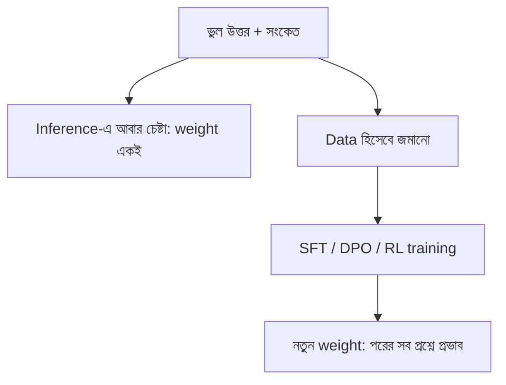

# Lecture 12 — Correction ও Self-correction: আবার চেষ্টা বনাম শেখা

> আগে যা জানা থাকলে ভালো: [Correction, target, preference ও reward](lecture-01-correction-target-preference-and-reward.md) এবং [RLVR ও GRPO](lecture-11-rlvr-and-grpo.md)। এই lecture শেষে পারবে: "inference-এ আবার চেষ্টা" আর "weight update করে শেখানো"-র তফাত বলতে, আর ছোট হিসাবে দেখাতে কোনটার খরচ কেমন। ([Map-এ অবস্থান](../01-learning-map.md): retry শুধু output বের করার পথ; weight বদলায় না। শেখা মানে training-এর পথ।)

## সমস্যাটা কী?

Chat-এ model ভুল উত্তর দিল। তুমি বললে "ভুল হয়েছে, আবার দেখো", আর সে ঠিক উত্তর দিল। মনে হয় model শিখে গেছে। কিন্তু নতুন একটা chat খুলে একই প্রশ্ন করলে সেই ভুলই ফিরে আসতে পারে। কারণ প্রথম ক্ষেত্রে model-এর **weights একটুও বদলায়নি**। সে শুধু context-এ থাকা তোমার ফিডব্যাক পড়ে নতুন উত্তর বানিয়েছে। এই দুটো জিনিস আলাদা, আর কোনটা কখন কাজে লাগে তা না জানলে ভুল সিদ্ধান্ত হয়।

## ধারণাটা সহজ ভাষায়

**Inference-এ correction:** উত্তর দেওয়ার সময়ই ভুল ধরে আবার চেষ্টা। উৎস হতে পারে তোমার মন্তব্য, test-এর ফল, calculator, বা model-এর নিজের পর্যালোচনা। Weight বদলায় না, তাই শেখা বলা যায় না। প্রতিটা প্রশ্নে বাড়তি চেষ্টার খরচ দিতে হয়, আর সেই context শেষ হলে সব শেষ।

**Weight update:** ভুল উত্তর, ঠিক উত্তর আর ফিডব্যাক জমিয়ে training data বানানো, তারপর model-কে training করানো। এরপর নতুন chat-এও উন্নতি থাকে। এটা [Lecture 01](lecture-01-correction-target-preference-and-reward.md)-এর তিন পথে হয়: ঠিক উত্তরকে target ধরে SFT ([Module 15](../module-15-domain-and-task-adaptation/lecture-06-correction-dataset-and-hard-examples.md)); ঠিকটা chosen আর ভুলটা rejected ধরে DPO; অথবা verifier-এর reward নিয়ে RL।

**Self-correction training** এই দুটোকে জোড়ে। Data-র একক হয় তিনটা জিনিস: প্রথম চেষ্টা, ফিডব্যাক, দ্বিতীয় চেষ্টা। Model শেখে ফিডব্যাক কাজে লাগিয়ে উত্তর শোধরাতে। Reward দেওয়া যায় চূড়ান্ত উত্তর ঠিক হলে, বা দ্বিতীয় চেষ্টা প্রথমটার চেয়ে ভালো হলে।



একটা সতর্কতা: বাইরের কোনো সংকেত (test, verifier, মানুষের মন্তব্য) ছাড়া model যদি শুধু নিজেই নিজের উত্তর দেখে শোধরায়, কিছু গবেষণায় দেখা গেছে তাতে উন্নতি বিশ্বাসযোগ্য নয়। সে ঠিক উত্তরকেও ভুল ভেবে বদলে ফেলতে পারে। তাই retry সবচেয়ে ভালো কাজ করে যেখানে নির্ভরযোগ্য verifier আছে।

## ছোট একটা উদাহরণ

ধরো এক চেষ্টায় ঠিক হওয়ার সম্ভাবনা `p = 0.6`। Verifier আছে, ঠিক হলে থামা যায়, সর্বোচ্চ ৩ চেষ্টা।

- তিনবারই ভুল হওয়ার সম্ভাবনা `0.4 × 0.4 × 0.4 = 0.064`, তাই ঠিক হওয়ার সম্ভাবনা `1 − 0.064 = 0.936`।
- গড়ে কত চেষ্টা লাগে? প্রথম চেষ্টা সবসময় হয় (১)। দ্বিতীয় হয় প্রথমটা ভুল হলে (০.৪)। তৃতীয় হয় প্রথম দুটো ভুল হলে (০.১৬)। মোট `1 + 0.4 + 0.16 = 1.56`।

এবার ধরো training করার পর model-এর `p` হয়েছে ০.৮। তুলনা:

| পথ | ঠিক হওয়ার সম্ভাবনা | গড় চেষ্টা প্রতি প্রশ্নে |
|---|---|---|
| Model যেমন আছে, ১ চেষ্টা | 0.600 | 1.00 |
| Model যেমন আছে + verifier-সহ retry | 0.936 | 1.56 |
| Training-এর পর, ১ চেষ্টা | 0.800 | 1.00 |
| Training-এর পর + retry | 0.992 | 1.24 |

এখানে দেখা যায়: retry শুধু inference খরচে ভালো মান কিনে নেয়, কিন্তু প্রতি প্রশ্নে ১.৫৬ গুণ কাজ। Training একবার খরচ করে প্রতি প্রশ্নের খরচ ১.০-এ নামায়; আর দুটো মেলালে সবচেয়ে ভালো ফল আসে। কাল্পনিক একটা হিসাব: training-এর মোট খরচ যদি ৫০০০ "চেষ্টার" সমান হয়, প্রতি প্রশ্নে বাঁচে `1.56 − 1.00 = 0.56` চেষ্টা, তাই প্রায় `5000 / 0.56 ≈ 8929` টা প্রশ্নের পর training-এর খরচ উঠে আসে। কিন্তু সেই তুলনা তখনই ন্যায্য যখন ০.৮ মান যথেষ্ট; নইলে retry-ও রাখতে হবে।

```python
def retry_stats(p, k):
    """p = এক চেষ্টায় ঠিক হওয়ার সম্ভাবনা, k = সর্বোচ্চ চেষ্টা।
    ধরে নিচ্ছি চেষ্টাগুলো স্বাধীন আর verifier নিখুঁত।"""
    success = 1 - (1 - p) ** k
    attempts = sum((1 - p) ** i for i in range(k))   # ঠিক হলে থামে
    return success, attempts

for name, p, k in [("সাধারণ model, ১ চেষ্টা", 0.6, 1),
                   ("সাধারণ model + retry (৩ বার)", 0.6, 3),
                   ("training-এর পর, ১ চেষ্টা", 0.8, 1),
                   ("training-এর পর + retry (৩ বার)", 0.8, 3)]:
    s, a = retry_stats(p, k)
    print(name, "| ঠিক:", round(s, 3), "| গড় চেষ্টা:", round(a, 2))

saved = retry_stats(0.6, 3)[1] - 1.0
print("প্রতি প্রশ্নে বাঁচে:", round(saved, 2), "| 5000 খরচ উঠবে প্রশ্ন:", round(5000 / saved))
# output:
# সাধারণ model, ১ চেষ্টা | ঠিক: 0.6 | গড় চেষ্টা: 1.0
# সাধারণ model + retry (৩ বার) | ঠিক: 0.936 | গড় চেষ্টা: 1.56
# training-এর পর, ১ চেষ্টা | ঠিক: 0.8 | গড় চেষ্টা: 1.0
# training-এর পর + retry (৩ বার) | ঠিক: 0.992 | গড় চেষ্টা: 1.24
# প্রতি প্রশ্নে বাঁচে: 0.56 | 5000 খরচ উঠবে প্রশ্ন: 8929
```

সাবধান: এই হিসাব আদর্শ ধরে নেওয়া। বাস্তবে চেষ্টাগুলো স্বাধীন নয় (model একই ভুল বারবার করে), verifier নিখুঁত নয়, আর `5000` কাল্পনিক সংখ্যা। তাই আসল সিদ্ধান্ত নিজের data-তে মেপে নিতে হয়।

## কোনটা কখন

| পরিস্থিতি | সাধারণত ভালো পথ |
|---|---|
| একই ধরনের ভুল বারবার, অনেক প্রশ্ন | Data জমিয়ে training |
| কম প্রশ্ন, নির্ভরযোগ্য verifier আছে | Inference-এ retry |
| Verifier নেই, শুধু model নিজের উত্তর দেখে | সাবধান: উন্নতি নিশ্চিত নয়, আগে মেপে নাও |
| উচ্চ মান দরকার, খরচ সামলানো যায় | Training + retry দুটোই |

## মনে রাখার সারকথা

- Chat-এ শোধরানো মানে weight বদলানো নয়; নতুন chat-এ সেই উন্নতি থাকে না।
- Retry প্রতি প্রশ্নে খরচ বাড়ায় কিন্তু training ছাড়াই কাজ করে; training একবার খরচ করে সব প্রশ্নে কাজ করে।
- বাইরের নির্ভরযোগ্য সংকেত ছাড়া self-correction ভরসাযোগ্য নয়।

## নিজে করো

১. `p = 0.5`, সর্বোচ্চ ২ চেষ্টা। ঠিক হওয়ার সম্ভাবনা ও গড় চেষ্টা কত?
২. একই `p = 0.5`, ৩ চেষ্টা হলে ঠিক হওয়ার সম্ভাবনা কত?
৩. কেন সত্যিকারের model-এ ২ নম্বর প্রশ্নের হিসাব সাধারণত একটু বেশি আশাবাদী?

<details><summary>উত্তর</summary>

১. ঠিক: `1 − 0.5² = 0.75`। গড় চেষ্টা: `1 + 0.5 = 1.5`।
২. `1 − 0.5³ = 0.875`।
৩. কারণ হিসাবটা ধরে নিয়েছে প্রতি চেষ্টা স্বাধীন। Model একই ভুল পথে বারবার গেলে পরের চেষ্টায় ঠিক হওয়ার সম্ভাবনা `p`-এর চেয়ে কম থাকে।

</details>

## পরের পাঠ

Reward আসলে কীভাবে বানানো হবে তা কাজ ভেদে আলাদা। math/code, OCR, style, robotics ও tool-use-এ reward-এর নকশা: [Lecture 13 — Task Case Studies](lecture-13-task-case-studies.md)।
