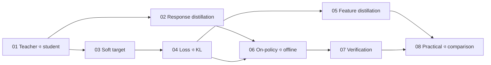

# Module 18 — Knowledge Distillation

[কেন্দ্রীয় map](../01-learning-map.md) · [Course outline](../00-course-outline.md) · [লেখার নিয়ম](../00-writing-style-guide.md)

## Status

**লেখা প্রস্তুত; শেখা নয়।** আটটা lecture লেখা হয়েছে এবং প্রতিটার Python code চালিয়ে `# output:` মেলানো হয়েছে। এগুলো পড়া, হাতে হিসাব করা বা নিজে চালানো এখনো বাকি।

## এই module কী নিয়ে

একটা model (teacher) যা জানে, তার output দিয়ে আরেকটা model (student)-কে শেখানো। Student ছোট হতে পারে, আবার একই আকারেরও হতে পারে। Teacher কী দেবে (text, probability, ভেতরের vector), loss কীভাবে মাপা হবে, কোন text-এ শেখা হবে, ভুল কীভাবে ঠেকানো হবে, আর quantization ও LoRA-র সঙ্গে কখন কোনটা, এই সব এখানে ধাপে ধাপে আছে।

## Prerequisites

- [Softmax ও temperature](../module-12-text-sequences-and-multimodal-models/lecture-03-logits-and-softmax.md) এবং [Cross-entropy](../module-12-text-sequences-and-multimodal-models/lecture-04-next-token-and-cross-entropy.md) (সঙ্গে [log loss](../module-03-logistic-regression/lecture-03-log-loss.md))।
- [Fine-tuning-এর মানচিত্র](../module-13-pretraining-finetuning-and-lora/lecture-02-finetuning-methods-map.md) (SFT কী তা জানতে)।
- Lecture 05-এর জন্য [hidden layer](../module-09-model-architecture/lecture-05-hidden-layer.md) ও [MSE](../module-02-linear-regression/lecture-02-error-and-mean-squared-error.md)।
- Lecture 08-এর জন্য [quantization](../module-13-pretraining-finetuning-and-lora/lecture-05-quantization-and-qlora.md) ও [LoRA A/B](../module-13-pretraining-finetuning-and-lora/lecture-04-lora-matrix-pairs-and-effective-weights.md)।

KL divergence আলাদা bridge ছাড়াই [Lecture 04](lecture-04-distillation-loss.md)-এ cross-entropy থেকে ধরে ধরে শেখানো হয়েছে।

## Lecture-এর তালিকা

| ক্রম | Lecture | এক লাইনে | নতুন ধারণা |
|---|---|---|---|
| 01 | [Teacher ও student](lecture-01-teacher-and-student.md) | কে কার থেকে শেখে; student ছোট হওয়া বাধ্যতামূলক নয় | teacher, student, distillation |
| 02 | [Response ও sequence distillation](lecture-02-response-and-sequence-distillation.md) | Teacher-এর লেখা উত্তরকে student-এর SFT data বানানো | sequence-level distillation |
| 03 | [Logits, temperature ও soft targets](lecture-03-logits-temperature-soft-targets.md) | তিন class-এর উদাহরণে temperature দিয়ে probability নরম করা | temperature, soft/hard target |
| 04 | [Distillation loss](lecture-04-distillation-loss.md) | KL হাতে হিসাব, cross-entropy-র সম্পর্ক, `T²`, gradient-এর দিক | KL divergence, মিলিত loss |
| 05 | [Feature ও intermediate distillation](lecture-05-feature-and-intermediate-distillation.md) | ভেতরের vector মেলানো; মাপ আলাদা হলে projection | feature loss, projection |
| 06 | [On-policy ও offline](lecture-06-on-policy-and-offline.md) | কোন model উদাহরণ লেখে, আর কেন তাতে ফারাক হয় | exposure bias, on-policy |
| 07 | [Reasoning data ও verification](lecture-07-reasoning-data-and-verification.md) | Teacher-এর ভুল বাছাই ও যাচাই করে ঠেকানো | filtering, agreement, step check |
| 08 | [Practical ও comparison](lecture-08-practical-and-comparison.md) | Distillation বনাম quantization বনাম LoRA; একটা খেলনা distillation চালানো | সিদ্ধান্ত-সারণি |

## কোন ক্রমে পড়বে

মূল পথ: **01 → 02 → 03 → 04 → 06 → 07 → 08**। Lecture 05 ঐচ্ছিক শাখা; Lecture 04 পড়া হলে যেকোনো সময় পড়া যায়, বাদ দিলেও পরের পাঠ বোঝা যায়। Lecture 04-এই সবচেয়ে বেশি math আছে। কঠিন লাগলে আগে [Module 12 Lecture 04](../module-12-text-sequences-and-multimodal-models/lecture-04-next-token-and-cross-entropy.md) আবার দেখো।

## Map-এ অবস্থান

| প্রশ্ন | উত্তর |
|---|---|
| শেখার ধারা | Supervised training, কিন্তু signal আসে আরেকটা model থেকে |
| Output-এর হিসাব | Student-এর logits থেকে softmax ([Lecture 03](lecture-03-logits-temperature-soft-targets.md)) |
| শেখার লক্ষ্য | Hard-label cross-entropy + `T² ×` KL (teacher ‖ student) ([Lecture 04](lecture-04-distillation-loss.md)); চাইলে feature loss |
| Update | Gradient `q − p` থেকে শুধু student-এর weights বদলায়, teacher স্থির |

## যাচাইয়ের অবস্থা ও সীমা

- সব Python block শুধু standard library-তে চালিয়ে output মেলানো হয়েছে। Torch বা অন্য library-র কোড চালানো হয়নি।
- Lecture 06-এর on-policy loop pseudo-code, চালানো হয়নি; function-এর নাম কাল্পনিক।
- Lecture 08-এর খেলনা পরীক্ষা খুব ছোট teacher/student, একটা seed ও 20 বারের গড়। বাস্তব বড় model-এ একই ফল ধরে নেওয়া যাবে না।
- Lecture 06-এর "প্রতি ধাপে 0.9" এবং Lecture 07-এর 100টা উত্তরের সংখ্যা শেখানোর জন্য বসানো, মাপা সংখ্যা নয়।
- Reference হিসেবে দেওয়া paper-এর লিংক (arXiv) ইন্টারনেটে খুলে যাচাই করা হয়নি।
