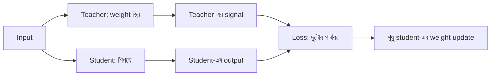

# Lecture 01 — Teacher ও Student: এক model আরেক model থেকে শেখে

> আগে যা জানা থাকলে ভালো: [Softmax ও probability](../module-12-text-sequences-and-multimodal-models/lecture-03-logits-and-softmax.md) এবং [Fine-tuning-এর পরিচয়](../module-13-pretraining-finetuning-and-lora/lecture-02-finetuning-methods-map.md)। এই lecture শেষে পারবে: teacher ও student কে, distillation কী সমস্যার সমাধান, এবং কেন student ছোট হতেই হবে এমন নয় তা বলতে।
> [Map-এ অবস্থান](../01-learning-map.md): শেখার লক্ষ্য ও feedback। সাধারণ training-এ শেখার তথ্য আসে মানুষের দেওয়া label থেকে। Distillation-এ তথ্য আসে আরেকটা model-এর output থেকে।

## সমস্যাটা কী?

একটা বড় model ভালো উত্তর দেয়, কিন্তু সে ধীর আর অনেক memory খায়। ধরো 7 বিলিয়ন parameter-এর model 16-bit-এ রাখলে শুধু weights-ই 14 GB। এটা ছোট server বা মোবাইলে চালানো কঠিন। আবার একই কাজে ছোট একটা model-কে শুধু সঠিক label দিয়ে শেখালে সে বড়টার মতো ভালো হয় না। প্রশ্ন হলো, বড় model যা শিখেছে তার কিছুটা কি ছোট model-কে সরাসরি দেওয়া যায়? Distillation এই কাজই করে। যারা model deploy করে, অর্থাৎ ব্যবহারকারীর কাছে চালায়, তারা এটা সবচেয়ে বেশি ব্যবহার করে।

## ধারণাটা সহজ ভাষায়

- **Teacher:** যে model-এর output থেকে শেখা হয়। সাধারণত training-এর সময় তার weight বদলায় না।
- **Student:** যে model শিখছে। শুধু তার weight update হয়।
- **Knowledge distillation:** teacher-এর output-কে student-এর শেখার সংকেত (learning signal) বানিয়ে student-কে train করা।

Teacher-এর output কেন কাজের? একটা উদাহরণ: ছবিতে আছে একটা বিড়াল। মানুষের label হলো `[cat 1, dog 0, car 0]`, শুধু "cat"। কিন্তু teacher বলে `[cat 0.70, dog 0.25, car 0.05]`। এতে একটা বাড়তি তথ্য আছে: এই ছবি dog-এর সঙ্গে বেশ মেলে, car-এর সঙ্গে প্রায় মেলে না। Hard label-এ এই তথ্য নেই। Student এটা teacher-এর output থেকে পায়।

## Student ছোট হওয়া বাধ্যতামূলক নয়

নাম শুনে মনে হয় "বড় থেকে ছোট"। আসলে মূল কথা হলো **signal আসছে আরেকটা model থেকে**। আকার আলাদা বিষয়।

| ক্ষেত্র | Teacher | Student | কেন করা হয় |
|---|---|---|---|
| ছোট করা | বড় model (7B) | ছোট model (1B) | কম memory, দ্রুত উত্তর |
| একই আকার | এক আকারের model | একই আকারের model | নতুন data বা নতুন উত্তরের ধরন শেখানো |
| অনেকের গড় | কয়েকটা model মিলিয়ে | একটাই model | অনেকগুলো চালানোর খরচ বাঁচানো |
| বাড়তি সুবিধাওয়ালা teacher | ধাপে ধাপে ভেবে উত্তর দেয় | সরাসরি উত্তর দেয় | চিন্তার ফল student-এ আনা |

## ছোট একটা উদাহরণ

Memory-র হিসাব: Teacher 7B, student 1B, দুটোই 16-bit (প্রতি weight 2 byte)।

- Teacher: 7,000,000,000 × 2 byte = 14 GB
- Student: 1,000,000,000 × 2 byte = 2 GB

Student-এর weights teacher-এর সাত ভাগের এক ভাগ জায়গা নেয়। (Activation ও অন্য memory আলাদা, শুধু weights-এর হিসাব এটা।)

```python
# Teacher ও student-এর weight-এর memory (শুধু weights, 16-bit = 2 byte)
for name, params in [("teacher 7B", 7e9), ("student 1B", 1e9)]:
    print(name, params * 2 / 1e9, "GB")
```

```text
# output:
teacher 7B 14.0 GB
student 1B 2.0 GB
```

## ছবি

Teacher কিছু বদলায় না, শুধু signal দেয়। Loss মাপা হয় student-এর output আর teacher-এর signal-এর পার্থক্যে, আর update হয় শুধু student-এ।



## Signal কয় রকম হতে পারে

Teacher থেকে student কী পাবে, সেটাই পরের lecture-গুলোর বিষয়:

- Teacher-এর লেখা উত্তরের text: [Lecture 02](lecture-02-response-and-sequence-distillation.md)।
- Teacher-এর probability, অর্থাৎ soft target: [Lecture 03](lecture-03-logits-temperature-soft-targets.md) ও [04](lecture-04-distillation-loss.md)।
- Teacher-এর ভেতরের মধ্যবর্তী সংখ্যা: [Lecture 05](lecture-05-feature-and-intermediate-distillation.md)।

সাবধান: teacher ভুল করলে student সেই ভুলও শেখে। এটা [Lecture 07](lecture-07-reasoning-data-and-verification.md)-এ।

## মনে রাখার সারকথা

- Teacher output দেয়, student সেই output থেকে শেখে। Update শুধু student-এ হয়।
- Teacher-এর output-এ শুধু "সঠিক উত্তর" নয়, বিকল্পগুলো কতটা কাছাকাছি সেই তথ্যও থাকে।
- Student ছোট হওয়া বাধ্যতামূলক নয়; একই আকারের হতে পারে।

## নিজে করো

১. Teacher 7B, student 3B, দুটোই 16-bit। Student-এর weights কত GB?
২. নিচের কোনটা distillation: (ক) 16-bit weights কে 4-bit করা, (খ) বড় model-এর probability দেখে ছোট model train করা?
৩. Soft output `[0.70, 0.25, 0.05]`-এ dog-এর probability car-এর কত গুণ? এই তথ্য hard label `[1, 0, 0]`-এ আছে কি?

<details><summary>উত্তর</summary>

১. 3,000,000,000 × 2 byte = **6 GB**।
২. **(খ)**। (ক) quantization: একই model-এর সংখ্যা কম bit-এ রাখা, কোনো teacher নেই ([Module 13 Lecture 05](../module-13-pretraining-finetuning-and-lora/lecture-05-quantization-and-qlora.md))।
৩. 0.25 ÷ 0.05 = **5 গুণ**। Hard label-এ এই তথ্য নেই, সেখানে dog আর car দুটোই 0।

</details>

## পরের পাঠ

Teacher যদি শুধু text লিখে দেয়, probability না দেয়, তাহলেও student শিখতে পারে: [Lecture 02 — Response ও sequence distillation](lecture-02-response-and-sequence-distillation.md)।

**Reference:** [Hinton et al., Distilling the Knowledge in a Neural Network](https://arxiv.org/abs/1503.02531)।
