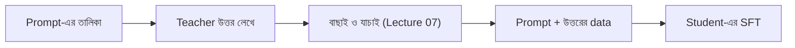

# Lecture 02 — Response ও Sequence Distillation: Teacher-এর লেখা উত্তর থেকে শেখা

> আগে যা জানা থাকলে ভালো: [Teacher ও student](lecture-01-teacher-and-student.md) এবং [Next-token prediction ও cross-entropy](../module-12-text-sequences-and-multimodal-models/lecture-04-next-token-and-cross-entropy.md)। এই lecture শেষে পারবে: teacher-এর লেখা উত্তর থেকে student-এর training data বানাতে এবং এই পদ্ধতি teacher-এর কোন তথ্য হারায় তা বলতে।
> [Map-এ অবস্থান](../01-learning-map.md): শেখার লক্ষ্য। Training পদ্ধতি সাধারণ SFT-ই; বদলায় শুধু target-এর উৎস।

## সমস্যাটা কী?

অনেক বড় model শুধু API-র মাধ্যমে পাওয়া যায়। তুমি prompt পাঠাও, সে text ফেরত দেয়। ভেতরের probability বা logits পাও না। আবার teacher আর student-এর tokenizer আলাদা হলে token ধরে probability মেলানোও যায় না। এই অবস্থায় teacher-এর "জ্ঞান" student-কে দেওয়ার উপায় কী? উপায় হলো teacher যে উত্তর লেখে, সেটাই student-এর শেখার উদাহরণ।

## ধারণাটা সহজ ভাষায়

**Response distillation** বা **sequence-level distillation** চলে তিন ধাপে:

1. অনেকগুলো prompt জোগাড় করো।
2. প্রতিটা prompt teacher-কে দাও এবং সে যে উত্তর লেখে তা রেখে দাও।
3. `(prompt, teacher-এর উত্তর)` জোড়া দিয়ে student-কে SFT করাও।

Student-এর training আলাদা কিছু নয়। আগের মতোই প্রতিটা token-এ "সঠিক token-কে student কত probability দিল" মাপা হয় (cross-entropy)। পার্থক্য শুধু একটাই: সঠিক উত্তর মানুষ লেখেনি, teacher লিখেছে। যে দল কম খরচে একটা ছোট কাজের model চায়, তারা সাধারণত এখান থেকেই শুরু করে।



## ছোট একটা উদাহরণ

**Data তৈরি।** দুটো prompt-এর জন্য teacher-এর উত্তর (এখানে নকল teacher, শুধু ধারণা বোঝাতে):

| prompt | teacher-এর উত্তর |
|---|---|
| 2+3? | 2 আর 3 যোগ করলে 5। উত্তর: 5 |
| 7-4? | 7 থেকে 4 বাদ দিলে 3। উত্তর: 3 |

**Loss।** ধরো teacher-এর লেখা একটা উত্তরের তিনটা token-এ student যথাক্রমে 0.5, 0.8, 0.9 probability দিয়েছে।

- `−ln(0.5) = 0.693`
- `−ln(0.8) = 0.223`
- `−ln(0.9) = 0.105`
- গড় = (0.693 + 0.223 + 0.105) ÷ 3 = **0.341**

**কী হারায়।** এক জায়গায় teacher-এর আসল probability ধরো `[ক 0.6, খ 0.3, গ 0.1]`। Text লেখার সময় teacher একটাই বিকল্প বাছে, ধরো "ক"। Student-এর কাছে পৌঁছায় `[1, 0, 0]`। বাকি দুটো বিকল্প কতটা সম্ভব ছিল, তা হারিয়ে যায়। অনেকবার sample করলে ছবিটা ফেরে:

| sample সংখ্যা | ক | খ | গ |
|---|---|---|---|
| 1 | 1.0 | 0.0 | 0.0 |
| 5 | 0.8 | 0.2 | 0.0 |
| 50 | 0.72 | 0.22 | 0.06 |
| 1000 | 0.622 | 0.264 | 0.114 |

অনেক prompt আর একাধিক sample দিয়ে এই ঘাটতি কিছুটা মেটে, তবে teacher-এর generation খরচ বাড়ে। যেমন 10,000 prompt, প্রতিটা উত্তর গড়ে 500 token হলে teacher-কে 5,000,000 token লিখতে হয়।

## কোড

```python
import math, random

# ১) sequence distillation: teacher-এর লেখা response-ই student-এর training target
def fake_teacher(prompt):          # আসল teacher-এর বদলে একটা নকল (কেবল ধারণা বোঝাতে)
    answers = {"2+3?": "2 আর 3 যোগ করলে 5। উত্তর: 5", "7-4?": "7 থেকে 4 বাদ দিলে 3। উত্তর: 3"}
    return answers[prompt]

dataset = [{"prompt": p, "response": fake_teacher(p)} for p in ["2+3?", "7-4?"]]
print(dataset[0])

# ২) student-এর loss: teacher-এর লেখা প্রতিটা token-এ student কত probability দিল
q_on_teacher_tokens = [0.5, 0.8, 0.9]
loss = sum(-math.log(q) for q in q_on_teacher_tokens) / len(q_on_teacher_tokens)
print("response-এর গড় loss:", round(loss, 3))

# ৩) একবার sample করলে teacher-এর probability-র কতটা ধরা পড়ে?
P = [0.6, 0.3, 0.1]               # teacher-এর আসল probability (তিন বিকল্প)
rng = random.Random(7)
for n in (1, 5, 50, 1000):
    s = rng.choices(range(3), weights=P, k=n)
    print(n, "বার sample:", [round(s.count(i) / n, 3) for i in range(3)])
```

```text
# output:
{'prompt': '2+3?', 'response': '2 আর 3 যোগ করলে 5। উত্তর: 5'}
response-এর গড় loss: 0.341
1 বার sample: [1.0, 0.0, 0.0]
5 বার sample: [0.8, 0.2, 0.0]
50 বার sample: [0.72, 0.22, 0.06]
1000 বার sample: [0.622, 0.264, 0.114]
```

## কখন কোনটা ভালো

| | Response distillation | Probability (soft target) |
|---|---|---|
| teacher থেকে যা লাগে | শুধু text | প্রতিটা token-এর probability |
| API-র teacher-এ | চলে | সাধারণত চলে না |
| tokenizer আলাদা হলে | চলে | জটিল |
| প্রতি উদাহরণে তথ্য | কম (একটা পথ) | বেশি |

সাবধান: কিছু teacher-এর output দিয়ে অন্য model train করা license বা ব্যবহারের শর্তে নিষিদ্ধ থাকতে পারে। শুরুর আগে শর্ত পড়ে নাও।

## মনে রাখার সারকথা

- Response distillation = teacher-এর লেখা উত্তরকে student-এর SFT data বানানো। Loss সাধারণ next-token cross-entropy।
- শুধু text লাগে, তাই API-র teacher-এও চলে।
- প্রতি জায়গায় teacher-এর একটাই পথ student-এর কাছে আসে; বিকল্পগুলোর সম্ভাবনা হারায়।

## নিজে করো

১. 4,000 prompt, প্রতিটার উত্তর গড়ে 300 token। Teacher-কে মোট কত token লিখতে হবে?
২. Student `[ক 0.5, খ 0.3, গ 0.2]` দিয়েছে। Teacher "খ" বেছেছে। Loss কত? Teacher-এর আসল probability `[0.6, 0.3, 0.1]` হলে প্রত্যাশিত (expected) loss কত?
৩. একটা prompt-এ teacher-কে ১ বার না করে ১০ বার উত্তর লেখালে কী সুবিধা, কী অসুবিধা?

<details><summary>উত্তর</summary>

১. 4,000 × 300 = **1,200,000 token**।
২. `−ln(0.3) = 1.204`। প্রত্যাশিত loss = 0.6×0.693 + 0.3×1.204 + 0.1×1.609 = 0.416 + 0.361 + 0.161 = **0.938**।
৩. সুবিধা: teacher-এর বিভিন্ন সম্ভাব্য উত্তর পাওয়া যায়, probability-র ছবি আরও পরিষ্কার হয়। অসুবিধা: generation-এর খরচ ১০ গুণ, আর বেশি উত্তরে ভুল উত্তরও আসে, তাই বাছাই লাগে ([Lecture 07](lecture-07-reasoning-data-and-verification.md))।

</details>

## পরের পাঠ

Teacher-এর probability পাওয়া গেলে student আরও বেশি তথ্য পায়। সেই probability-কে "নরম" করার উপায়: [Lecture 03 — Logits, temperature ও soft targets](lecture-03-logits-temperature-soft-targets.md)।
