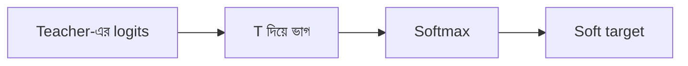

# Lecture 03 — Logits, Temperature ও Soft Targets

> আগে যা জানা থাকলে ভালো: [Logits ও softmax (temperature-সহ)](../module-12-text-sequences-and-multimodal-models/lecture-03-logits-and-softmax.md) এবং [Teacher ও student](lecture-01-teacher-and-student.md)। এই lecture শেষে পারবে: তিনটা class-এর logits থেকে temperature দিয়ে soft target হাতে বের করতে এবং বলতে পারবে temperature কেন লাগে।
> [Map-এ অবস্থান](../01-learning-map.md): output-এর হিসাব। এখানে শুধু teacher-এর output কীভাবে student-এর শেখার উপযোগী হয় তা দেখা হচ্ছে; loss আর update পরের lecture-এ।

## সমস্যাটা কী?

Teacher যখন নিজের বিষয়ে খুব নিশ্চিত, তার probability প্রায় hard label-এর মতো হয়ে যায়। ধরো logits `[cat 5, dog 2, car -1]`। Softmax-এর পর পাওয়া যায় `[0.950, 0.047, 0.002]`। এখানে dog-এর 0.047 আর car-এর 0.002 এত ছোট যে loss-এ প্রায় কোনো প্রভাব ফেলে না। অথচ ওই দুটোর অনুপাতেই (dog, car-এর প্রায় 20 গুণ) teacher-এর বাড়তি জ্ঞান। সেটা student-এর কাছে পৌঁছাতে হলে ছোট probability-গুলোকে একটু বড় করে দেখাতে হবে। Temperature এই কাজ করে।

## ধারণাটা সহজ ভাষায়

Logits হলো teacher-এর শেষ layer-এর কাঁচা score। Softmax তাদের probability বানায়। Softmax-এর আগে সব logit-কে একটা সংখ্যা **T (temperature)** দিয়ে ভাগ করলে:

- `T = 1`: সাধারণ softmax।
- `T > 1`: logits-এর ফারাক ছোট হয়, তাই probability ছড়িয়ে যায় (নরম)।
- Class-গুলোর ক্রম বদলায় না, শুধু ব্যবধান কমে।

Temperature-সহ softmax-এর ফলকে বলে **soft target**। আর মানুষের দেওয়া `[1, 0, 0]`-এর মতো label-কে বলে **hard target**। Distillation-এ teacher ও student দুজনেই একই T-তে softmax করে, তারপর তুলনা হয় (তুলনার নিয়ম [Lecture 04](lecture-04-distillation-loss.md)-এ)। যখন student ব্যবহারকারীর জন্য চলে, তখন T = 1। Temperature শুধু training-এর সময়ের একটা হাতিয়ার, শেখার parameter নয়।

## ছোট একটা উদাহরণ

Logits `z = [5, 2, -1]` (cat, dog, car)।

**T = 1:** `e^5 = 148.41`, `e^2 = 7.39`, `e^-1 = 0.37`। যোগফল 156.17। Probability `[0.950, 0.047, 0.002]`।

**T = 3:** আগে ভাগ: `[5/3, 2/3, -1/3] = [1.667, 0.667, -0.333]`।
`e^1.667 = 5.29`, `e^0.667 = 1.95`, `e^-0.333 = 0.72`। যোগফল 7.96। Probability `[0.665, 0.245, 0.090]`।

| T | cat | dog | car | dog ÷ car |
|---|---|---|---|---|
| 1 | 0.950 | 0.047 | 0.002 | 20.1 |
| 2 | 0.786 | 0.175 | 0.039 | 4.5 |
| 3 | 0.665 | 0.245 | 0.090 | 2.7 |

T = 1 থেকে 3 করায় dog-এর probability 0.047 থেকে 0.245 হয়েছে। এখন student-এর loss-এ "dog কাছের, car দূরের" তথ্যটা দেখা যায়।

## Formula

যেখানে `z_i` হলো i-তম class-এর logit আর `T` temperature:

`p_i(T) = exp(z_i / T) ÷ ( exp(z_1 / T) + exp(z_2 / T) + … )`

উপরের T = 3 হিসাবটাই এই লাইন। Dog ও car-এর অনুপাত দাঁড়ায় `exp((z_dog − z_car) / T)`: T = 1-এ `e^3 = 20.1`, T = 3-এ `e^1 = 2.7`। অর্থাৎ T বাড়লে অনুপাত কমে।



## কোড

```python
import math

def softmax(z, T=1.0):
    e = [math.exp(v / T) for v in z]
    s = sum(e)
    return [v / s for v in e]

logits = [5.0, 2.0, -1.0]          # cat, dog, car
for T in (1, 2, 3):
    p = softmax(logits, T)
    print("T =", T, [round(v, 3) for v in p], "dog/car =", round(p[1] / p[2], 1))
```

```text
# output:
T = 1 [0.95, 0.047, 0.002] dog/car = 20.1
T = 2 [0.786, 0.175, 0.039] dog/car = 4.5
T = 3 [0.665, 0.245, 0.09] dog/car = 2.7
```

সাবধান: T খুব বড় করলে সব class প্রায় সমান হয়ে যায় এবং তথ্য মুছে যায়। যেমন `[4, 2, 0]`-এ T = 100 দিলে `[0.340, 0.333, 0.327]`। তাই T একটা hyperparameter; কয়েকটা মান চেষ্টা করে validation data-য় বেছে নিতে হয়।

## মনে রাখার সারকথা

- Soft target = teacher-এর logits-কে T দিয়ে ভাগ করে softmax করা probability।
- T > 1 হলে probability ছড়ায়, ছোট probability-গুলোর অনুপাত student-এর চোখে পড়ে।
- T শুধু training-এর সময় লাগে; student inference-এ T = 1। T বেশি বড় করলে সব সমান হয়ে যায়।

## নিজে করো

১. Logits `[4, 2, 0]`, T = 1। Probability কত?
২. একই logits, T = 2। Probability কত? Dog-এর probability বেড়েছে না কমেছে?
৩. T = 1-এ dog ÷ car অনুপাত কত? T = 2-এ কত?

<details><summary>উত্তর</summary>

১. `e^4 = 54.60`, `e^2 = 7.39`, `e^0 = 1`, যোগফল 62.99। Probability **[0.867, 0.117, 0.016]**।
২. Logits ÷ 2 = `[2, 1, 0]`। `e^2 = 7.39`, `e^1 = 2.72`, `1`, যোগফল 11.11। Probability **[0.665, 0.245, 0.090]**। Dog-এর probability 0.117 থেকে 0.245-এ **বেড়েছে**।
৩. T = 1-এ `e^((2−0)/1) = e^2 = 7.39`; T = 2-এ `e^((2−0)/2) = e^1 = 2.72`। (Probability দিয়ে দেখলেও মেলে: 0.117 ÷ 0.016 ≈ 7 আর 0.245 ÷ 0.090 ≈ 2.7, গোল করা সংখ্যার কারণে সামান্য তফাত।)

</details>

## পরের পাঠ

Student-এর soft output আর teacher-এর soft target-এর পার্থক্য কীভাবে মাপা হয়, সেটাই loss: [Lecture 04 — Distillation loss](lecture-04-distillation-loss.md)।
