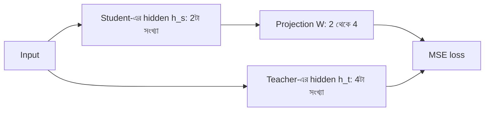

# Lecture 05 — Feature ও Intermediate Distillation: ভেতরের সংখ্যা মেলানো

> আগে যা জানা থাকলে ভালো: [Distillation loss](lecture-04-distillation-loss.md), [Hidden layer ও vector](../module-09-model-architecture/lecture-05-hidden-layer.md), [MSE](../module-02-linear-regression/lecture-02-error-and-mean-squared-error.md) এবং [Shape ও parameter count](../module-09-model-architecture/lecture-07-shapes-and-parameter-count.md)। এই lecture শেষে পারবে: teacher ও student-এর hidden vector-এর মাপ আলাদা হলেও তাদের মেলানোর loss হাতে বের করতে।
> [Map-এ অবস্থান](../01-learning-map.md): শেখার লক্ষ্যে একটা নতুন পদ যোগ হচ্ছে। Output বের করার নিয়ম আর আগের output-loss একই থাকে।

## সমস্যাটা কী?

এ পর্যন্ত আমরা শুধু teacher-এর শেষ output থেকে শিখেছি। কিন্তু teacher-এর ভেতরেও অনেক কাজ হয়: প্রতিটা layer ইনপুটকে নতুন একটা vector-এ রূপান্তর করে। শেষ output দেখে student কেবল "উত্তর কী" শেখে, "ভেতরে কীভাবে উপস্থাপন করা হচ্ছে" নয়। আবার ভেতরের vector মেলাতে গেলে একটা বাধা আসে: teacher-এর hidden vector-এ ধরো 4টা সংখ্যা, student-এর মাত্র 2টা। দুটো মাপ আলাদা, সরাসরি তুলনা করা যায় না। তাই ভেতরের সংখ্যা মেলানোর উপায় দরকার।

## ধারণাটা সহজ ভাষায়

**Feature distillation** (**intermediate distillation**-ও বলে) এই কাজ করে:

1. Teacher-এর একটা মাঝের layer-এর vector `h_t` নাও।
2. Student-এর একটা layer-এর vector `h_s` নাও।
3. `h_s`-কে একটা ছোট **projection** (শেখার যোগ্য matrix `W`) দিয়ে teacher-এর মাপে নিয়ে যাও।
4. `W·h_s` আর `h_t`-র পার্থক্য loss হিসেবে ধরো (এখানে MSE)।

Teacher-এর weight স্থির থাকে। Student ও `W` দুটোই update হয়। `W` শুধু training-এর সময়ের সেতু; student-কে ব্যবহারের সময় দরকার হয় না। যারা শুধু output-এর বদলে student-কে ভেতর থেকেও teacher-এর মতো করতে চায়, তারা এই পদ্ধতি নেয়। যেমন DistilBERT hidden state-এর মিলের জন্য আলাদা loss ব্যবহার করেছে (reference নিচে)।

মোট loss হয় আগের output-loss আর নতুন feature-loss-এর যোগ: `L = L_output + λ × L_feature`। `λ` একটা সংখ্যা, feature-loss-কে কতটা গুরুত্ব দেওয়া হবে তা ঠিক করে।



## ছোট একটা উদাহরণ

- `h_t = [1, 2, 0, 3]` (teacher, 4টা সংখ্যা)
- `h_s = [1, 2]` (student, 2টা সংখ্যা)
- `W` একটা 4×2 matrix: `[[1, 0], [0, 1], [0, 0], [0.5, 0.5]]`

**ধাপ ১: projection।** প্রতিটা সারির সঙ্গে `h_s`-এর dot product:
`W·h_s = [1×1 + 0×2, 0×1 + 1×2, 0, 0.5×1 + 0.5×2] = [1, 2, 0, 1.5]`।

**ধাপ ২: ভুল।** `[1, 2, 0, 1.5] − [1, 2, 0, 3] = [0, 0, 0, −1.5]`।

**ধাপ ৩: MSE।** `(0 + 0 + 0 + 2.25) ÷ 4 = 0.5625`।

**ধাপ ৪: update।** `W`-এর gradient হলো `(2 ÷ n) × ভুল × h_s`, এখানে `n = 4`। শুধু শেষ সারিতে ভুল আছে, তাই gradient `0.5 × (−1.5) × [1, 2] = [−0.75, −1.5]`। Learning rate 0.1 হলে শেষ সারি `[0.5, 0.5] − 0.1×[−0.75, −1.5] = [0.575, 0.65]`।

**ধাপ ৫: আবার।** নতুন শেষ সংখ্যা `0.575×1 + 0.65×2 = 1.875`। ভুল `1.875 − 3 = −1.125`। MSE `1.2656 ÷ 4 = 0.3164`, আগের 0.5625 থেকে কম। (সরলতার জন্য এখানে শুধু `W` বদলানো হলো। বাস্তবে student-এর নিজের weights-ও `h_s`-এর মাধ্যমে একই loss থেকে gradient পায়।)

## Formula ও কোড

`L_feature = (1 ÷ n) × Σ ( (W·h_s)_i − (h_t)_i )²`

উপরের ধাপ ১ থেকে ৩-ই এই সূত্র। এখানে `n` হলো teacher-এর vector-এ কয়টা সংখ্যা আছে।

```python
def project(W, h):
    return [sum(w * x for w, x in zip(row, h)) for row in W]

def mse(a, b):
    return sum((x - y) ** 2 for x, y in zip(a, b)) / len(a)

h_teacher = [1.0, 2.0, 0.0, 3.0]            # teacher-এর hidden vector (4 সংখ্যা)
h_student = [1.0, 2.0]                      # student-এর hidden vector (2 সংখ্যা)
W = [[1, 0], [0, 1], [0, 0], [0.5, 0.5]]    # projection: 2 থেকে 4

out = project(W, h_student)
print("projected:", out, "| MSE =", mse(out, h_teacher))

# W-এর gradient: (2/n) × error × h_student; এক ধাপ, learning rate 0.1
n = len(h_teacher)
err = [a - b for a, b in zip(out, h_teacher)]
W = [[w - 0.1 * (2 / n) * e * x for w, x in zip(row, h_student)] for row, e in zip(W, err)]
print("W-এর শেষ সারি:", W[3], "| নতুন MSE =", mse(project(W, h_student), h_teacher))
```

```text
# output:
projected: [1.0, 2.0, 0.0, 1.5] | MSE = 0.5625
W-এর শেষ সারি: [0.575, 0.65] | নতুন MSE = 0.31640625
```

## বাস্তবে যা ভাবতে হয়

- **কোন layer কোনটার সঙ্গে?** Student-এ কম layer থাকলে teacher-এর কোন layer-কে student-এর কোন layer-এর লক্ষ্য ধরা হবে, সেটা ডিজাইনের সিদ্ধান্ত। শুরুতে একটা জোড়া নিয়ে ছোট করে দেখাই ভালো।
- **MSE না cosine?** দুটো vector-এর মাপ আলাদা হলে MSE বড় আসে, যদিও দিক একই। যেমন `[1, 2, 0, 3]` আর `[2, 4, 0, 6]`-এ cosine similarity 1 (দিক একই), কিন্তু MSE 3.5। যখন দিক গুরুত্বপূর্ণ, মাপ নয়, তখন cosine-ভিত্তিক loss বেছে নেওয়া হয়।
- **Teacher-এর ভেতরে ঢোকা চাই।** Hidden vector পেতে teacher-এর weights ও code হাতে থাকতে হবে। API-র teacher-এ এটা সম্ভব নয়, সেখানে [Lecture 02](lecture-02-response-and-sequence-distillation.md)।
- Attention pattern-এর মতো অন্য মধ্যবর্তী জিনিসও একইভাবে মেলানো যায়; মূল ধারণা একই।

## মনে রাখার সারকথা

- Feature distillation teacher ও student-এর মাঝের layer-এর vector মেলায়, শুধু শেষ output নয়।
- মাপ আলাদা হলে student-এর vector একটা শেখার যোগ্য projection matrix দিয়ে teacher-এর মাপে নেওয়া হয়; teacher স্থির থাকে।
- মোট loss = output-loss + `λ` × feature-loss।

## নিজে করো

১. Teacher `[2, 1, 0]`, projection-এর পর student `[1, 1, 1]`। MSE কত?
২. `[1, 2, 3]` আর `[2, 4, 6]`-এর MSE কত? এদের cosine similarity কত?
৩. Teacher-এর hidden vector 1024 সংখ্যার, student-এর 768। Projection matrix-এ কয়টা সংখ্যা (bias ছাড়া)?

<details><summary>উত্তর</summary>

১. ভুল `[1−2, 1−1, 1−0] = [−1, 0, 1]`; বর্গ `[1, 0, 1]`; MSE = 2 ÷ 3 = **0.667**।
২. ভুল `[−1, −2, −3]`; বর্গ `[1, 4, 9]`; MSE = 14 ÷ 3 = **4.667**। দ্বিতীয় vector প্রথমটার ঠিক দ্বিগুণ, অর্থাৎ একই দিক, তাই cosine similarity **1**।
৩. 1024 × 768 = **786,432**।

</details>

## পরের পাঠ

এখন পর্যন্ত teacher-এর সংকেত আগে থেকে তৈরি data-র উপর ছিল। Student নিজে লিখলে কী হয়: [Lecture 06 — On-policy ও offline distillation](lecture-06-on-policy-and-offline.md)।

**References:** [FitNets: Hints for Thin Deep Nets](https://arxiv.org/abs/1412.6550), [DistilBERT](https://arxiv.org/abs/1910.01108)।
