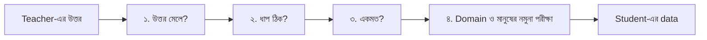

# Lecture 07 — Reasoning Data ও Verification: Teacher-এর ভুল student-এ যাওয়া ঠেকানো

> আগে যা জানা থাকলে ভালো: [Response distillation](lecture-02-response-and-sequence-distillation.md) এবং [Data leakage](../module-05-data-preparation-and-splits/lecture-04-data-leakage.md)। এই lecture শেষে পারবে: teacher-এর উত্তর থেকে ভুল বাদ দেওয়ার কয়েকটা স্তর বলতে এবং প্রতিটা স্তর কী ধরতে পারে, কী পারে না তা বলতে।
> [Map-এ অবস্থান](../01-learning-map.md): training data-র মান। Loss বা update বদলায় না; বদলায় কোন উদাহরণ training-এ ঢুকবে।

## সমস্যাটা কী?

Teacher বড় হলেও ভুল করে। সেই ভুল উত্তর যদি student-এর SFT data-তে ঢোকে, student ওটাকে "সঠিক উত্তর" ধরে শেখে, কোনো সন্দেহ ছাড়া। Reasoning (ধাপে ধাপে যুক্তি) data-তে সমস্যা আরও সূক্ষ্ম: শেষ উত্তর ঠিক, কিন্তু মাঝের একটা ধাপ ভুল, এমন উত্তরও হতে পারে। Student তখন ভুল যুক্তির ধরনটাও শেখে। তাই teacher-এর উত্তর training-এ দেওয়ার আগে বাছাই (filtering) ও যাচাই (verification) করা দরকার।

## ধারণাটা সহজ ভাষায়

যাচাই কয়েক স্তরে হয়। প্রতিটা স্তর আলাদা ধরনের ভুল ধরে:

| স্তর | কী যাচাই করে | কখন চলে | কী ধরতে পারে না |
|---|---|---|---|
| ১. উত্তর মেলানো | শেষ উত্তর জানা সঠিক উত্তরের সঙ্গে মেলে কি | গণিত, code-এর test-এর মতো যেখানে সঠিক উত্তর জানা | ভুল ধাপ, কিন্তু ঠিক উত্তর |
| ২. ধাপ যাচাই | প্রতিটা ধাপ নিয়ম বা calculator দিয়ে ঠিক কি | যেখানে ধাপ যন্ত্র দিয়ে মাপা যায় | যে ধাপ যন্ত্র বুঝতে পারে না |
| ৩. একমত (agreement) | একই প্রশ্নে teacher-এর কয়েকটা উত্তর কতটা মেলে | জানা উত্তর নেই | Teacher বারবার একই ভুল করলে |
| ৪. Domain ও মানুষের যাচাই | উৎস আছে কি, তথ্য বানানো নয় তো, বিশেষজ্ঞ কী বলেন | ডাক্তারি, আইন, ধর্মীয় বিধানের মতো ঝুঁকিপূর্ণ ক্ষেত্র | সব উদাহরণ দেখা সম্ভব নয়; নমুনা পরীক্ষা হয় |



সব স্তর সব কাজে লাগে না। গণিতে ১ ও ২; জানা উত্তর ছাড়া প্রশ্নে ৩; ঝুঁকিপূর্ণ ক্ষেত্রে ৪ অবশ্যই। যে দল student model ব্যবহারকারীর কাছে পৌঁছে দেবে, তাদের কাছে এটাই সবচেয়ে বড় মান-নিয়ন্ত্রণের জায়গা।

## ছোট একটা উদাহরণ

**স্তর ১ বনাম ২।** Teacher 100টা উত্তর লিখেছে। 80টায় শেষ উত্তর ঠিক, 20টায় ভুল। ঠিক 80টার মধ্যে 10টার মাঝের একটা ধাপ ভুল।

- শুধু উত্তর মিলিয়ে নিলে 80টা থাকে। তার মধ্যে 10টা ভুল-যুক্তির: 10 ÷ 80 = **12.5%**।
- ধাপও যাচাই করলে 70টা থাকে, ভুল-যুক্তি 0টা।

**স্তর ৩।** একই প্রশ্নে teacher 5টা উত্তর দিল: `42, 42, 41, 42, 40`। সবচেয়ে বেশি এসেছে 42, তিনবার। Agreement = 3 ÷ 5 = 0.6। সীমা (threshold) 0.6 হলে এই প্রশ্ন থাকে। উত্তর `7, 7, 3, 3, 9` হলে agreement 2 ÷ 5 = 0.4, বাদ।

প্রতিটা উত্তর যদি আলাদাভাবে p সম্ভাবনায় ঠিক হয়, তাহলে 5টার মধ্যে অন্তত 3টা ঠিক হওয়ার সম্ভাবনা:

| p | 0.5 | 0.6 | 0.7 | 0.8 |
|---|---|---|---|---|
| অন্তত 3টা ঠিক | 0.500 | 0.683 | 0.837 | 0.942 |

সাবধান: এই হিসাব ধরে নেয় উত্তরগুলো স্বাধীন। বাস্তবে teacher একই ভুল বারবার করে, তাই agreement বেশি থাকলেও উত্তর ভুল হতে পারে। Agreement একটা সহায়ক সংকেত, প্রমাণ নয়।

## কোড

```python
import re
from collections import Counter

samples = [  # (প্রশ্ন, জানা সঠিক উত্তর, teacher-এর response)
    ("12+30", "42", "12+30=42. উত্তর 42"),
    ("12+30", "42", "12+30=41. উত্তর 41"),
    ("50-8",  "42", "50-8=41, 41+1=42. উত্তর 42"),   # সঠিক উত্তর, কিন্তু একটা ধাপ ভুল
    ("7*6",   "42", "7*6=42. উত্তর 42"),
]
ops = {"+": lambda a, b: a + b, "-": lambda a, b: a - b, "*": lambda a, b: a * b}

def answer_ok(gold, text):             # ধাপ ১: শেষ উত্তর মেলে কি
    m = re.search(r"উত্তর (\d+)", text)
    return bool(m) and m.group(1) == gold

def steps_ok(text):                    # ধাপ ২: প্রতিটা "a op b = c" ধাপ ঠিক কি
    for a, op, b, c in re.findall(r"(\d+)([+\-*])(\d+)=(\d+)", text):
        if ops[op](int(a), int(b)) != int(c):
            return False
    return True

kept1 = [s for s in samples if answer_ok(s[1], s[2])]
kept2 = [s for s in kept1 if steps_ok(s[2])]
print("মোট:", len(samples), "| উত্তর মিললে:", len(kept1), "| ধাপও ঠিক:", len(kept2))

# ধাপ ৩: জানা উত্তর না থাকলে, একই প্রশ্নের 5টা উত্তরের মধ্যে একমত কতটা
votes = Counter(["42", "42", "41", "42", "40"])
best, n = votes.most_common(1)[0]
print("majority:", best, "| agreement:", n / 5)
```

```text
# output:
মোট: 4 | উত্তর মিললে: 3 | ধাপও ঠিক: 2
majority: 42 | agreement: 0.6
```

তিন নম্বর (50-8) উত্তরটা শুধু উত্তর মেলালে পাস করত, ধাপ যাচাই তাকে ধরেছে। সম্ভাবনার সারণির কোড:

```python
from math import comb

# 5টা স্বাধীন উত্তরের অন্তত 3টা ঠিক হওয়ার সম্ভাবনা, প্রতিটা ঠিক হয় p সম্ভাবনায়
for p in (0.5, 0.6, 0.7, 0.8):
    print("p =", p, "| majority ঠিক:", round(sum(comb(5, k) * p**k * (1 - p)**(5 - k) for k in range(3, 6)), 3))
```

```text
# output:
p = 0.5 | majority ঠিক: 0.5
p = 0.6 | majority ঠিক: 0.683
p = 0.7 | majority ঠিক: 0.837
p = 0.8 | majority ঠিক: 0.942
```

## আরও যা মাথায় রাখতে হবে

- **Soft target-এও ভুল যায়।** Teacher ভুল উত্তরে খুব নিশ্চিত হলে তার probability student-কে ভুল দিকে টানে। সঠিক label জানা থাকলে [মিলিত loss](lecture-04-distillation-loss.md)-এ `α` > 0 রাখলে hard label ভারসাম্য আনে।
- **বাছাইয়ে ঝোঁক।** কঠিন প্রশ্নে teacher সাধারণত বেশি ভুল করে, তাই কড়া filter কঠিন প্রশ্ন বেশি বাদ দেয়। Student তখন শুধু সহজ প্রশ্ন দেখতে পারে। কত বাদ পড়ল আর কোন ধরনের প্রশ্ন বাদ পড়ল, দুটোই গুনে দেখো।
- **Test data দূরে রাখো।** যে প্রশ্নে পরে student-কে মাপবে, সেই প্রশ্ন বা তার কাছাকাছি কিছু distillation data-তে থাকলে ফল ফাঁপা হয় ([data leakage](../module-05-data-preparation-and-splits/lecture-04-data-leakage.md))।
- **ঝুঁকিপূর্ণ ক্ষেত্রে** মানুষের যাচাই বাদ দেওয়া যায় না। উৎস নিজে খুলে দেখা, আর বিশেষজ্ঞকে নমুনা দেখানো। বানানো উৎস বা উদ্ধৃতিসহ উত্তর student শিখে ফেললে ব্যবহারকারীর ক্ষতি হতে পারে।

## মনে রাখার সারকথা

- Teacher-এর ভুল student-এ হুবহু যায়, তাই training-এর আগে বাছাই ও যাচাই দরকার।
- ঠিক শেষ উত্তরের পেছনেও ভুল ধাপ থাকতে পারে। উত্তর মেলানোর পরে ধাপ যাচাই, জানা উত্তর না থাকলে agreement, ঝুঁকিপূর্ণ ক্ষেত্রে মানুষের নমুনা পরীক্ষা।
- Agreement প্রমাণ নয়; বাছাই করলে কত আর কী ধরনের data বাদ গেল, তা মাপতে হবে।

## নিজে করো

১. 100টা উত্তরের 80টায় শেষ উত্তর ঠিক, তার 10টায় ভুল ধাপ। শুধু উত্তর মিলিয়ে বাছলে কত শতাংশ ভুল-যুক্তির উদাহরণ থেকে যায়?
২. প্রতিটা উত্তর 0.7 সম্ভাবনায় ঠিক, 5টা স্বাধীন উত্তর। অন্তত 3টা ঠিক হওয়ার সম্ভাবনা কত? p = 0.5 হলে কত, আর এতে majority vote থেকে কী বোঝা যায়?
৩. উত্তর `[7, 7, 3, 3, 9]`, threshold 0.6। প্রশ্নটা থাকবে, না বাদ?
৪. Teacher-এর একটা ডাক্তারি উত্তর বিন্যাসে ঠিক, কিন্তু একটা অস্তিত্বহীন গবেষণাপত্রের উদ্ধৃতি দিয়েছে। কোন স্তর এটা ধরবে?

<details><summary>উত্তর</summary>

১. 10 ÷ 80 = **12.5%**।
২. p = 0.7-এ **0.837**। p = 0.5-এ **0.5**, মানে প্রতিটা উত্তর কয়েন-টসের মতো হলে majority vote কোনো সুবিধা দেয় না। Majority vote তখনই সাহায্য করে যখন প্রতিটা উত্তর একা 0.5-এর চেয়ে বেশি ঠিক।
৩. সবচেয়ে বেশি এসেছে 2 বার (7 বা 3)। Agreement = 2 ÷ 5 = 0.4 < 0.6, তাই **বাদ**।
৪. **স্তর ৪ (domain ও মানুষের যাচাই)**: উদ্ধৃতি সত্যিই আছে কি, তা উৎস খুলে দেখে।

</details>

## পরের পাঠ

Distillation-এর সব অংশ জানা হলো। এবার quantization ও LoRA-র সঙ্গে তুলনা এবং একটা ছোট কাজের উদাহরণ: [Lecture 08 — Practical ও comparison](lecture-08-practical-and-comparison.md)।
